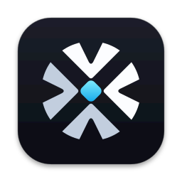

<p align="center">
  
</p>

<h1 align="center">Omnixa</h1>

<p align="center">
  <strong>Everything, Agentized.</strong><br />
  An open-source multi-agent AI workbench for coding, structured workflows, and custom agent orchestration across Desktop, Web, TUI, and CLI.
</p>

<p align="center">
  <a href="https://github.com/keerzzz/Omnixa/releases"></a>
  <a href="LICENSE"></a>
  
</p>

<p align="center">
  <strong>English</strong> | <a href="README.zh.md">简体中文</a>
</p>

---

## Why Omnixa (`Omni × X → a`)

**Omnixa** stands for **`Omni`** (every tool, prompt, skill, document, and workflow) **`× X`** (composable cross-mode routing and transformation) **`→ a`** (autonomous, verifiable agents).

Instead of locking AI inside a single chat box or a single-purpose coding loop, Omnixa provides a unified local-first runtime ("circuit board") where reusable capabilities snap together into specialized agents and multi-agent teams—with durable state, explicit permissions, and full execution visibility.

## Key Capabilities

- **Five Domain Workspaces + Custom Assembly**
  - **Coding**: Full-featured software engineering with `build` (execution) and `plan` (read-only exploration & architecture analysis).
  - **Chat**: Asset studio for drafting, reviewing, and versioning reusable prompts, skills, commands, tools, and agent definitions.
  - **Work**: Structured task execution, multi-step workflows, delegation graphs, and deliverable tracking.
  - **Custom**: Compose reusable assets into version-pinned custom agent profiles with explicit snapshot adoption.
  - **Assistant**: Personal long-term memory, notes, knowledge base, and scheduled reminders.

- **Meta-Agent Orchestration & Governance**
  - Select **`meta`** alongside **`build`** and **`plan`** to coordinate complex multi-step work.
  - **Task & Subagent Delegation**: Fan out isolated child sessions, run multi-model **`Judge`** reviews, and inspect live execution trees in the unified right sidebar.
  - **Verifiable Goals & Schedules**: Bind sessions to `Goals` with machine-checked command/human acceptance conditions and step budgets, or automate recurring work via `Schedules`.
  - **Cross-Session Communication & Project Memory**: Exchange traceable messages across active sessions with exact `replyTo` provenance and curate scoped project facts.

- **One Durable Engine Across Four Surfaces**
  - Native **Desktop App** (Electron for macOS Apple Silicon & Intel, Windows x64 & ARM64, Linux AppImage / `.deb` / `.rpm`), **Web Workspace**, **Terminal UI (OpenTUI)**, and **CLI (`omnixa`)** all share one local SQLite + SSE session server.
  - Write-ahead execution claims, durable inbox queuing/steering, and step-level recovery keep work safe across restarts.

- **Model-Agnostic & Standards-Native**
  - Connect **Anthropic, OpenAI, Google Gemini, DeepSeek, OpenRouter, Ollama**, or any OpenAI-compatible provider with live capability & pricing metadata from `models.dev` (plus offline snapshot fallback).
  - Built-in support for **MCP (Model Context Protocol)**, **LSP**, persistent **PTY** terminals, and **CodeMode**.

## Download & Quick Start

### 1. Desktop App

Download the latest installer for **macOS** (`.dmg` / `.zip`), **Windows** (`.exe`), or **Linux** (`.AppImage` / `.deb` / `.rpm`) from [**GitHub Releases**](https://github.com/keerzzz/Omnixa/releases).

### 2. Run & Build from Source

Prerequisites: [Bun](https://bun.sh) `1.4.2+` (matching root `packageManager`).

```bash
git clone https://github.com/keerzzz/Omnixa.git
cd Omnixa
bun install

# Launch the Web workspace in development
bun run dev:web

# Launch the Electron Desktop app in development
bun run dev:desktop
```

To install a locally built CLI binary into `$HOME/.omnixa/bin`:

```bash
./install --binary /absolute/path/to/omnixa
"$HOME/.omnixa/bin/omnixa" --version
```

For full packaged Desktop builds, see [packages/desktop/README.md](packages/desktop/README.md).

## Built-in Agents

Switch primary agents anytime from the Composer selector or with `Tab`:

- **`build`** — Default full-capability agent for code editing, shell execution, and implementation.
- **`plan`** — Read-only analysis agent that denies file edits by default and asks before running shell commands.
- **`meta`** — Orchestration coordinator for task decomposition, subagent delegation, verifiable goals, schedules, and cross-session collaboration.
- **`@general`** — Built-in subagent for deep codebase research and multi-step parallel searches.

## Documentation & Architecture

| Topic                                    | Entrypoint                                               |
| :--------------------------------------- | :------------------------------------------------------- |
| Package Ownership & Runtime Architecture | [ARCHITECTURE.md](ARCHITECTURE.md)                       |
| Workspace Surfaces & UX Contracts        | [DESIGN.md](DESIGN.md)                                   |
| V2 Public Specifications                 | [specs/v2/README.md](specs/v2/README.md)                 |
| Desktop Packaging & Startup Benchmarks   | [packages/desktop/README.md](packages/desktop/README.md) |
| Validation & Testing Gates               | [docs/testing.md](docs/testing.md)                       |
| Contributing Guide                       | [CONTRIBUTING.md](CONTRIBUTING.md)                       |

## Building on Omnixa

If you publish a community project with `omnixa` in its name (for example, `omnixa-plugin-*` or `omnixa-recipes`), please note in your README that it is an independent community project and not officially affiliated with the Omnixa maintainers.

## License

Released under the [MIT License](LICENSE). Built upon the open-source foundation of [OpenCode](https://github.com/anomalyco/opencode).
