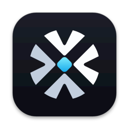

<p align="center">
  
</p>

<h1 align="center">Omnixa</h1>

<p align="center">
  <strong>万物皆可智能体 · Everything, Agentized.</strong><br />
  面向工程研发、结构化工作流与自定义智能体编排的开源多智能体工作台，原生覆盖 Desktop、Web、TUI 与 CLI 四端。
</p>

<p align="center">
  <a href="https://github.com/keerzzz/Omnixa/releases"></a>
  <a href="LICENSE"></a>
  
</p>

<p align="center">
  <a href="README.md">English</a> | <strong>简体中文</strong>
</p>

---

## 品牌理念（`Omni × X → a`）

**Omnixa** 源自 **`Omni`**（全域万物：提示词、技能、工具、命令、文档与工作流）**`× X`**（任意组合与跨模式转化枢纽）**`→ a`**（自主、可验证的 Agent 智能体原核）。

Omnixa 不把 AI 局限在单一对话框或单一编码循环中，而是提供一套本地优先的可插拔智能体底座（“电路板架构”）：将可复用能力元件自由装配为专业智能体与多智能体协作网络，兼顾持久化状态恢复、精细权限门控与全链路可观测性。

## 核心特性

- **五大领域工作面 + 自定义智能体装配**
  - **Coding（编程）**：提供 `build`（完整读写与终端执行）与 `plan`（默认只读探索与架构规划）双模式体验。
  - **Chat（资产工坊）**：沉淀、审阅与版本化保存可复用的 Prompt、Skill、Command、Tool 与 Agent 元件。
  - **Work（任务协同）**：承载结构化任务拆解、工作流运行、任务委派图谱与产物审阅。
  - **Custom（自由装配）**：将底座能力与用户资产组装为版本锁定的自定义智能体组合，显式确认后快照采用。
  - **Assistant（个人助手）**：支持长期个人记忆、笔记、知识库与定时提醒。

- **Meta 元智能体统筹与闭环治理**
  - 在 **`build`**、**`plan`** 之外并列提供 **`meta`** 统筹智能体，按需开启多智能体调度。
  - **任务委派与多模型评审**：支持派生隔离子会话（`Task` / `Subagent`）、多模型并行评审（`Judge`）以及右侧栏实时调度拓扑可视化。
  - **可验证目标（Goal）与定时任务（Schedule）**：为会话绑定带命令退出码/人工验收条件与轮次预算的 `Goal` 自动推进闭环，或通过 `Schedule` 执行周期唤醒。
  - **跨会话通信与项目记忆**：支持多根会话与子会话间带精确 `replyTo` 溯源的消息投递/触发，以及受权限门控的项目级事实记忆沉淀。

- **统一持久化内核，四端无缝协同**
  - 原生 **桌面客户端**（Electron，支持 macOS Apple Silicon & Intel、Windows x64 & ARM64、Linux AppImage / `.deb` / `.rpm`）、**Web 工作区**、**终端界面（OpenTUI）** 与 **命令行（`omnixa`）** 共享同一本地 SQLite + SSE 会话服务。
  - 基于预写式执行认领（Execution Claim）、持久化收件箱（Queue / Steer）与单步物理请求溯源，进程重启后可安全恢复。

- **多模型自由接入与开放协议**
  - 支持接入 **Anthropic、OpenAI、Google Gemini、DeepSeek、OpenRouter、Ollama** 及任意 OpenAI 兼容网关，支持 `models.dev` 在线模型能力/价格元数据更新与离线快照兜底。
  - 原生集成 **MCP（Model Context Protocol）**、**LSP**、持久化 **PTY** 终端与 **CodeMode**。

## 下载与快速开始

### 1. 桌面端安装包

前往 [**GitHub Releases**](https://github.com/keerzzz/Omnixa/releases) 下载最新全平台安装包：

- **macOS**：`arm64`（Apple Silicon）与 `x64`（Intel）`.dmg` / `.zip`
- **Windows**：`x64` 与 `arm64` 安装程序（`.exe`）
- **Linux**：`.AppImage`、`.deb`、`.rpm`（`x86_64` 与 `arm64`）

### 2. 从源码运行与构建

环境要求：[Bun](https://bun.sh) `1.4.2+`（与根目录 `packageManager` 对齐）。

```bash
git clone https://github.com/keerzzz/Omnixa.git
cd Omnixa
bun install

# 启动 Web 开发工作区
bun run dev:web

# 启动 Electron 桌面端开发环境
bun run dev:desktop
```

将本地构建生成的 CLI 二进制安装至 `$HOME/.omnixa/bin`：

```bash
./install --binary /absolute/path/to/omnixa
"$HOME/.omnixa/bin/omnixa" --version
```

桌面端同源打包与启动基准测试说明详见 [packages/desktop/README.md](packages/desktop/README.md)。

## 内置智能体

可在输入框选择器或按 `Tab` 键随时切换主智能体：

- **`build`** — 默认开发智能体，具备文件读写与命令执行能力。
- **`plan`** — 只读分析智能体，默认禁止修改文件并在执行命令前请求确认，适合熟悉代码库与方案设计。
- **`meta`** — 元智能体统筹角色，负责复杂任务拆解、子智能体委派、Goal 验收推进、定时调度与跨会话协同。
- **`@general`** — 内置通用子智能体，可在消息中通过 `@general` 调用以执行深度检索与多步调研。

## 架构与文档导航

| 主题                     | 权威入口                                                 |
| :----------------------- | :------------------------------------------------------- |
| 包职责划分与运行时架构   | [ARCHITECTURE.md](ARCHITECTURE.md)                       |
| 工作面设计与交互合同     | [DESIGN.md](DESIGN.md)                                   |
| V2 公共协议规范          | [specs/v2/README.md](specs/v2/README.md)                 |
| 桌面端打包与启动基准测试 | [packages/desktop/README.md](packages/desktop/README.md) |
| 验证命令与交付门禁       | [docs/testing.md](docs/testing.md)                       |
| 贡献指南与提交规范       | [CONTRIBUTING.md](CONTRIBUTING.md)                       |

## 基于 Omnixa 开发

如果你发布了名称中包含 `omnixa` 的社区衍生项目（例如 `omnixa-plugin-*` 或 `omnixa-recipes`），请在项目 README 中注明其为独立社区项目，与 Omnixa 维护团队无官方隶属关系。

## 开源许可

本项目基于 [MIT License](LICENSE) 开源，底层演进自 [OpenCode](https://github.com/anomalyco/opencode)。
