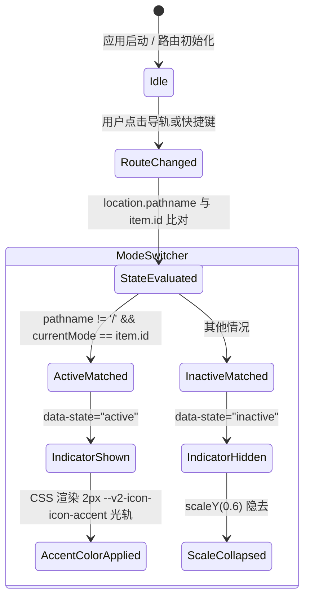

# 品牌 Logo 全景收敛与五模式侧栏导轨重构实施计划

> **状态**：**Draft — 草案待批准（2026-10-15 修订版）**
> **Owner**：UI + App + Desktop（品牌资产与五模式主导航导轨全链路收敛）
> **事实来源**：设计评审共识记录、工件库原型演进（方案04 淬火熔炉鼎 + 变体1 智库手账 Classic BC 宽体修正版）
> **实施基线**：主工作区 `/home/keer/workspace/aigcfroge`（Linux 原生 Ext4 SSD），基准 commit `d5376379f`（`Merge pull request #127 from keerzzz/local-cli-discovery`，上游 `origin/main` 一致）
> **计划分支**：`brand-mode-icons`（遵守 `AGENTS.md` 最多三词、连字符、无类型前缀规范）
> **工作区**：`/home/keer/workspace/aigcfroge`（机械盘 `/media/win_data` 暂不使用并封存保持原样）
> **协议依据**：[`CLAUDE.md`](../../CLAUDE.md)、[`AGENTS.md`](../../AGENTS.md)、[`DESIGN.md`](../../DESIGN.md)、[`ARCHITECTURE.md`](../../ARCHITECTURE.md)、[`docs/testing.md`](../testing.md)、[`packages/app/AGENTS.md`](../../packages/app/AGENTS.md)、[`packages/ui/AGENTS.md`](../../packages/ui/AGENTS.md)
> **技能依据**：`.aigcfroge/skills/reuse-first-refactor`（复用 → 删除 → 归并 → 重构 → 新增）、`.aigcfroge/skills/frontend-theming`、`.aigcfroge/skills/quality-to-pr`
> **实施原则**：识别假设 → 追溯本源 → 重构方案 → 精简输出
> **TDD 规则**：每个 Slice 必须独立完成 RED → GREEN → REFACTOR → 包级门禁 → 资产校验；当前 Slice 未绿绝不进入下一 Slice；禁止伪造/侵入式源码断言，严格遵循 `docs/testing.md §10`

---

## 0. 产品总监架构裁决与前置决策（Product Director Decisions）

### 0.1 裁决 D1：激活光轨采用“单一强调色” vs “模式专属独立主题色”的产品深度思考

作为 AigcForge 的高级产品总监，在权衡全局左侧主导轨（ModeSwitcher Rail）的激活状态指示器时，必须从用户群体画像、认知负荷、无障碍合规以及系统工程可持续性四个维度进行深度解构：

#### 1. 用户画像与核心心智模型分析

- **画像 A：核心重度工程用户（Coding Persona，占应用日均在线时长 65%+）**
  - **核心诉求**：**极致宁静、高度聚焦、无视觉干扰（Quiet & Dense）**。该类用户长时间沉浸在代码编辑、差异比对、终端编译等高强度心流任务中。左侧导轨处于其周边视野（Peripheral Vision）。
  - **冲突与风险**：如果导轨激活指示器采用五彩斑斓的模式专属色（如 Coding 蓝、Chat 绿、Work 紫等切换跳动），每次视觉余光掠过都会形成彩虹糖般的视觉噪音，直接违背了 `DESIGN.md` 强调的“严谨工具型、低视觉刺激、无装饰性渐变/发光”的产品调性。
- **画像 B：多任务调度与知识整理者（Chat / Work / Assistant Persona）**
  - **核心诉求**：**空间定位清晰、零认知摩擦切换**。用户在会话（Chat）、任务流水线（Work）和日程记忆（Assistant）之间快速穿梭。
  - **认知心理学事实**：用户确认“我在哪个模式”的第一视觉线索是**图标本身的物理几何轮廓（Unique Silhouette）**，以及主视窗内次级侧栏（Secondary Sidebar）和顶部 Header 的排版结构；导轨左侧或底部的 2px~3px 激活光轨，核心职能是**确认当前哪个项目被选中（Focus/Active State）**，而不是承担色彩分类的语义。

#### 2. 无障碍（Accessibility）与系统合规性

- **WCAG 2.1 规范（1.4.1 Use of Color）红线**：严禁仅依靠色彩作为传达信息、指示操作或区分界面的唯一视觉线索。
- 弱视与色觉障碍用户（红绿色弱、色盲等）无法稳定区分 5 个模式的主题微差，而**5 个截然不同的几何外形轮廓 + 明确的系统级激活线 + ARIA 状态（`aria-pressed="true"`）**才是普适、坚固的无障碍设计。

#### 3. 主题系统维护性与技术债务防御

- AigcForge 当前内置 37 款主题（包含 Light / Dark 及各色调变量）。若引入“每个模式独立颜色”，意味着需要新增 5 个模式的主题 Token，并在 37 套主题下分别调配对比度与亮度适配（37 × 5 = 185 种色彩组合）。
- 目前仓库尚未建立自动化的全主题色彩对比度门禁（DESIGN.md:94）。在未建立自动化基线前引入 5 个新主题色，会极大增加色彩漂移和次生样式 Bug 的概率，严重破坏当前 Theme Engine（`resolve.ts` / `v2/mapping.ts`）的紧凑契约。

#### 4. 裁决结论与可逆性架构保障

- **产品总监裁决**：**主导航激活光轨采用“单一强调色（Single Accent Color）”方案**。
  - 直接复用成熟的语义化 Token `--v2-icon-icon-accent`（深浅主题自适应，亮色下为纯净深蓝，暗色下为轻量明蓝）或 `--v2-border-border-focus`。
  - 形式上采用宁静克制的物理指示轨（2px 垂直细条），消除位移与布局抖动，无晕影、无渐变光波。
- **可逆性架构防护（Reversible Architecture）**：
  - 在 `ModeSwitcher` 的 DOM 结构上保留 `data-component="mode-switcher"`、`data-slot="rail-item"` 以及 `data-mode={item.id}`。
  - 样式的激活状态由 `data-state="active"` 驱动。
  - **逃生通道**：若未来产品演进或遥测数据表明多色有助于提升特定场景辨识度，且主题引擎完成了多色 Token 扩展，团队只需在 CSS 层面针对 `[data-mode="xxx"][data-state="active"]` 声明局部变量覆盖，完全无需改动组件层或测试层。

---

### 0.2 裁决 D2：导航轨图标与内部业务 Glyph 的解耦隔离（Rail-Scoped Icon Keys）

- **实测基线冲突**：
  - 代码库中 `mode-*`（`mode-chat`, `mode-coding`, `mode-work`, `mode-assistant`, `mode-custom`）已被 11 个文件的 21 处内部业务界面复用作为实体徽标（例如 `mode-surfaces.tsx:36-40` 用作 Prompt/Skill/Command/Agent 特性标记；`assistant-nav-tree.tsx:90,99` 用作树节点图标；`work-secondary-sidebar.tsx:134,140` 用作工件类别图标）。
  - 若直接修改 `mode-*` 的 SVG 路径，会导致所有内页界面的局部图标发生非预期的几何形变和视觉语义崩塌。
- **裁决**：
  - 在 `packages/ui/src/v2/components/icon.tsx` 中新增独立命名的导航轨图标键：`rail-chat`、`rail-coding`、`rail-work`、`rail-assistant`、`rail-custom`。
  - 既有 `mode-*` 图标键完全保留其原样，保持内部业务界面向后兼容。
  - `packages/app/src/context/mode.tsx` 中的 `MODE_DEFINITIONS` 更新其 `icon` 属性为 `rail-*`，解耦导航轨与内页实体。
  - 同步更新 `packages/app/src/context/mode.test.ts:26` 的单向一致性校验规则。

---

### 0.3 裁决 D3：实施分支与工作区策略（Ext4 Native Worktree）

- **工作区选址**：
  - 机械盘 `/media/win_data`（NTFS）封存备用。当前主开发工作区锁定为 `/home/keer/workspace/aigcfroge`（原生 Linux Ext4 SSD，位于 `/dev/sdd3`），彻底解决 NTFS 文件锁、权限和 IO 瓶颈。
  - 从当前的最新 `main`（`d5376379f`）签出分支 `brand-mode-icons`（或在该主目录下建立全新 worktree），确保所有测试与构建均在 SSD 上高速运行。

---

### 0.4 裁决 D4：Assistant 模式图标“智库手账 (Classic BC 宽体修正版)”定型

- **用户反馈本源**：
  - 彻底废弃雷达/天线与卡通吉祥物。
  - 采纳方案 B 夹板头部 + 方案 C 手账身部的融合构型，解决早期版本结构不合理、连接悬空的问题。
- **几何骨架规范**：
  - **头部挂夹（Clipboard Header）**：双耳夹具 `M6 1V2.5M10 1V2.5` + 圆角夹板 `<rect x="4.5" y="2.5" width="7" height="5" rx="1.5">` + 极简时钟核心（表盘圆环 `r=1.6` 与表针 `M8 4.2V5H8.7`，代表 Schedule / Cron 自动化日程与提醒）。
  - **物理衔接中轴（Vertical Neck Join）**：垂直刚性连接脊柱 `M8 7.5V8.5`，杜绝悬空水平缝隙断层。
  - **宽体手账身部（Wide Notebook Base）**：采用 12 单元宽体设计 `<rect x="2" y="8.5" width="12" height="6" rx="1.5">`（下宽上窄 12:7，黄金比例稳固底盘），承载知识库条纹（Lines）与右侧垂挂书签带（Bookmark Ribbon，代表个人记忆与笔记沉淀）。

---

### 0.5 裁决 D5：主品牌 Logo 定型为“方案 04：淬火金字塔与熔炉鼎 (Refined Crucible)”扁平规范化

- **品牌核心理念**：
  - 全面贯彻 `DESIGN.md`，淘汰过时的伪 3D 浮雕、刺眼光晕滤镜与径向光球，回归纯粹的精密工程几何美学。
  - **A 面**：左侧上升斜坡（`--v2-avatar-bg-blue`）。
  - **G 面**：右侧几何内折边缘（`--v2-avatar-bg-cyan`）。
  - **C 鼎底座**：锻造熔炉弧形托座（自适应蓝色/青色）。
  - **I 芯柱与极点**：中央垂直对比度光柱/顶点（`--v2-text-text-contrast`）。
- **技术规范**：
  - 严禁任何硬编码 Hex，全量注入 `--v2-*` 语义变量。
  - 消除 0.5px 浮点亚像素缝隙，确保在 16px、20px、24px、100px 以及 512px 下均呈现刀锋般的锐利渲染。
  - 多端资产全渠道同步：`Mark`（16~24px 紧凑态）、`Splash`（100px 启动展示态）、`SplashLoader`（动效加载态保持 slot 结构不变）、Web Favicon 套件以及 Desktop 多渠道应用图标。

---

## 1. 开工 Gate 与实测基线（Baseline & Gates）

### 1.1 事实真源实测矩阵

| 检验项               | 源码真源位置                                               | 实测状态 / 事实证据                                                                                       | 对应裁决                      |
| :------------------- | :--------------------------------------------------------- | :-------------------------------------------------------------------------------------------------------- | :---------------------------- |
| **导航轨图标名注册** | `packages/app/src/context/mode.tsx:7-48`                   | `MODE_DEFINITIONS` 注册了 `mode-chat`, `mode-coding`, `mode-work`, `mode-assistant`, `mode-custom` 5 个键 | 解耦至 `rail-*` (D2)          |
| **模式定义契约测试** | `packages/app/src/context/mode.test.ts:19,26`              | 断言 `definition.icon === 'mode-' + definition.id` 且图标互不重复                                         | 同步更新断言 (D2)             |
| **内页引用重用**     | 11 个文件，21 处引用                                       | `mode-surfaces.tsx`, `assistant-nav-tree.tsx`, `work-secondary-sidebar.tsx` 等                            | 保留老键，免受干扰 (D2)       |
| **导轨按钮现状**     | `packages/app/src/components/mode-switcher.tsx:46-54`      | 使用 `IconButtonV2`，激活态仅靠 `variant={active() ? "neutral" : "ghost-muted"}`，无专用 CSS，无导轨条    | 引入 `mode-switcher.css` (D1) |
| **导轨 e2e 现状**    | `packages/app/e2e/regression/global-shell.spec.ts:135-177` | 验证按钮可见性、`aria-pressed`、路由导航与 Assistant badge 计数                                           | 扩展 RED 断言 (S1/S2)         |
| **Brand Mark 现状**  | `packages/ui/src/components/logo.tsx:13-67`                | 现存为基础金字塔，仍需收敛为方案 04                                                                       | 收敛为方案 04 淬火熔炉鼎 (D5) |
| **Favicon 资产真源** | `packages/ui/src/assets/favicon/`                          | `packages/app/public/*` 均为指向该目录的软链接 (symlink)                                                  | 一次更新，全端生效 (D5)       |

### 1.2 跨包调用与影响面排查（Blast Radius）

```text
[packages/ui] (Icon 组件, Logo Mark, Splash, Favicon)
      │
      ├──> [packages/app] (ModeContext, ModeSwitcher, HomePage, SessionViews)
      │
      └──> [packages/desktop] (Window Shell, Dock/App Icons, Splash View)
```

- **安全边界**：本计划所有变更限定在前端展示层、UI 组件库及静态图标资产，**不触碰** core 运行时、session 调度、通信协议或服务端 HTTP 契约。

### 1.3 门禁准入条件（Gates G0 - G4）

| Gate                | 门禁条件                                                                                    | 责任人 / 验证命令                                                                  | 状态        | 阻塞范围 |
| :------------------ | :------------------------------------------------------------------------------------------ | :--------------------------------------------------------------------------------- | :---------- | :------- |
| **G0 隔离基线**     | 工作区 `/home/keer/workspace/aigcfroge` 处于 clean 或受控状态，切出 `brand-mode-icons` 分支 | `git status --short` 确认基线                                                      | **已就绪**  | 全量批次 |
| **G1 图标解耦**     | `icon.tsx` 注入 `rail-*`，不破坏既有 21 处 `mode-*` 调用，`mode.test.ts` 通过               | `bun --cwd packages/app test src/context/mode.test.ts`                             | 待执行 (S1) | S1 交付  |
| **G2 导轨光轨**     | 激活态由 `data-state="active"` 驱动，无多余位移，符合 `DESIGN.md`                           | `bun --cwd packages/app test:e2e packages/app/e2e/regression/global-shell.spec.ts` | 待执行 (S2) | S2 交付  |
| **G3 品牌统一**     | Logo / Splash / Favicon / Desktop 资产全量更新为方案 04，slot 动画无损                      | 多端构建与类型检查通过                                                             | 待执行 (S3) | S3 交付  |
| **G4 全量质量门禁** | 全包 typecheck 绿、lint 绿、协议引用检查通过                                                | `turbo typecheck` + `lint-changed.ts` + `check-refs.sh`                            | 待执行 (S4) | 最终 PR  |

---

## 2. 目标与非目标（Goals & Non-Goals）

### 2.1 目标

1. **G1 [导航图标重塑]**：为 Chat、Coding、Work、Assistant、Custom 5 个模式提供高辨识度、几何独立的导轨图标，终结雷达/卡通形象，实现解耦 `rail-*` 体系。
2. **G2 [Assistant 智库手账定型]**：落地 Classic BC 宽体修正版，将日程时钟夹板与知识库宽体手账通过实体中轴无缝接合。
3. **G3 [宁静激活指示导轨]**：在 `ModeSwitcher` 引入规范的 `mode-switcher.css`，以单一强调色指示线明确激活状态，严守视觉无抖动。
4. **G4 [主品牌全景收敛]**：将品牌主 Mark、Splash、SplashLoader、Favicon 及桌面图标收敛至“方案 04 淬火金字塔与熔炉鼎”，清除硬编码颜色与伪 3D 杂质。
5. **G5 [工程与测试闭环]**：严格遵循 TDD 闭环，完成单元测试、e2e 行为测试和多包门禁验证，不留死角。

### 2.2 非目标

- ❌ **不做每个模式的多彩霓虹主题**：不增加 5 套全局模式色彩 Token，严格遵循单一强调色沉静体验。
- ❌ **不做内页业务图标的暴力替换**：不替换 `mode-surfaces.tsx` 等业务模块引用的 `mode-*` 图标，防止次生破损。
- ❌ **不改变 ModeSwitcher 核心交互逻辑**：不篡改路由导航、Dialog 设置弹出和 Assistant 待办角标监听逻辑。
- ❌ **不修改后端协议与数据存储**：完全纯前端与静态资产变更，不触动任何 SQLite 模式或 RPC 端点。

---

## 3. 视觉规范与几何原型真源（Visual Specifications）

### 3.1 导航轨五模式图标矢量坐标（16×16 viewBox，纯矢量）

所有图标均基于 `viewBox="0 0 16 16"` 设计，描边采用 `stroke="currentColor"`，连接处使用圆角以确保现代质感：

```xml
<!-- 1. rail-chat (终端气泡与交互提示符) -->
<symbol id="aigcfroge-v2-icon-rail-chat" viewBox="0 0 16 16">
  <path d="M2.5 2.5H13.5V10.5H7L4 13.5V10.5H2.5V2.5Z" stroke="currentColor" stroke-linejoin="round" stroke-linecap="round"/>
  <path d="M5 5L7 6.5L5 8M8.5 8H10.5" stroke="currentColor" stroke-linecap="round" stroke-linejoin="round"/>
</symbol>

<!-- 2. rail-coding (代码语法双括号与斜杠) -->
<symbol id="aigcfroge-v2-icon-rail-coding" viewBox="0 0 16 16">
  <path d="M5.5 4.5L2 8L5.5 11.5M10.5 4.5L14 8L10.5 11.5M9 3.5L7 12.5" stroke="currentColor" stroke-linecap="round" stroke-linejoin="round"/>
</symbol>

<!-- 3. rail-work (2×2 任务流网格与完成对勾) -->
<symbol id="aigcfroge-v2-icon-rail-work" viewBox="0 0 16 16">
  <rect x="2.5" y="2.5" width="4" height="4" rx="1" stroke="currentColor"/>
  <rect x="9.5" y="2.5" width="4" height="4" rx="1" stroke="currentColor"/>
  <rect x="2.5" y="9.5" width="4" height="4" rx="1" stroke="currentColor"/>
  <rect x="9.5" y="9.5" width="4" height="4" rx="1" stroke="currentColor"/>
  <path d="M10.6 11.6L11.6 12.5L12.8 10.7" stroke="currentColor" stroke-linecap="round" stroke-linejoin="round"/>
</symbol>

<!-- 4. rail-assistant (智库手账变体1 Classic BC 宽体修正版) -->
<symbol id="aigcfroge-v2-icon-rail-assistant" viewBox="0 0 16 16">
  <!-- 头部夹板与双挂耳 -->
  <path d="M6 1V2.5M10 1V2.5" stroke="currentColor" stroke-linecap="round"/>
  <rect x="4.5" y="2.5" width="7" height="5" rx="1.5" stroke="currentColor"/>
  <!-- 时钟微缩表盘 (Cron/Schedule) -->
  <circle cx="8" cy="5" r="1.6" stroke="currentColor"/>
  <path d="M8 4.2V5H8.7" stroke="currentColor" stroke-linecap="round" stroke-linejoin="round"/>
  <!-- 实体中轴垂直刚性连接颈 (消除悬空断层) -->
  <path d="M8 7.5V8.5" stroke="currentColor" stroke-linecap="round"/>
  <!-- 宽体手账主体 (下宽上窄稳固底盘，宽12) -->
  <rect x="2" y="8.5" width="12" height="6" rx="1.5" stroke="currentColor"/>
  <!-- 知识沉淀条纹与书签带 -->
  <path d="M4.5 10.8H8M4.5 12.7H6.8" stroke="currentColor" stroke-linecap="round"/>
  <path d="M10.5 8.5V12L11.5 11.2L12.5 12V8.5Z" fill="currentColor"/>
</symbol>

<!-- 5. rail-custom (三档参数微调滑轨与旋钮) -->
<symbol id="aigcfroge-v2-icon-rail-custom" viewBox="0 0 16 16">
  <path d="M2.5 4H13.5M2.5 8H13.5M2.5 12H13.5" stroke="currentColor" stroke-linecap="round"/>
  <circle cx="5.5" cy="4" r="1.5" fill="currentColor"/>
  <circle cx="10.5" cy="8" r="1.5" fill="currentColor"/>
  <circle cx="7.5" cy="12" r="1.5" fill="currentColor"/>
</symbol>
```

---

### 3.2 导航轨指示光轨（Rail Active Indicator）视觉与 DOM 规范

在 `packages/app/src/components/mode-switcher.css` 中定义专用规范：

- 严格遵循 `DESIGN.md`：组件使用同名 CSS 文件，使用 `data-component="mode-switcher"`，子元素使用 `data-slot` 与 `data-state`。
- 指示光轨采用居左垂直物理条 `[data-slot="active-indicator"]` 或 `::before` 伪元素：
  - 宽度：`2px`（对齐 `--spacing: 0.25rem` 体系中的 `calc(var(--spacing) * 0.5)`）。
  - 高度：贴合按钮或居中 `20px`。
  - 颜色：`var(--v2-icon-icon-accent, var(--v2-border-border-focus))`。
  - 状态：`[data-state="inactive"]` 时 `opacity: 0; transform: scaleY(0.6);`；`[data-state="active"]` 时 `opacity: 1; transform: scaleY(1);`；使用微动效 `transition: opacity 150ms ease, transform 150ms ease`，避免卡顿与突兀感。
  - 零位移保证：指示条使用 `absolute` 定位脱离流，严禁修改父容器 padding/margin 导致内部图标抖动。

---

### 3.3 主品牌 Logo 方案 04 淬火鼎规范（Mark / Splash / SplashLoader）

- **统一无接缝几何**：
  - A 翼面：`M11.25 2.8L4.2 16.8H8.1L9.75 13.5H10.55L10.65 17H11.25V2.8ZM9.1 12.2L10.55 9.3V12.2H9.1Z`
  - G 翼面：`M12.75 2.8V17H13.35L13.45 13.5H15.9V14.8H14.65V16.8H19.8L12.75 2.8ZM13.45 12.2V9.3L14.9 12.2H13.45Z`
  - I 柱/极点：`M12 2L12.65 3.1V17.2H11.35V3.1L12 2Z`
  - C 鼎托盘：`M4 18.2C4 18.2 7.2 21.6 12 21.6C16.8 21.6 20 18.2 20 18.2C20 18.2 16.5 20.3 12 20.3C7.5 20.3 4 18.2 4 18.2Z`
- **颜色注入标准**：
  - A 面：`var(--v2-avatar-bg-blue, #3B82F6)`
  - G 面：`var(--v2-avatar-bg-cyan, #06B6D4)`
  - I 芯柱：`var(--v2-text-text-contrast, #FFFFFF)`
  - C 鼎座：`var(--v2-avatar-bg-blue, #3B82F6)` 与 `var(--v2-avatar-bg-cyan, #06B6D4)` 扁平混合或纯色承托
- **SplashLoader 动效契约保持**：
  - 保留 `data-slot="facet-a"`, `data-slot="facet-g"`, `data-slot="facet-c"`, `data-slot="pillar-i"`，保持现有飞入聚拢动画与呼吸浮动帧（CSS keyframes）完美联动。

---

## 4. 切片实施计划（Slices S0 - S4，严格 TDD 驱动）

### S0：工作区环境与基线门禁固化

- **目标**：锁定工作区独立性与现有代码健康度。
- **验证命令**：
  - 当前工作目录锁定为 `/home/keer/workspace/aigcfroge`
  - 检视并固化 `bun typecheck` 基线。

---

### S1：导航轨五模式图标集入驻与解耦（Rail Icons Decoupling）

- **RED 阶段**：
  - 编写/扩充 `packages/app/e2e/regression/global-shell.spec.ts`：
    - 断言导轨 5 个模式按钮的 SVG `<use>` 标签引用的 symbol id 分别以 `aigcfroge-v2-icon-rail-` 开头，而非老旧的 `plus` fallback，且不是通用 `mode-*`。
    - 验证内页（如 `/mode/assistant` 次级侧栏）中的特定图标引用仍保持为 `mode-assistant`，两者成功解耦。
  - 此时运行测试预期失败（RED）。
- **GREEN 阶段**：
  - 在 `packages/ui/src/v2/components/icon.tsx` 中新增 `rail-chat`、`rail-coding`、`rail-work`、`rail-assistant`、`rail-custom` 5 个键及其几何代码。
  - 在 `packages/app/src/context/mode.tsx` 中，将 `MODE_DEFINITIONS` 的各模式 `icon` 字段指向对应的 `rail-*`。
  - 更新 `packages/app/src/context/mode.test.ts:26`：`expect(definition.icon).toBe("rail-" + definition.id)`。
  - 运行 `bun --cwd packages/app test src/context/mode.test.ts` → 确认单元测试绿。
  - 运行 `bun --cwd packages/app test:e2e packages/app/e2e/regression/global-shell.spec.ts` → 确认 e2e 行为测试绿（GREEN）。
- **REFACTOR 阶段**：
  - 审查 SVG 矢量精简度，确保无多余群组与冗余坐标。
  - 运行单包门禁：`bun --cwd packages/ui typecheck` 与 `bun --cwd packages/app typecheck`。

---

### S2：导轨激活光轨状态重构与动效对齐（Active Rail Track）

- **RED 阶段**：
  - 在 `packages/app/e2e/regression/global-shell.spec.ts` 补充导轨指示光轨的行为断言：
    - 断言每个导轨按钮的外层或槽位具有 `data-component="mode-switcher"` 且带有 `data-state="active"`（仅激活的一个项具备）和 `data-state="inactive"`（其他项具备）。
    - 断言激活项具备指示器槽位 `[data-slot="active-indicator"]`，且激活状态下 `aria-pressed="true"`。
    - 断言切换模式时，`data-state="active"` 严格互斥转移。
  - 运行测试预期失败（RED）。
- **GREEN 阶段**：
  - 创建 `packages/app/src/components/mode-switcher.css`，定义组件作用域样式：
    - 设置 `[data-component="mode-switcher"]` 基础布局。
    - 为每个导轨项增加 `[data-slot="rail-item"]` 容器，渲染 `[data-slot="active-indicator"]`。
    - 指示器宽度为 2px，颜色为 `var(--v2-icon-icon-accent)`，居左绝对定位，随 `data-state="active"` 平滑淡入。
  - 更新 `packages/app/src/components/mode-switcher.tsx`：
    - 引入 `./mode-switcher.css`。
    - 为组件外层注入 `data-component="mode-switcher"`。
    - 为每个项注入 `data-slot="rail-item"`、`data-mode={item.id}` 以及 `data-state={active() ? "active" : "inactive"}`。
    - 确保 `IconButtonV2`、Tooltip 与 Badge 层次清晰，无布局偏移。
  - 运行 `bun --cwd packages/app test:e2e packages/app/e2e/regression/global-shell.spec.ts` → 确认全绿（GREEN）。
- **REFACTOR 阶段**：
  - 审查 CSS 变量复用情况，确保无硬编码像素与色值；检查无障碍高对比度模式下的可见性。

---

### S3：主品牌 Logo 全渠道收敛（Brand Convergence）

- **RED 阶段**：
  - 对比现存 `Mark`、`Splash` 与方案 04 的几何差异，验证无渐变与纯扁平契约。
- **GREEN 阶段**：
  - 重构 `packages/ui/src/components/logo.tsx`：
    - 采用方案 04 纯扁平淬火金字塔与熔炉鼎几何，完全剔除 `<linearGradient>` 与发光滤镜。
    - 严格复用 `--v2-avatar-bg-blue`、`--v2-avatar-bg-cyan` 与 `--v2-text-text-contrast`。
    - 保持 `Mark`（紧凑 16~24px）与 `Splash`（100px）的 viewBox 与 slot 命名兼容。
  - 同步重构 `packages/ui/src/components/splash-loader.tsx`：
    - 将加载器的 SVG 几何与方案 04 对齐，严格保留 `facet-a`、`facet-g`、`facet-c`、`pillar-i` 等动画 slot 标识。
  - 重新生成 Web 静态图标套件（基于单一 Master SVG 生成到 `packages/ui/src/assets/favicon/`）：
    - `favicon.svg`、`favicon.ico`、`favicon-96x96.png`、`apple-touch-icon.png`、`web-app-manifest-*.png`。
    - 借助系统内置 `convert` 工具批量生成标准尺寸。
    - 验证 `packages/app/public/` 下的软链接自动指向最新产物。
  - 桌面端多渠道图标同步：
    - 同步更新 `packages/desktop/icons/{dev,beta,prod}` 中的 PNG 图标资产。
- **REFACTOR 阶段**：
  - 视觉校验 16px、24px、48px、96px、512px 缩放下的边缘锐利度与多主题适应度。

---

### S4：全量集成门禁、多端验证与全景审查（Integration & Verification）

- **全量门禁流水线**：
  1. `bun --cwd packages/ui typecheck`
  2. `bun --cwd packages/app typecheck`
  3. `bun --cwd packages/desktop typecheck`
  4. `bun --cwd packages/app test src/context/mode.test.ts`
  5. `bun --cwd packages/app test:e2e packages/app/e2e/regression/global-shell.spec.ts`
  6. `bun run script/lint-changed.ts`
  7. `bash .aigcfroge/skills/protocols/scripts/check-refs.sh`
- **人工/截图验证矩阵**：
  - 浅色模式（Light Default）与深色模式（Dark Default）下的导轨对比度。
  - 14px、16px、20px 尺寸下的 Assistant 时钟与手账细节可读性。
  - 启动加载器（SplashLoader）过渡动效流畅度。

---

## 5. 数据流、状态转移与影响面（Data Flow & State Lifecycle）



- **状态唯一真源**：导航轨选中状态由 `useLocation().pathname` 与 `useMode().currentMode` 纯响应式计算，不引入任何局部冗余 signal。
- **样式解耦边界**：导轨激活光轨的展示由 `data-state` 纯 CSS 控制，彻底消除 JS 操作 DOM 样式引起的重排与重绘。

---

## 6. 风险评估与回滚预案（Risks & Rollback）

| 风险项                                 | 严重等级 | 触发条件                                | 缓解机制与应急预案                                                       |
| :------------------------------------- | :------- | :-------------------------------------- | :----------------------------------------------------------------------- |
| **R1. 14px 下 Assistant 图标细节糊化** | 低       | 在极端紧凑容器或缩放模式下渲染          | 头部时钟采用强化轮廓；若实测过密，备用方案为时钟简化为圆环加中心锚点     |
| **R2. 桌面端应用图标缓存**             | 低       | macOS/Windows 任务栏图标未立即刷新      | 重建打包产物缓存，验证 `app.dock.setIcon` 指向的 `dock.png` 同步更新     |
| **R3. 浅色主题下白色柱体对比度不足**   | 中       | 方案 04 中间 I 柱在浅色模式下与亮底接近 | I 芯柱绑定 `--v2-text-text-contrast`，在亮底主题自动翻转为深色对比度基准 |

- **回滚机制**：每个切片独立提交（S1、S2、S3 分立 commit），如出现突发视觉或构建异常，支持单切片原子化 `git revert`。

---

## 7. 未交付范围与技术债务登记（Undelivered Scope Ledger）

依据 `AGENTS.md` 切片检查点原则，明确登记本计划范围外或延期交付的事项：

| 事项说明                       | 责任方 / 归属      | 解锁条件 / 后续计划                                                               | 债务跟踪位置             |
| :----------------------------- | :----------------- | :-------------------------------------------------------------------------------- | :----------------------- |
| **模式独立主题色板扩展**       | Design System 团队 | 待 37 套主题建立自动化对比度审计工具（CI Contrast Checker）后，按需扩展           | `docs/technical-debt.md` |
| **执行中会话导轨呼吸脉冲动效** | App Team           | 待全局会话状态跨模式聚合监听机制成熟，且不破坏 `whenActive` 懒加载性能契约        | 专项 PRD 评估            |
| **模式全局切换快捷键（⌘1~5）** | App Shell Team     | 需统一规划跨平台快捷键冲突检测机制（VS Code / Browser keymap）                    | 快捷键系统专项           |
| **静态图标生成自动化脚本封装** | Tooling / Script   | 暂使用 ImageMagick 纯命令批量生成；后续可沉淀为 `script/generate-brand-assets.ts` | CLI 工具链专项           |

---

## 8. 交付提交流水线（Commit Plan & PR Checklist）

### 8.1 规范化提交序列（遵循 Conventional Commits 与 AGENTS.md）

1. `feat(ui): add decoupled rail mode icons and 16px geometry` (Slice 1)
2. `feat(app): add quiet rail active indicator with single accent` (Slice 2)
3. `feat(ui): converge brand mark splash and favicon to refined crucible` (Slice 3)
4. `test(app): reinforce global shell mode rail assertions` (Slice 1/2)
5. `docs(plan): record brand mode icons and rail convergence plan` (文档收尾)

### 8.2 PR 审查清单

- [ ] 分支命名：`brand-mode-icons`（≤3 词、连字符、无前缀）
- [ ] 关联 Issue：`Fixes #<ISSUE_NUMBER>`
- [ ] 严格遵循单一强调色，无彩虹糖视觉噪音
- [ ] Assistant 图标结构合理，无悬空断层
- [ ] 内页 21 处 `mode-*` 调用未受波及
- [ ] 所有门禁通过，无新增 warning
- [ ] 零未注册范围隐瞒

---

## 9. 复查结论模板（CLAUDE.md Checkpoint Skeleton）

每次代码合入与复查时必须生成的审计段落骨架：

```markdown
### 复查结论

- **影响文件**：
  - `packages/ui/src/v2/components/icon.tsx`
  - `packages/app/src/context/mode.tsx`
  - `packages/app/src/context/mode.test.ts`
  - `packages/app/src/components/mode-switcher.tsx`
  - `packages/app/src/components/mode-switcher.css` (新)
  - `packages/ui/src/components/logo.tsx`
  - `packages/ui/src/components/splash-loader.tsx`
  - `packages/ui/src/assets/favicon/*`
  - `packages/desktop/icons/*`
  - `packages/app/e2e/regression/global-shell.spec.ts`
- **命中 skills**：
  - `.aigcfroge/skills/reuse-first-refactor`
  - `.aigcfroge/skills/frontend-theming`
  - `.aigcfroge/skills/quality-to-pr`
- **安全门禁**：
  - 无网络请求或核心通信协议改动；
  - 纯 UI 表现层与静态资产收敛；
  - 严格保持无障碍 ARIA 规范与对比度合规。
- **工程门禁**：
  - [ ] `bun --cwd packages/ui typecheck`
  - [ ] `bun --cwd packages/app typecheck`
  - [ ] `bun --cwd packages/app test src/context/mode.test.ts`
  - [ ] `bun --cwd packages/app test:e2e packages/app/e2e/regression/global-shell.spec.ts`
  - [ ] `bun run script/lint-changed.ts`
  - [ ] `bash .aigcfroge/skills/protocols/scripts/check-refs.sh`
- **已运行命令实录**：（粘贴终端实际输出）
- **剩余风险与跟踪**：
  - 桌面多端打包产物校验。
```
