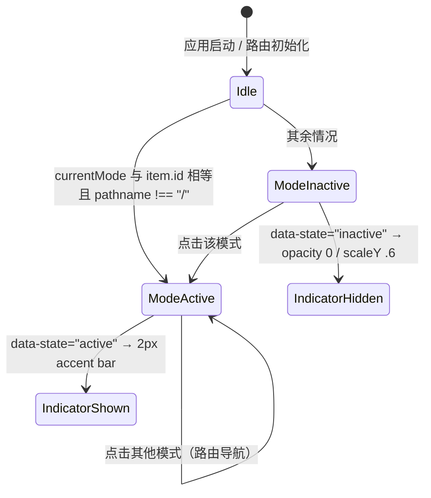

# 品牌 Logo 全景收敛与五模式侧栏导轨重构实施计划

> **状态**：**S1/S2 已验收；S3 与 R/汇聚修订已实现，本地门禁通过，最终视觉与发布验收未闭环（2026-10-20）**。当前状态以[闭环核对](../review/brand-mode-icons-closure-2026-10-20/README.md)为准；各阶段证据保留当时含义。
> **Owner**：UI + App + Desktop（品牌资产与五模式主导航导轨全链路收敛）
> **事实来源**：用户方向性指令（对话 step 350/387/413/433/446/456/468/518/733/768）+ 助手代理提案 + Antigravity 工件库 + 2026-10-07 第 517 步自审 + [审批记录](../review/brand-mode-icons-plan-approval-2026-10-20.md)
> **实施基线**：工作区 `/home/keer/workspace/aigcfroge`，分支 `brand-mode-icons`（2026-10-20 从新 main 重建），基准 commit `43997011e`（= `origin/main`，2026-10-20 实测；上一基线 `6b72b057b` 为其祖先，两基线间仅 docs/CLAUDE.md 变更，代码路径零漂移）
> **实施分支**：`brand-mode-icons`（遵守 `AGENTS.md` 最多三词、连字符、无类型前缀规范；计划、实现与证据均已本地提交，远端交付见 §8）
> **工作区**：`/home/keer/workspace/aigcfroge`（原生 Linux Ext4 SSD；旧机械盘 `/media/win_data` 与旧 worktree 已弃用，其 commit `06872530f` 在当前 clone 中不存在）
> **协议依据**：[CLAUDE.md](../../CLAUDE.md)、[AGENTS.md](../../AGENTS.md)、[DESIGN.md](../../DESIGN.md)、[ARCHITECTURE.md](../../ARCHITECTURE.md)、[docs/testing.md](../testing.md)、[packages/app/AGENTS.md](../../packages/app/AGENTS.md)
> **技能依据**：`.aigcfroge/skills/reuse-first-refactor`（复用 → 删除 → 归并 → 重构 → 新增）、`.aigcfroge/skills/frontend-theming`、`.aigcfroge/skills/quality-to-pr`
> **实施原则**：识别假设 → 追溯本源 → 重构方案 → 精简输出
> **TDD 规则**：S1/S2 必须独立完成 RED → GREEN → REFACTOR → 包级门禁；S3 为资产切片，无自动化 RED，按"视觉验收 + 缺口登记"执行（见 §4）。当前 Slice 未绿绝不进入下一 Slice；禁止伪造/侵入式源码断言，严格遵循 [docs/testing.md §10](../testing.md)。
> **高保真审批预览**：[`docs/research/brand-mode-icons/brand-mode-icons-preview-2026-10-20.html`](../research/brand-mode-icons/brand-mode-icons-preview-2026-10-20.html)（与本文同时落盘，供视觉复核）

---

## 审批修订记录（2026-10-20，权威覆盖下文的冲突描述）

依据 [`docs/review/brand-mode-icons-plan-approval-2026-10-20.md`](../review/brand-mode-icons-plan-approval-2026-10-20.md) 的三路核验（对话 / 工件 / 仓库），本版对 2026-10-15 修订版做如下修正；下文与本节冲突时以本节为准。

### 已修正的 P0

1. **来源与审批状态（P0-1）**：删除"设计评审共识记录"这一不存在的来源。本计划是**助手在用户委派下撰写的提案**；此前从未获得用户批准；Antigravity 的 9 次 artifact auto-approval（step 318/336/377/399/407/429/441/454/464）是工具评审策略事件，不是用户设计决策。用户明确要求审批在 step 768（"我需要审批"），审批结论见上述 review 记录：**S1/S2 有条件通过，S3 退回修订**。
2. **S3 基线（P0-2）**：旧版的 `packages/ui/src/components/splash-loader.tsx`、`SplashLoader`、`facet-a/g/c`、`pillar-i` 与飞入/呼吸 keyframes 在 43997011e **均不存在**（全库 grep 只命中旧计划自身）。S3 已按当前 `logo.tsx` 的 `Mark` / `Splash` / `Logo` 重写；加载态保持现有 `<Splash class="animate-pulse">`，不引入新组件。旧 `brand-splash-redesign` 代码**不迁移**（如用户 step 768 的"所有内容"包含它，另行立项，见 §7）。
3. **Logo 几何来源（P0-3）**：旧版 §3.3 的 4 条 path 抄自旧工作区梯度版 `logo.tsx`/2026-10-07 `favicon.svg`，**不是方案 04 工件**。本版改为**采用方案 04 工件几何**（`professional_logo_redesign.html` 100×100 多边形 + 顶点白点 + `opt4.svg` C 底座），并给出小尺寸简化规则、viewBox 与 token 映射；固定 hex fallback 删除。

### 关键校准（P1）

- §0.1：删除无数据来源的"65%+"与"用户确认…"表述；D1 明确为**用户委派（step 518）下的助手裁决**；主题组合数由 185 修正为约 370（37 主题 × 明暗 × 5 模式）。
- §3.1：五个图标是**方案 04 交互预览 24×24 图标的 16px 适配**（非工件原样）；补 `stroke-width=1.5`、圆角端点、20px 实渲尺寸与 14px 微缩形态。**2026-10-20 追加**：rail-chat 按用户反馈从"终端提示符"改为"对话气泡 + 三点"（新设计），其余四枚保持不变。
- §3.2：2px 单一强调色是**新设计**（2026-10-07 后确定），明确收回此前展示的 3.5px per-mode 色/12% 柔光/呼吸脉冲；指示器形态固定为 `<span data-slot="active-indicator">`（不再用 `::before`）。
- §3.3 / S3：favicon 补齐 **`-v3` 套件**（`index.html:10-13`、`favicon.tsx:6-8`、`entry.tsx:72` 实际引用）、`site.webmanifest` 品牌文本、social-share；桌面图标按 160 个实际资产盘点；本轮生成 54 个根目录 PNG/ICO/ICNS/Square/StoreLogo，mobile 目录延期登记。
- §6 R3：`--v2-text-text-contrast` 明暗主题都是近白（#ffffff / #fafafa），**不会**在亮底自动翻转深色；改为真实对比度验证并推荐自适应 token。
- 全局：修正 D2 行号、`logo.tsx` 行号、§5 active 判定、`packages/ui/AGENTS.md`（不存在）引用、S4 缺 UI 包测试、G0 "clean" 表述。

### 视觉确认（2026-10-20，用户勾选 4/4）

用户已在审批预览中勾选全部 4 项并选择 C 底座候选 2。本确认构成 S1/S2 的最后一项开工条件：

1. **C 底座 = 候选 2（55% 混白）**：`color-mix(in srgb, var(--v2-avatar-bg-cyan) 55%, var(--v2-text-text-contrast))`；不新增品牌色。
2. **小尺寸 Mark 规则**：16/20/24 紧凑（A+G）、32/48 标准（A+G+顶点）、100/160 完整（含 C）；仅用于资产母版。
3. **rail 图标统一 stroke 1.5 + 14px Assistant 微缩**。
4. **收回 per-mode 3.5px / 12% 柔光 / 呼吸脉冲**，改用 2px 单一强调色（D1）。

同日附加确认：rail-chat 定稿「对话气泡 + 三点」；顶点改为自适应前景（亮色深点 / 深色白点）。

### 实施阶段视觉修订（2026-10-20，覆盖先前描边批准值）

用户反馈真实导轨图标偏粗。提供相同生产几何的亮/暗 × 14/16/20px × stroke 1.0/1.25/1.5 并排预览后，用户明确选择「采用 1.0」。

- 五个 rail 图标及 `rail-assistant-micro` 统一显式 `stroke-width="1"`；坐标、圆头端点、圆角连接、实心耳朵/书签/三点/旋钮不变。
- 14/16/20px 对应描边 0.875/1/1.25 CSS px；此前 1.5 是首次视觉批准的历史值，现由本修订覆盖。
- S2 指示条仍为 2×20px 单一强调色；此回执时 S3 仍冻结；现由后文 S3 开工回执解除。
- 新证据与审批回执：[实施证据](../review/brand-mode-icons-s1-s2-2026-10-20/README.md)。历史审批预览与 01–12 截图保留，不当作当前描边真源。

### S3 开工回执（2026-10-20）

用户本轮明确：「S1和S2没有问题，可以继续剩下的任务」，并指出桌面/Dock 图标及新建会话中的 OpenCode。该指令覆盖此前 S3 冻结状态。S1/S2 保留已验收结果，S3 使用已预览的方案 04 几何与颜色，不重新设计。

补充根因：真实 `/new-session` 使用 `NewSessionDesignView` → `WordmarkV2`，后者将 OpenCode 编码为 SVG 路径，源码文字检索无法发现。S3 将其改为复用现有 `Logo` 字标，保留画布宽高比和布局尺寸，删除旧滤镜/渐变。原 `NewSessionView` 与文件面板继续复用共享 `Mark`。用户随后要求 AIGC 连成一组：GC 使用 0.6 缩放紧贴 AI 右侧并与底线对齐，末尾 E 补底横。该授权覆盖原 Logo 几何冻结，`WordmarkV2` 与 social-share 继续复用同一字标。

生成方案对冲：手工 convert 命令易产生跨渠道遗漏；小型 Bun 脚本复用唯一几何和既有 token，统一 PNG/ICO/ICNS 与 Web 产物。本轮采用脚本；CI 固定工具链与平台安装验收仍登记 §7。没有新增主题状态或运行时加载器。

S3 本地交付：[实施证据](../review/brand-mode-icons-s3-2026-10-20/README.md) 保存组件矩阵、真实新建会话亮暗截图、用户 Dock 截图、54 个桌面资产解码与 Web 实际路径审计。最终外壳 e2e 为 16 passed；暗色测试通过设置菜单触发主题引擎。旧历史阻断、未录制启动过渡、生成器 JSX 格式依赖和跨平台验收登记于技术债 §18。

### S3 R 字形与汇聚修订（2026-10-20）

用户随后指出「R 有问题」并要求核对加载动画是否缺少「周围向中心汇聚」。此直接指令覆盖前文保留整体 `animate-pulse` 的加载规格。共享 `Logo` 的 R 改为连续竖干、镂空上半部和斜腿；新建会话与三张社交图沿用该字标。共享 `Splash` 增加 `animate` 选项：左右片、上方顶点和下方底座用 CSS 在 1100ms 内拼合一次，结束后归位；`prefers-reduced-motion: reduce` 直接显示完整图标。App 连接门禁和桌面启动调用均已接入。

验证：[精修证据](../review/brand-mode-icons-refinement-2026-10-20/README.md)。真实新建会话验证 R 镂空、竖干与斜腿；独立夹具直接加载生产 `Splash`、生产 CSS 和 `ThemeProvider`，覆盖亮暗、390px 与减少动态。Web 入口显式关闭连接检查，不作为启动动画验收入口。组件汇聚录屏已保存；真实桌面从启动到主页的连续录屏与跨平台发布仍登记 §7 / 技术债 §18。

### 切片裁决

| 切片    | 审批状态                   | 开工条件                                                                             |
| :------ | :------------------------- | :----------------------------------------------------------------------------------- |
| S0      | 通过                       | 提交本计划 + review 记录后重跑基线命令                                               |
| S1 / S2 | **已验收**                 | 本轮用户明确表示「S1 和 S2 没有问题」；保持现有实现                                  |
| S3      | **已实施，待最终视觉验收** | 本地门禁通过；GC 缩小与 E 修正已同步；用户已提供新 Dock 图标截图；发布验收按 §7 跟踪 |
| S4      | 通过                       | 补 UI 包测试与缺口登记                                                               |

### 交付前闭环核对（2026-10-20）

- **实现与本地验证**：S1/S2、S3、GC/E/R 精修及四周汇聚均已落地。本轮 UI 20/20、模式 5/5、浏览器 20/20；全仓 `bun typecheck` 为 16 successful / 16 total（13 cached）。完整证据见[闭环核对](../review/brand-mode-icons-closure-2026-10-20/README.md)。
- **S0 证据缺口**：计划提交与基线 commit 可由 Git 复核；未完整保留实现前 ui/app/desktop typecheck 与 UI/mode 测试的原始输出。当前通过不能补造为历史基线，已登记技术债 §18。
- **视觉与发布仍开放**：S3 最终用户验收、完整桌面启动录屏、macOS/Windows 安装包、mobile、全主题/真实系统及自动视觉/生成 CI，继续由 §7 / 技术债 §18 跟踪。Linux xvfb 真实桌面冒烟 1/1 不代替这些范围。
- **品牌对比度**：补测复用生产 Splash、ThemeProvider、App CSS 与 `theme/color.ts:257` 的 `contrastRatio()`；实际亮/暗背景为 `#f8f8f8` / `#121212`。50% opacity 后亮 C 为 1.35、暗 A/G 为 1.33/1.37；不能把导轨 4.89/8.67 的结果推广为品牌通过。保留已批准 token/混色，由 Design/UI 在最终视觉验收中决定是否调整，见技术债 §18。
- **PR 分拆**：保留已验证提交，不改写历史。S1/S2 使用 `mode-rail-icons`（从 `9ae07926f` 接入标题栏 P2 修复 `f174e0300`）对 `main`；S3 经 merge `d7103f4fc` 接入导轨分支，使用 `brand-mode-icons` 对 `mode-rail-icons`，独立 draft PR。待前者合并后把后者 base 改为 `main`；最终视觉验收后再转 ready。Issue、远端 CI 和 PR readback 在远端交付后回写。

---

## 0. 产品与架构裁决（Product Director Decisions）

### 0.1 裁决 D1：激活光轨采用"单一强调色"

- **决策性质（诚实声明）**：用户在 2026-10-07 step 518 明确把"单一强调色 vs 每模式独立色"委派给助手的产品总监视角；助手在 step 623 作出单一强调色裁决。**这不是用户直接选择，也没有用户遥测数据支撑**；本计划不虚构画像占比。
- **理由**：
  - 模式身份已由**独立几何轮廓 + aria-label + tooltip + 页面内容**承载，激活光轨只承担 Focus 状态，不承担色彩分类。
  - WCAG 1.4.1（Use of Color）：不能只靠颜色传达信息；形状 + `aria-pressed` 更稳健。
  - 主题维护成本：37 套主题 × 明/暗 = 74 套调色板；per-mode 色需 74 × 5 ≈ 370 组对比度适配，而仓库无自动化对比度门禁（DESIGN.md:94）。
  - DESIGN.md 禁止装饰性发光/渐变；现有产品性格为 quiet & dense。
- **实现**：`--v2-icon-icon-accent`（light `blue-600` / dark `blue-400`），2px 垂直指示条；`data-mode` 属性保留，为未来 per-mode 扩展留逃生通道（只需 CSS 局部变量覆盖）。
- **明确收回**：2026-10-05 预览中出现过的"3.5px 模式专属色指示条 + 10px glow + 12% 柔光 + 1.5s 呼吸脉冲"**不再实施**；呼吸脉冲仍按 §7 延期登记。

### 0.2 裁决 D2：导航轨图标与内部业务 Glyph 解耦（Rail-Scoped Icon Keys）

- **实测基线**（43997011e）：`mode-*` 被内页 **11 个文件 / 21 处**复用，坐标精确复核：
  - `mode-surfaces.tsx:36,37,39,40`（prompt/skill/command/agent）
  - `assistant-nav-tree.tsx:88,97`、`work-secondary-sidebar.tsx:137,143`
  - `custom-builder-main.tsx:73,128`、`custom-preview-tabs.tsx:115`、`custom-sidebar.tsx:289,339,390,511`
  - `custom-snapshot-panel.tsx:231`、`chat-import-dialog.tsx:69,71`、`suggestion-bar.tsx:21`
  - `workflow-runtime-panel.tsx:99`、`assistant-entity-lists.tsx:63`
- **裁决**：新增 `rail-chat|coding|work|assistant|custom` 5 个键，仅 `MODE_DEFINITIONS.icon` 指向它们；`mode-*` 原样保留，内页零改动。
- **验证边界**：`Icon.name` 接受任意字符串且未知键回退 `plus`（`icon.tsx:126`），**typecheck 抓不到漏注册**——必须以 e2e `<use href>` 符号断言作为门禁；内页 `mode-assistant` 断言是**回归断言**，不是 RED。
- **影响面**：`MODE_DEFINITIONS.icon` 仅被 `ModeSwitcher`（`mode-switcher.tsx:50`）消费；home 侧栏 `modeFilters` 只读 id/labelKey，不受影响。

### 0.3 裁决 D3：实施分支与工作区策略（Ext4 Native Branch）

- 全部工作在工作区 `/home/keer/workspace/aigcfroge` 的分支 `brand-mode-icons`（从 `43997011e` 签出，已存在）执行。
- 旧机械盘工作区与其上未合入的 `06872530f`（brand-splash-redesign）**不在当前 clone 中，不迁移**；S3 只以当前基线的 `Mark/Splash/Logo` 为准。
- 分支名合规（3 词、连字符、无前缀）；当前工作树仅有计划与本审批记录两个未跟踪文件，**G0 以"计划已提交"为准**。

### 0.4 裁决 D4：Assistant 模式图标"智库手账（Classic BC 宽体修正版）"

- **来源校正**：「变体 1 智库手账 (Classic BC) 宽体修正版」是**计划自造复合名**；工件的真实拆分是 `schedule_memory_fusion.html` 的"变体 1: 智库手账 (Classic BC)"+"结构 1: 轴颈台座 (Pedestal) · 黄金 5:8 比例 · 首推"（`wider_assistant_structure.html`，2026-10-05T13:39:43Z，最新工件）。
- **用户指令链**：B 夹板头（433）→ C 记忆卡片身体（446）→ 身体更宽、结构更合理（456）→ 采用变体 1（468）。**最终 16px 几何由助手在 2026-10-07 自审后适配，用户未复核**，需由高保真预览确认。
- **16 网格几何**（`viewBox 0 0 16 16`，stroke 1.0，Assistant 部件见 §3.1）：
  - 宽体 body 归一化后与工件结构 1 **精确一致**（artifact 84 宽 : head 48 → 16 网格 12 : 7，body:head ≈ 1.71；工件原文"黄金 5:8"指 head:body = 1:1.6，差异来自 16 网格取整，需在预览中目检）；
  - 头部由工件归一化 y≈1.6、高≈6；双耳为 1.1×2.2 圆角实心耳；时钟 r≈1.7，指针按 20px 可读性简化为 `M8 3.9V4.5H9`；
  - 轴颈固定为**垂直连接** `M8 7.6V8.5`（修复早期水平线悬空问题）；
  - 14px 微缩形态：时钟只保留圆环 + 中心点，去掉指针与第二条纹（对应工件变体 3 "16/22px 极限微缩"思路）。

### 0.5 裁决 D5：主品牌 Mark 定型为"方案 04：淬火金字塔与熔炉鼎 (Refined Crucible)"

- **几何来源**：`professional_logo_redesign.html`（12:13:47Z）方案 04 的 **100×100 网格多边形** + 顶点（自适应前景）；C 底座取 `opt4.svg` 的弧线几何。旧版计划中的 4 条 path（`M11.25 2.8…` 等）是梯度时代 `logo.tsx`，**废弃**。
- **规范几何**：
  - A 面：`48,16 16,74 38,74 48,54`
  - G 面：`52,16 52,54 62,54 62,62 52,62 52,74 84,74`
  - 顶点：`circle cx=50 cy=14 r=4`
  - C 底座：`M22 82 C32 88 68 88 78 82 C78 82 66 85 50 85 C34 85 22 82 22 82 Z`
- **颜色映射（DOM 内联 SVG）**：A=`--v2-avatar-bg-blue`，G=`--v2-avatar-bg-cyan`，**顶点=`--v2-text-text-base`（自适应：浅色 #161616 / 深色 #fafafa）**，C=`color-mix(in srgb, var(--v2-avatar-bg-cyan) 55%, var(--v2-text-text-contrast))`（**已确认采用候选 2（55% 混白）**；候选 1 纯 cyan、候选 3 工件固定 #67E8F9 仅作参考）。**不写 hex fallback**。
- **尺寸分级**：Mark 组件实际消费尺寸为 40-56px（`session-new-view.tsx` 40px、`session-side-panel.tsx` 56px），固定使用完整 A+G+顶点+C；**16/20/24px 紧凑形态**（A+G 简化）与 **32/48px 标准形态**（A+G+顶点）仅用于 favicon/桌面资产母版，不改组件 API。
- **Splash**：同一 100 网格完整几何；调用点为 `app.tsx:584,623`、`desktop/src/renderer/index.tsx:344`，加载态保持现有 `animate-pulse`；**不引入 SplashLoader**。
- **静态资产**：DOM 用 token，栅格资产必须用 resolved hex（DESIGN.md:47 第三方约束例外，需在生成脚本/计划附录记录映射）。Favicon 必须同时覆盖 `-v3` 套件并修正 `site.webmanifest`（当前仍为 "OpenCode"）。

---

## 1. 开工 Gate 与实测基线（Baseline & Gates）

### 1.1 事实真源实测矩阵（2026-10-20，43997011e）

| 检验项                | 源码真源位置                                               | 实测状态（已复核）                                                                                                                                                                    | 对应裁决 |
| :-------------------- | :--------------------------------------------------------- | :------------------------------------------------------------------------------------------------------------------------------------------------------------------------------------ | :------- |
| 导航轨图标注册        | `packages/app/src/context/mode.tsx:7-48`                   | 5 个 `mode-*` 键（:11/:19/:27/:35/:43）                                                                                                                                               | D2       |
| 模式契约测试          | `packages/app/src/context/mode.test.ts:19,26`              | 唯一性 + `icon === "mode-"+id`；共 5 个 test                                                                                                                                          | D2       |
| 内页复用              | 11 文件 / 21 处                                            | 精确复算通过（见 §0.2 列表）                                                                                                                                                          | D2       |
| 导轨按钮现状          | `packages/app/src/components/mode-switcher.tsx:46-54`      | `IconButtonV2` + `variant={active() ? "neutral" : "ghost-muted"}`，无专用 CSS                                                                                                         | D1/D2    |
| 激活判定              | `mode-switcher.tsx:42`                                     | `location.pathname !== "/" && mode.currentMode === item.id`（pathname 只作 home 守卫）                                                                                                | §5       |
| 导轨 e2e 现状         | `packages/app/e2e/regression/global-shell.spec.ts:135-177` | 可见性、aria-pressed、路由与 badge；符号 id 断言有先例                                                                                                                                | S1/S2    |
| Icon 渲染             | `packages/ui/src/v2/components/icon.tsx:90-145`            | sprite `aigcfroge-v2-icon-<name>`、`<use href>`、尺寸 14/16/20、未知键回退 `plus`                                                                                                     | S1       |
| 当前 Mark/Splash/Logo | `packages/ui/src/components/logo.tsx`                      | Mark :8-32、Splash :34-61、Logo 字标 :63-100；已扁平 + token 化，无 gradient/filter；slots `logo-mark-a/g/c/i`、`logo-splash-a/g/c/i`                                                 | D5/S3    |
| 加载态                | `app.tsx:584,623`、`desktop/src/renderer/index.tsx:344`    | `<Splash class="w-16 h-20 opacity-50 animate-pulse">`；**无 SplashLoader**                                                                                                            | D5/S3    |
| 品牌 token            | `packages/ui/src/v2/styles/theme.css`                      | accent :31/:149、border-focus :39/:156、avatar blue/cyan :73/:81（暗色 :398/:406）、text-contrast :22/:141                                                                            | D1/D5    |
| 主题规模              | `packages/ui/src/theme/themes/`                            | 37 套，各含 light/dark → 74 调色板                                                                                                                                                    | D1       |
| 无自动对比度门禁      | `DESIGN.md:94`                                             | 原文确认                                                                                                                                                                              | D1       |
| Favicon 真源          | `packages/ui/src/assets/favicon/`                          | `packages/app/public/*` 为 symlink；**活体引用为 -v3 套件**（`index.html:10-13`、`favicon.tsx:6-8`、`entry.tsx:72` 远程）；`site.webmanifest` 仍写 "OpenCode"/#080808                 | S3       |
| 桌面图标              | `packages/desktop/icons/{dev,beta,prod}`                   | 每渠道 53 个文件（共 160 跟踪，含 `icon.icns`/`icon.ico`/`dock.png`/Square\*Logo/StoreLogo/android/ios）；`copy-icons.ts` → `resources/icons`；README 依赖 macOS Image2Icon 生成 icns | S3       |
| 资产工具链            | 仓库                                                       | 无 master SVG、无生成脚本、无 `app-icon.png`；ImageMagick 6.9.12 可用但不支持 ICNS                                                                                                    | S3       |
| 测试盲区              | 仓库                                                       | `packages/ui` 仅 4 个测试；e2e 无 `toHaveScreenshot`/视觉基线                                                                                                                         | S3       |
| 协议脚本              | 仓库                                                       | `test:unit:file`/`test:e2e` 脚本存在；`script/lint-changed.ts`、`check-refs.sh` 存在；`packages/ui/AGENTS.md` **不存在**（不再引用）                                                  | S4       |

### 1.2 影响面（Blast Radius）

```text
[packages/ui] icon.tsx (rail-* 5 键) · logo.tsx (Mark/Splash) · logo.css · assets/favicon/* · assets/brand/*
      │
      ├──> [packages/app] mode.tsx / mode.test.ts / mode-switcher.tsx(+css) / e2e global-shell
      │
      └──> [packages/desktop] icons/{dev,beta,prod} → copy-icons.ts → resources/icons → electron-builder
```

- 不触碰 core / session / HTTP / SQLite；纯前端展示层 + 静态资产。
- 明确不在范围：`mode-*` 内页语义、`Logo` 字标几何（当前已扁平 token 化，仅保留导出名与调用点）、SplashLoader（不存在）、旧 brand-splash 分支代码。

### 1.3 门禁准入条件（G0–G4）

| Gate            | 条件                                                                                                                                      | 验证命令                                                                                                                                                                                                                           | 状态             |
| :-------------- | :---------------------------------------------------------------------------------------------------------------------------------------- | :--------------------------------------------------------------------------------------------------------------------------------------------------------------------------------------------------------------------------------- | :--------------- |
| **G0 基线**     | 计划与审批记录已提交；工作树无无关改动；记录 typecheck/lint 基线                                                                          | `git rev-parse HEAD origin/main`；`git status --short`；`bun --cwd packages/app typecheck`                                                                                                                                         | 待提交计划后复核 |
| **G1 图标解耦** | 5 个 `rail-*` 注册；21 处 `mode-*` 零改动；符号级 e2e 通过（typecheck 不能兜底）                                                          | `bun --cwd packages/app test:unit:file src/context/mode.test.ts` + `bun --cwd packages/app test:e2e e2e/regression/global-shell.spec.ts`                                                                                           | S1               |
| **G2 激活光轨** | `data-state`/指示器由 CSS 驱动，无布局位移；单激活互斥；亮暗主题可见                                                                      | 同上 e2e + 截图证据                                                                                                                                                                                                                | S2               |
| **G3 品牌统一** | Mark/Splash/Web favicon（含 -v3）/manifest/social-share 与桌面 PNG/ICO/ICNS/dock/Square/StoreLogo 更新；mobile 与跨平台安装验收按 §7 延期 | `bun --cwd packages/app typecheck` + 预览截图矩阵 + 资产清单核对                                                                                                                                                                   | S3（已授权）     |
| **G4 全量门禁** | 多包 typecheck、受影响包测试、lint、协议引用检查                                                                                          | `bun --cwd packages/{ui,app,desktop} typecheck`、`bun --cwd packages/ui test`、`bun --cwd packages/app test`、`LINT_BASE_REF=origin/main bun run script/lint-changed.ts`、`bash .aigcfroge/skills/protocols/scripts/check-refs.sh` | S4               |

---

## 2. 目标与非目标（Goals & Non-Goals）

### 2.1 目标

1. **G1 导航图标重塑**：5 个高辨识度、几何独立的 rail 图标（16 网格、stroke 1.0、20px 实渲），与内页 `mode-*` 解耦。
2. **G2 Assistant 定型**：按 §3.1 的宽体手账几何落地，并在 20px/14px 双尺寸提供可读形态。
3. **G3 宁静激活指示**：`mode-switcher.css` + 2px 单一强调色指示条，零位移、无 glow、无渐变。
4. **G4 主品牌全景收敛**：Mark/Splash 采用方案 04 工件几何与 token 映射；Web favicon 含 -v3 全套与 manifest；桌面资产按实际盘点交付。
5. **G5 工程闭环**：S1/S2 TDD 闭环；S3 视觉验收 + 缺口登记；S4 全量门禁。

### 2.2 非目标

- ❌ 不做 per-mode 彩色指示/发光/脉冲（D1 已收回）。
- ❌ 不修改内页 21 处 `mode-*` 语义图标。
- ❌ 不引入 SplashLoader/新加载组件（当前基线无该组件）。
- ❌ 不迁移旧 `brand-splash-redesign`（06872530f）代码；如需要另行立项。
- 本轮使用 Pillow 生成 ICNS，并更新 Square/StoreLogo；macOS/Windows 安装包与 Android/iOS 目录按 §7 延后验收。
- ❌ 不改 core/session/协议/存储。

---

## 3. 视觉规范与几何真源（Visual Specifications）

### 3.1 导航轨五模式图标（16×16，stroke 1.0，currentColor）

> 真源：`sidebar_interactive_preview.html` 的 **24×24 / stroke 2–2.5** 线性图标；下表是 16 网格适配后的最终值（2026-10-20 实施阶段用户复核真实组件后选择 stroke 1.0；20px rail 渲染时约合 1.25 CSS px 描边，主动减轻小尺寸厚重感，不再追求与工件描边等粗）。所有图标 `fill="none" stroke="currentColor" stroke-width="1" stroke-linecap="round" stroke-linejoin="round"`，注意单独声明的 fill 除外。

```xml
<!-- 1. rail-chat：对话气泡 + 三点省略号（2026-10-20 按用户反馈替换旧版终端提示符 >_） -->
<symbol id="aigcfroge-v2-icon-rail-chat" viewBox="0 0 16 16">
  <path d="M12 2.5H4A1.5 1.5 0 0 0 2.5 4v6A1.5 1.5 0 0 0 4 11.5h1.2v2.4l2.9-2.4H12A1.5 1.5 0 0 0 13.5 10V4A1.5 1.5 0 0 0 12 2.5Z"/>
  <circle cx="5.2" cy="7" r="0.85" fill="currentColor" stroke="none"/>
  <circle cx="8" cy="7" r="0.85" fill="currentColor" stroke="none"/>
  <circle cx="10.8" cy="7" r="0.85" fill="currentColor" stroke="none"/>
</symbol>

<!-- 2. rail-coding：代码括号 + 斜杠 -->
<symbol id="aigcfroge-v2-icon-rail-coding" viewBox="0 0 16 16">
  <path d="M5.33 4L1.33 8L5.33 12M10.67 4L14.67 8L10.67 12M9.33 2.67L6.67 13.33"/>
</symbol>

<!-- 3. rail-work：2×2 任务网格 + 完成对勾 -->
<symbol id="aigcfroge-v2-icon-rail-work" viewBox="0 0 16 16">
  <rect x="2" y="2" width="4.67" height="4.67" rx="1.33"/>
  <rect x="9.33" y="2" width="4.67" height="4.67" rx="1.33"/>
  <rect x="2" y="9.33" width="4.67" height="4.67" rx="1.33"/>
  <rect x="9.33" y="9.33" width="4.67" height="4.67" rx="1.33"/>
  <path d="M10.67 11.67L11.67 12.67L13.33 11"/>
</symbol>

<!-- 4. rail-assistant：智库手账（夹板头 + 时钟 + 垂直轴颈 + 宽体手账 + 书签） -->
<symbol id="aigcfroge-v2-icon-rail-assistant" viewBox="0 0 16 16">
  <rect x="5.9" y="0.1" width="1.1" height="2.2" rx="0.5" fill="currentColor" stroke="none"/>
  <rect x="9" y="0.1" width="1.1" height="2.2" rx="0.5" fill="currentColor" stroke="none"/>
  <rect x="4.5" y="1.6" width="7" height="6" rx="1.5"/>
  <circle cx="8" cy="4.5" r="1.7"/>
  <path d="M8 3.9V4.5H9"/>
  <path d="M8 7.6V8.5"/>
  <rect x="2" y="8.5" width="12" height="6" rx="1.5"/>
  <path d="M4.5 10.6H8M4.5 12.4H6.8"/>
  <path d="M10.6 8.5V11.1L12 10.3L13 11.1V8.5Z" fill="currentColor" stroke="none"/>
</symbol>

<!-- 4b. 14px 微缩回退：去时钟指针、保留圆环 + 中心点、去第二条纹 -->
<symbol id="aigcfroge-v2-icon-rail-assistant-micro" viewBox="0 0 16 16">
  <rect x="5.9" y="0.1" width="1.1" height="2.2" rx="0.5" fill="currentColor" stroke="none"/>
  <rect x="9" y="0.1" width="1.1" height="2.2" rx="0.5" fill="currentColor" stroke="none"/>
  <rect x="4.5" y="1.6" width="7" height="6" rx="1.5"/>
  <circle cx="8" cy="4.5" r="1.5"/>
  <circle cx="8" cy="4.5" r="0.55" fill="currentColor" stroke="none"/>
  <path d="M8 7.6V8.5"/>
  <rect x="2" y="8.5" width="12" height="6" rx="1.5"/>
  <path d="M4.5 10.8H7.6"/>
  <path d="M10.6 8.5V11.1L12 10.3L13 11.1V8.5Z" fill="currentColor" stroke="none"/>
</symbol>

<!-- 5. rail-custom：三档滑轨 + 旋钮 -->
<symbol id="aigcfroge-v2-icon-rail-custom" viewBox="0 0 16 16">
  <path d="M2.67 4H13.33M2.67 8H13.33M2.67 12H13.33"/>
  <circle cx="5.33" cy="4" r="1.67" fill="currentColor"/>
  <circle cx="10.67" cy="8" r="1.67" fill="currentColor"/>
  <circle cx="6.67" cy="12" r="1.67" fill="currentColor"/>
</symbol>
```

- 14px 时仅 Assistant 切换到 `rail-assistant-micro`；其余图标 20px/16px/14px 共用同一几何。
- **rail-chat 例外**：2026-10-20 用户反馈旧版"终端提示符 >\_"读作终端而非对话，已改为**对话气泡 + 三点省略号**（新设计，不再引用工件 24 网格源）；其余四枚仍为工件 24 网格的 16px 适配。
- 图标未继承工件 24 网格的 stroke 粗细，**必须显式写 `stroke-width="1"`**（2026-10-20 用户在 1.0 / 1.25 / 1.5 并排预览中选择 1.0；实心部件与所有坐标保持不变）。

### 3.2 激活光轨（Rail Active Indicator，新设计）

- **DOM 契约（固定元素，不用 ::before）**：
  - `nav[data-component="mode-switcher"]`（现有 nav 上新增）
  - 每个条目 wrapper：`div[data-slot="rail-item"][data-mode="<id>"][data-state="active|inactive"]`
  - 指示器：`<span data-slot="active-indicator" aria-hidden="true">`，绝对定位、脱离文档流。
  - **禁止**把上述 data-\* 传给 `IconButtonV2`：它会在 spread 后覆盖 `data-component`/`data-state`（icon-button-v2.tsx:23,27；titlebar.tsx:950-951 同类陷阱）。
- **样式（packages/app/src/components/mode-switcher.css，同名 co-located）**：
  - 宽度 `2px`，高度 `20px`，圆角 `1px`，垂直居中于 entry，贴 rail 内容左缘；
  - 颜色 `var(--v2-icon-icon-accent)`；
  - inactive：`opacity: 0; transform: scaleY(0.6);` active：`opacity: 1; transform: scaleY(1);` 过渡 `150ms ease`；
  - 不改变父容器 padding/margin，保证零位移；禁止 glow、渐变、per-mode 色。
- **可访问性**：按钮保留 `aria-label`、`aria-pressed` 与 focus-visible 轮廓（`--v2-border-border-focus`）；指示器 `aria-hidden`。

### 3.3 主品牌 Mark / Splash（方案 04，100 网格）

```xml
<!-- 完整形态（应用内 Mark / Splash；100px+ 静态资产）viewBox 0 0 100 100 -->
<polygon points="48,16 16,74 38,74 48,54" fill="var(--v2-avatar-bg-blue)"/>
<polygon points="52,16 52,54 62,54 62,62 52,62 52,74 84,74" fill="var(--v2-avatar-bg-cyan)"/>
<circle cx="50" cy="14" r="4" fill="var(--v2-text-text-base)"/>
<path d="M22 82 C32 88 68 88 78 82 C78 82 66 85 50 85 C34 85 22 82 22 82 Z"
      fill="color-mix(in srgb, var(--v2-avatar-bg-cyan) 55%, var(--v2-text-text-contrast))"/>
```

- **应用内 Mark（40px / 56px）**：组件固定使用**完整形态**（A + G + 顶点 + C），与 §0.5 一致；`logo.css` 的 `aspect-ratio` 改为 `1/1`（新几何 bbox 68×74，接近方形）。
- **静态资产母版三档（仅资产生成，不改组件输出）**：16/20/24 紧凑（A `48,16 16,74 40,74 48,54` + G `52,16 52,74 84,74`，无顶点/底座）；32/48 标准（A+G+顶点，无 C）；100/160 完整（含 C）。
- **Splash**：使用同一完整 100 网格几何；实际 class 渲染尺寸为 64×80（`app.tsx:584`）与 48×60（`app.tsx:623`），非 100px 直出。
- **颜色**：DOM 内联 SVG 全部走 token/color-mix，**不写 hex fallback**；静态资产必须写成 resolved hex（DESIGN.md:47 例外），映射表固定为：A=`#3250df`（暗 `#263fa9`）、G=`#0096b8`（暗 `#005a6e`）、**顶点=`var(--v2-text-text-base)`（浅色 `#161616` / 深色 `#fafafa`，自适应前景）**、C=`color-mix(cyan 55%, text-contrast)` 的静态等价色（由母版生成脚本计算并注释）。**C 底座采用候选 2（55% 混白），已于 2026-10-20 视觉确认。\*\***2026-10-20 修正\*\*：顶点不再使用 `--v2-text-text-contrast`（明暗主题都近白，亮色下不可见）。
- **Logo 字标**：当前 `Logo`（`logo.tsx:63-100`）已扁平、token 化，原计划保留几何；本轮用户要求 GC 缩小置于 AI 右下并修正末尾 E，现按该反馈修改；保留 `Mark`/`Splash`/`Logo` 三个导出名与调用点（`app.tsx:10,584,623`、`desktop/src/renderer/index.tsx:29,344`、`session-new-view.tsx`、`session-side-panel.tsx`、`pages/error.tsx`）。
- **静态资产母版与产物（S3）**：
  - 新增 `packages/ui/src/assets/brand/mark-master.svg`（100 网格完整形态）与 `mark-compact.svg`（紧凑形态）；通过 `packages/ui/script/generate-brand-assets.ts` 复用 `assets/brand/geometry.ts` 与 v2 avatar token 生成；组件与资产使用同一几何。
  - Web：`favicon.svg`、`favicon.ico`、`favicon-96x96.png`、`apple-touch-icon.png`、`web-app-manifest-192/512.png`，**以及 `-v3` 同名套件**（实际被 index.html/favicon.tsx 引用）；`site.webmanifest` 改名/改主题色；`social-share.png`/`social-share-zen.png` 重新出图。
  - Desktop：`icons/{dev,beta,prod}` 的 PNG（32/64/128/128@2x/dock/Square/StoreLogo）与 `icon.ico` 与 `icon.icns`；android/ios 目录延期（§7）。
  - `convert` 生成 PNG/ICO；本机 Pillow 自带 ICNS 编码器，用于生成 ICNS，读取各尺寸条目验证；不自行实现格式编码。

---

## 4. 切片实施计划（S0–S4）

### S0：工作区环境与基线门禁

- 提交本计划 + 审批记录（`docs(plan)`）；`git status --short` 应只剩已提交前的暂存改动。
- 记录基线：`bun --cwd packages/{ui,app,desktop} typecheck`、`bun --cwd packages/ui test`、`bun --cwd packages/app test:unit:file src/context/mode.test.ts` 的实际输出。

### S1：导航轨五模式图标入驻与解耦（有条件通过）

- **RED**：扩充 `global-shell.spec.ts`：
  - 5 个 rail 按钮内 `use[href]` 的 symbol id 以 `#aigcfroge-v2-icon-rail-` 开头且互不相同；不得是 `plus` fallback（`icon.tsx:126`）；
  - 回归断言：`/mode/assistant` 内页仍使用 `mode-assistant`（该断言在变更前即为绿，属回归保护，不计 RED）。
- **GREEN**：`icon.tsx` 注入 5 个键（§3.1）；`mode.tsx` 的 `icon` 指向 `rail-*`；`mode.test.ts:26` 改为 `expect(definition.icon).toBe("rail-" + definition.id)`。
- **交付前 P2 修复（2026-10-21）**：标题栏模式面板按钮是 `MODE_DEFINITIONS.icon` 的另一消费点，现显式复用旧 `mode-*` 图标；新增 700px Chat Session DOM 回归，分别验证标题栏与导轨 glyph。该修复归入 S1/S2 PR。
- **REFACTOR/证据**：14/16/20px × 亮/暗 × 5 图标渲染矩阵截图（预览 HTML 已提供基线），确认 stroke 1.0 与微缩变体。
- **门禁**：`bun --cwd packages/app test:unit:file src/context/mode.test.ts`；`bun --cwd packages/app test:e2e e2e/regression/global-shell.spec.ts`；ui/app typecheck。

### S2：导轨激活光轨状态重构（有条件通过）

- **RED**：e2e 断言 `nav[data-component="mode-switcher"]`、`[data-slot="rail-item"]` 的 `data-mode`/`data-state` 互斥切换、`[data-slot="active-indicator"]` 存在、`aria-pressed` 与路由一致、切换时按钮 bounding-box 不变（零位移）。
- **GREEN**：新增 `mode-switcher.css` 并 import；nav 与 wrapper 注入 §3.2 属性；渲染指示器 span；保留 `IconButtonV2` 的 variant 逻辑与 badge。
- **REFACTOR**：亮/暗主题对比度目检；高对比度模式下可见性；focus-visible 轮廓。
- **门禁**：同 S1 e2e + app typecheck + 截图证据。

### S3：主品牌 Logo 全渠道收敛（2026-10-20 已授权实施）

- **资产切片，无自动化 RED**：以高保真预览 + 截图矩阵作为验收；在 `packages/app/e2e/coverage-manifest.json` 或技术债台账登记"无视觉回归门禁"的缺口（owner + unlock + 来源）。
- **Web**：按 §3.3 更新 `logo.tsx` Mark/Splash、`logo.css`、`mark-master.svg`/`mark-compact.svg`、`assets/favicon/`（含 -v3）、`site.webmanifest`、social-share；验证 `packages/app/public` symlink 自动生效。
- **Desktop**：重生成 PNG/ICO/dock/Square/StoreLogo；`copy-icons.ts` 链路核对；ICNS 由 Pillow 生成；android/ios 延期。
- **验收矩阵**：16/20/24/32/48/100/160/512px；亮/暗主题；favicon 实际路径（`/favicon-96x96-v3.png` 等）在浏览器 DevTools 中确认新品牌。
- **门禁**：ui/app/desktop typecheck；资产清单逐项核对；预览截图入 `docs/review/` 证据。
- **结果**：上述本地门禁通过，见 S3 实施证据；默认亮暗的新建会话使用实际设置菜单验证。未捕获的真实启动过渡与未完成的平台验收见技术债 §18。

### S4：全量集成门禁

1. `bun --cwd packages/ui typecheck`
2. `bun --cwd packages/app typecheck`（含 e2e tsconfig）
3. `bun --cwd packages/desktop typecheck`
4. `bun --cwd packages/ui test`
5. `bun --cwd packages/app test:unit:file src/context/mode.test.ts`
6. `bun --cwd packages/app test:e2e e2e/regression/global-shell.spec.ts`
7. `LINT_BASE_REF=origin/main bun run script/lint-changed.ts`
8. `bash .aigcfroge/skills/protocols/scripts/check-refs.sh`
9. `bun typecheck`（跨包提交与 pre-push 全仓门禁；本轮 16 个任务通过，13 个缓存）

- 人工矩阵：亮/暗主题导轨；14/16/20px Assistant 可读性；Splash 过渡；favicon 实际生效。
- 当前本地门禁已通过；人工范围与历史证据的剩余条件见[闭环核对](../review/brand-mode-icons-closure-2026-10-20/README.md)。不以 S4 命令通过宣称 S3 视觉/发布验收完成。

---

## 5. 数据流与状态转移



- **唯一状态源**：`mode.currentMode`（持久化）+ `location.pathname !== "/"` home 守卫（`mode-switcher.tsx:42`），不引入新 signal。
- **纯 CSS 呈现**：`data-state` 驱动指示器，JS 不操作样式，避免布局抖动。

---

## 6. 风险评估与回滚

| 风险                          | 等级 | 触发                  | 缓解                                                                                                                                                                |
| :---------------------------- | :--- | :-------------------- | :------------------------------------------------------------------------------------------------------------------------------------------------------------------ |
| R1 14px Assistant 细节糊化    | 中   | 14px 小尺寸           | 切换 `rail-assistant-micro`（圆环+点、单条纹）；预览确认                                                                                                            |
| R2 桌面图标缓存/不一致        | 低   | 打包后旧图标          | `copy-icons.ts` 重建；`dock.png` 与打包产物对齐；重启验证                                                                                                           |
| R3 亮色主题对比度             | 中   | 顶点/C 底座落在浅背景 | 顶点改用自适应前景 `--v2-text-text-base`（浅色 #161616 / 深色 #fafafa，已按用户反馈修正）；C 用 color-mix 提亮并做 DevTools 对比度实测；不宣称 token 会自动翻转深色 |
| R4 DOM token 与静态资产色漂移 | 中   | 栅格资产用固定 hex    | 生成脚本输出 token→hex 映射表并注释（DESIGN.md:47 例外）                                                                                                            |
| R5 跨平台安装包未验收         | 中   | macOS/Windows 打包    | 本轮更新 ICNS/ICO/tiles；§7 登记目标平台验收                                                                                                                        |
| R6 无自动化视觉回归           | 中   | 资产型改动            | 截图矩阵 + coverage-manifest/债务登记；后续补视觉基线                                                                                                               |

- **回滚**：S1/S2/S3 各自独立 commit，可单切片 revert；S3 单独 draft PR，堆叠在 S1/S2 分支上（§8）。
- **发布门禁**：S1/S2 的 e2e 红绿证据必须贴命令输出；S3 资产验收需截图；不得只跑 typecheck 就宣称完成。

---

## 7. 未交付范围与技术债务登记

| 事项                                            | 归属           | 来源/触发条件                                                          | 解锁条件 / 后续                                         |
| :---------------------------------------------- | :------------- | :--------------------------------------------------------------------- | :------------------------------------------------------ |
| macOS/Windows 安装包及 Android/iOS 资产验收     | Desktop/QA     | S3 更新 PNG/ICO/ICNS/Square/StoreLogo；本机为 Linux，mobile 目录未更新 | 在各目标平台构建并验收；移动端接入时重生成 mobile 目录  |
| 静态资产生成 CI 漂移门禁                        | Tooling/Script | S3 已提供统一生成脚本；依赖 ImageMagick/Pillow，尚未并入 CI            | CI 固定工具版本，重生成后检查 diff                      |
| 视觉回归门禁（toHaveScreenshot/Storybook a11y） | QA/App         | S3 无自动化 RED；M3 历史缺口                                           | 建立稳定截图基线后，把 S3 资产纳入门禁                  |
| 旧 brand-splash-redesign（06872530f）代码迁移   | App            | 用户 step 768"所有内容"语义未定；当前 clone 无该 commit                | 用户确认需要后单独立项（含 splash-loader 设计决策）     |
| per-mode 主题色板扩展                           | Design System  | D1 决策；无自动对比度门禁                                              | 37×明暗对比度审计工具建立后再评估                       |
| 执行中呼吸脉冲                                  | App            | 2026-10-05 预览承诺；跨模式状态订阅与 `whenActive` 冲突                | 专项 PRD 评估                                           |
| 模式快捷键 ⌘1–5                                 | App Shell      | 仓库不存在任何绑定                                                     | 快捷键冲突检测专项                                      |
| v2 图标 Storybook 故事                          | UI             | `packages/ui` 无 icon/logo 测试                                        | 与视觉回归门禁一并补齐                                  |
| `packages/ui/AGENTS.md`（计划曾引用但不存在）   | Docs           | 2026-10-20 审批发现                                                    | 需要时新建或从协议依据删除（本版已删除）                |
| S0 实现前基线原始日志归档                       | QA / Docs      | 只保留基线 commit 与阶段通过输出，缺完整实现前命令收据                 | 找回原日志或明确接受历史证据缺口；当前门禁不能替代      |
| 品牌 Mark/Splash 实际背景与透明度的可读性       | Design / UI    | 补测亮 C、暗 A/G 对比度偏低；导轨结果不能替代品牌矩阵                  | 基于实测值完成 S3 最终视觉验收；若调整 token 则重新出图 |

---

## 8. 提交与 PR 计划

### 8.1 提交序列

1. `docs(plan): revise brand mode icons plan per 2026-10-20 approval`（本文件 + 审批记录 + 预览 HTML）
2. `feat(ui): add decoupled rail mode icons with 16px geometry`（S1）
3. `test(app): assert rail icon symbol ids and preserve in-surface glyphs`（S1）
4. `feat(app): add quiet rail active indicator with single accent`（S2）
5. `feat(ui): converge brand mark and splash to scheme 04`（S3，已授权）
6. `feat(ui): regenerate web favicon suite and manifest branding`（S3）
7. `feat(desktop): refresh channel png ico and icns assets`（S3，延期项另记）
8. `docs(plan): record slice checkpoint and undelivered scope`（收尾，粘贴 `git log --oneline` 实录）

### 8.2 PR 清单

- [x] 实施分支 `brand-mode-icons`（≤3 词、连字符、无类型前缀）
- [x] S1/S2 RED→GREEN 收据已归档；旧 `mode-*` 字典及内页调用未改（首轮 S1 日志缺失独立声明）
- [x] S3 亮/暗 × 尺寸截图矩阵与 favicon 实际路径证据已归档
- [x] 延期项与新发现的验证缺口已登记（§7 / 技术债 §18），含 owner、来源与解锁条件
- [x] 运行时使用 token；批准的几何/计时集中于局部变量，静态 resolved hex 按 §3.3 注释
- [ ] 分开创建 S1/S2 与 S3 PR，按本节的分支依赖交付；S3 保持 draft
- [x] 分别关联 rail Issue [#134](https://github.com/keerzzz/AigcForge/issues/134) 与品牌 Issue [#135](https://github.com/keerzzz/AigcForge/issues/135)（按模板创建，PR 使用 `Closes #N`）
- [ ] 两条远端分支、PR base/head/Issue 与 CI 状态 readback
- [ ] S3 最终用户视觉验收及实机发布（技术债 §18；draft PR 不关闭此项）

远端目标：`keerzzz/AigcForge`；S1/S2 base 为 `main`，S3 初始 base 为 `mode-rail-icons`。分拆是 §6/§8 原定的独立评审要求；本轮采用堆叠 PR，避免重写已验证提交。上游 `anomalyco/opencode` 仅作来源，不是交付目标。

---

## 9. 复查结论模板（CLAUDE.md Skeleton）

```markdown
### 复查结论

- **影响文件**：packages/ui/src/v2/components/icon.tsx；packages/app/src/context/mode.tsx；mode.test.ts；components/mode-switcher.tsx；components/mode-switcher.css（新）；packages/ui/src/components/logo.tsx；logo.css；packages/ui/src/assets/{brand,favicon}/_；packages/app/{index.html,public/_}；packages/desktop/icons/\*；packages/app/e2e/regression/global-shell.spec.ts
- **命中 skills**：reuse-first-refactor / frontend-theming / quality-to-pr
- **安全门禁**：无网络/协议/存储改动；纯展示层与静态资产；aria 与对比度复核
- **工程门禁**：[ ] ui typecheck [ ] app typecheck [ ] desktop typecheck [ ] ui test [ ] app unit [ ] app e2e [ ] lint-changed [ ] check-refs
- **已运行命令实录**：（粘贴实际输出）
- **剩余风险与跟踪**：跨平台安装验收/mobile 延期；视觉回归缺口；旧 branch 迁移未定
```

---

## 10. 高保真审批预览（本次交付）

- 文件：[`docs/research/brand-mode-icons/brand-mode-icons-preview-2026-10-20.html`](../research/brand-mode-icons/brand-mode-icons-preview-2026-10-20.html)
- 内容：方案 04 Mark 全尺寸与亮暗对比、五个 rail 图标 20/16/14px 与现状对比、Assistant 细节与微缩回退、2px 单一强调色导轨真实外壳、token/尺寸/状态规格、待确认清单。
- 用途：**仅用于视觉审批**，不进入产品代码；与本文冲突时以本文为准。
- **确认状态（2026-10-20）**：用户已勾选 4/4，C 底座候选 2 采纳；本计划已回写确认结果，S1/S2 可开工。
