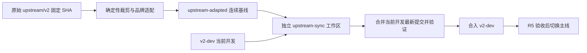

# V2 审批整改与上游增量同步方案

日期：2026-10-17。状态：**设计方案，未实施生产代码修复或分支同步**。

依据：[独立审批报告](../review/v2-branch-independent-review-2026-10-17.md)、主仓 CLAUDE / AGENTS、ADR-20、ADR-26、V2 本地协议及桌面迁移计划。实施时采用 V2 当前接口，不机械移植旧主仓实现。

## 1. 已核实的起点

| 对象                 | 本轮固定值 / 状态                                                                                               |
| -------------------- | --------------------------------------------------------------------------------------------------------------- |
| 主工作区             | `/home/keer/workspace/aigcfroge`，`main@75ee27fbd15bb4b65316acb05b7e102968ab0626`                               |
| V2 工作区            | `/home/keer/workspace/aigcfroge-v2`，`v2-dev@8b0661b2a9278373cb020b0998ef0943bb433459`，工作树干净              |
| 已记录的原始上游     | `upstream/v2@4617210822bdbb31e5749751afbfb4584ccedac8`；本轮未 fetch，不代表远端最新值                          |
| 功能迁移前的适配提交 | `9c29234af30f3cd36aed4b52c0ba99da536e20d6`；`git merge-base 9c29234af HEAD` 返回该提交，已证实为 V2 HEAD 的祖先 |
| 历史完整性           | 当前仍为浅仓库；上游更新前补足祖先，R5 前遵循原计划完成完整历史核验                                             |

当前审批仍为 REQUEST_CHANGES。四项问题集中在生产连接契约和生成物同步；修复这批问题不等于完成整个 V2 迁移或 R5 交付。

## 2. 修复顺序与验收

先把前次三条独立失败探针整理为包内回归，再进行以下三个小批次。测试必须调用生产服务和生产 Tool 注册路径，不能在测试里代替 HTTP 入口绑定 responder，也不能自行构造一个正确工具来替代 connection 生成的工具。

### A. 真实事件流登记审批连接（F1）

修改入口：V2 `packages/server/src/handlers/event.ts`；必要的依赖接线在 Server / Core 组合根完成。事实 owner 继续为 `packages/core/src/permission/approval-presence.ts`。

- 在事件队列已就绪、发出 `server.connected` 之前登记 responder；登记和释放归 HTTP **响应流消费期间的 Scope**。不能在构建完 Response 后就结束的临时 Scope 中登记。
- HTTP 与各 Location 的 Permission 必须取得同一进程级 ApprovalPresence 实例。仅重复提供同名 Service 不足以证明共享，须验证 Layer / app-node 组合。
- 复用 `ProductModePolicy.CAPABILITIES_HEADER` 和 `isCustomCapable`。当前 `/api/event` 是全局事件流，按实际可见范围登记；有 Location 过滤的订阅才登记相应 Location。能力头表示客户端能力，不代表授权。
- 关闭连接、取消消费、队列溢出或编码失败都必须释放连接登记；多个连接按各自 Scope 独立释放。无 responder 仍即时拒绝，已有请求继续遵循既有 TTL 与取消语义。
- 保留 `Permission.assert`、reply 校验和 grant 规则；不改为默认在线，不放宽 deny。

验收：真实 HTTP SSE → 真实 Permission.assert → 收到审批事件 → HTTP reply → 工具继续执行；断连后新 ask 被拒绝；普通与 Custom 能力匹配；不同 Location 的可见范围匹配；多个连接中关闭一个不会误清空另一个；超时和取消不遗留 pending。并发测试用握手、Deferred 或队列信号，不靠固定 sleep。

### B. MCP 授权与输出一起修复（F2 / F3）

修改 owner：V2 `packages/core/src/mcp/connection.ts`。复用 `packages/core/src/tool/mcp.ts:49` 的叶执行约定，保留新连接现有凭据、健康检查、取消与注册生命周期。

- 叶 `execute(input, context)` 获取 Permission，使用真实 Session、Agent、messageID、调用 ID，在 `tools/call` RPC 前完成 `assert`。
- action 必须复用 `packages/core/src/tool/mcp-registration.ts:55` 的 `canonicalToolName`，与实际注册名一致，包括长名称摘要。不能直接照搬旧 MCP 路径的另一套名称拼接函数。
- 工具目录可见性继续由 Tool registry 决定，执行授权继续由叶执行器决定。已取得快照也不能绕过叶授权。
- `tools/list` 解析保留 `outputSchema`；注册使用声明的 schema，无声明时采用现有 MCP 同族的 `{}` 输出约定。`toolResultOf` 与之配套：优先结构化结果；仅在未声明输出 schema 时保留现有文本 JSON 推断约定；空内容与 `isError` 依当前 Tool 契约处理。
- 不移除 `tool/runtime.ts:46` 的契约检查；只有两个实现确实共享同一转换语义时，才抽取小型共用转换函数。本批不合并两套 transport。

验收必须经过 connection → registration → `Tool.snapshot(...).execute(...)` 全链：

| 场景                               | 必须观测的结果                                   |
| ---------------------------------- | ------------------------------------------------ |
| ask 未回复、拒绝、超时、取消       | 外部 fixture 收到零次 `tools/call`               |
| allow 或 ask 获准                  | 恰好调用一次，context / source 正确              |
| deny、资源级规则、缓存快照         | 仍执行相应拒绝规则，无外部副作用                 |
| 短名称和超长名称                   | 权限 action 与实际 canonical 注册名一致          |
| 文本、结构化内容、混合内容、空内容 | 正常结算，不产生缺少 output schema 的 defect     |
| 远端 `isError`、传输失败           | 进入既有可处理工具失败路径，保留有意义的错误信息 |

新增 McpConnection 尚缺上层生产 connect 消费者的已验证接线。本批修复其交付接口，不把未完成的 composition / runner 迁移顺带宣称完成。

### C. 官方生成器同步客户端（F4）

从 V2 `packages/client` 运行 `bun run generate`，审查并提交产物，使 ConfigEntry 包含 `cli_agents` 与 `subagent_attended_default`。随后 `bun run check:generated` 必须退出 0。不手改 generated 类型。

### 批次关闭条件

- A / B 的生产链路回归转绿；相关既有 Permission、MCP、Server、Schema、Client 测试通过。
- V2 根目录 `TURBO_FORCE=true bun run check` 通过；客户端零生成漂移。
- 固定仓库声明的 Bun 版本；测试从包目录运行。Server 使用独立 XDG_DATA_HOME / XDG_CACHE_HOME / XDG_CONFIG_HOME / XDG_STATE_HOME；Core 使用其隔离测试入口。
- 记录最终 HEAD、命令、退出码、通过 / 失败 / 跳过数。前次全量测试仍有未定界失败，不能沿用“全绿”或统称“历史失败”；需要豁免时逐名提供同环境旧 HEAD 对照、owner 和解锁条件。
- 重新审查实际修复差异，再更新本批审批结论。真实桌面审批 UI / 完整 E2E 仍按 R3–R5 验收。

## 3. 同步策略：持续维护一条上游适配基线

| 路径                                     | 收益                                                   | 成本与局限                                                            |
| ---------------------------------------- | ------------------------------------------------------ | --------------------------------------------------------------------- |
| 每次在临时工作区直接合并原始 upstream/v2 | 初次投入低，可处理一次小更新                           | 上游品牌名、裁剪包和本地 feature 反复交叉，人工冲突处理成为持续技术债 |
| 原始上游 → 确定性适配 → 候选合并         | 品牌和产品边界只维护一处；Git 可按连续适配祖先计算增量 | 需要一次性补齐 recipe、来源记录和回放测试；仍需审查语义冲突           |

建议第二条路径，先做本地可复现命令，随后接入现有 CI。暂不另建常驻同步服务或新的发布系统。首次本地演练期间，候选准备仍需人工运行，这是明确保留的短期技术债。

拟采用的分支职责（尚未创建）：

- `upstream/v2`：原始上游跟踪引用，只保留上游代码。
- `upstream-adapted`：连续的规范化快照，只含桌面依赖闭包、品牌适配和维持这些转换所需的受控基线文件；不接收业务功能修复。
- `upstream-sync`：从已冻结的 `v2-dev` 提交创建的短期候选分支，在独立工作区合并、解冲突、验证。
- `v2-dev`：本项目迁移与功能集成分支。
- 当前 `main`：继续当前开发与稳定交付；V2 整体替换遵循已有 R5 cutover，不能把上游小批次同步当作跨代迁移已完成。

### 3.1 先证明初始基线，避免伪造共同祖先

`9c29234af` 位于裁剪 / 改名之后、功能迁移之前，并已是 `v2-dev` 的祖先，适合作为 **N0 候选**。但它还包含同步研究、审批文档及 rename 脚本，不能将其描述为未经验证的“纯净生成快照”。

建立 recipe 时，先从原始 `461721082` 重放裁剪与改名，对托管路径逐字节比较 N0。明确记录历史附带文档 / 脚本等保留文件及摘要，防止下一次重建将它们当作上游删除。上游新文件与保留文件撞名必须报冲突。

若重建不一致，先解释并提交适配规则修正，单独验证；不要用 `merge -s ours`、`--allow-unrelated-histories` 或整树覆盖伪装历史一致。原计划禁止旧 main 与新 V2 盲目合并，和这里在已验证的共同适配祖先上做后续增量，是两件不同的事。

后续 N1 从干净原始 U1 生成，Git 父提交是 N0；N2 的父提交是 N1。每次只合并连续适配分支，并保留普通 merge 祖先，不能每次创建互不相干的快照，也不能 squash 掉全部适配来源。原始 U 的来源以完整 SHA 记录，不伪造额外 merge parent。

### 3.2 复用现有脚本时需要补齐什么

| 现有入口                                            | 当前事实                                                                   | 需要补齐                                                                                                              |
| --------------------------------------------------- | -------------------------------------------------------------------------- | --------------------------------------------------------------------------------------------------------------------- |
| `script/rename-bridge.ts:26`                        | 目标根固定为脚本所在仓库；`transform:40` 做文本转换；路径改名从 `:94` 开始 | 显式目标目录、路径碰撞检查、外部包名和协议 fixture 保护、幂等回放；仅运行于干净上游快照                               |
| `docs/research/upstream-v2-sync/scan-divergence.sh` | 比较与报告工具，保留旧 package 映射和历史 BASE_SHA                         | 从同步记录读取基线与映射，用于预览差异；不承担 merge                                                                  |
| 桌面闭包裁剪                                        | 迁移计划已定义保留 / 退役范围                                              | 以实际 workspace / import / build / workflow 引用重新计算依赖闭包；上游新增必要依赖时需更新规则，不能机械按旧名单删除 |
| CI 工作流                                           | `test.yml:130`、`:141`、`:157`、`:171` 仍引用退役包                        | 按已登记 R0.1 / ADR-26 修复整个引用闭包，并保留生成客户端检查与真实桌面交付检查                                       |

recipe 必须固定版本或提交摘要。同一上游 SHA + 同一 recipe 应产生相同托管树；重复运行无差异。规则升级与上游版本升级分开审查，先用旧上游解释规则产生的差异。

依赖锁文件也属受控产物：优先保留上游解析结果；因裁剪 / 改名必须调整时固定工具链并检查差异，再通过 frozen-lockfile 安装证明重现性。不能把每次重新解析出的无关依赖升级混进上游同步。

### 3.3 每次更新流程

1. **固定输入**：记录已接受的原始上游 U0、适配 N0、当前开发 D0、recipe 摘要。fetch 上游后固定 U1；确认 U0 是 U1 的祖先，历史不足先 deepen。上游改写历史进入单独审查。
2. **生成预览**：在独立临时目录从 U1 生成适配 N1，父提交为 N0。输出上游提交列表、裁剪 / 改名统计、实际语义差异与依赖闭包变化。提交清单全部由 `git log` 生成。
3. **准备候选**：在从 D0 创建的独立工作区中合并 N1。验证共同祖先为上次接受的适配基线；多重或意外祖先先解释。冲突按协议 / Session / Tool / Schema / App / 构建责任域处理。
4. **分层验证**：先跑差异及依赖影响面测试，再跑固定边界回归、无缓存 check、生成物和锁文件漂移检查。Schema / 数据库 / SDK 改动扩展到真实升级回放；App / 桌面改动扩展到对应真实 E2E 与构建。未定界失败阻止自动通过。
5. **吸收并行开发**：若 `v2-dev` 已从 D0 前进到 D1，把 D1 合进候选，重跑最终差异所需门禁。最终交付来源必须是实际验证的候选；主线再次前进就更新候选或由合并队列重新验证，不能拿 D0 的绿灯批准新组合。
6. **接受与记账**：合入通过审批的候选，保留适配 ancestry；记录 U1、N1、recipe、开发基点、最终候选 SHA、测试证据和豁免台账。只有接受完成才更新“上次已同步”指针；失败候选不得推进该指针。

速度来自频繁的小批次、消除品牌差异、先跑相关测试和复用依赖缓存；最终必需门禁不因追求速度而省略。必要时临时提取紧急上游修复，但须记录来源，下一次完整同步时检查重复或冲突。

## 4. 如何隔离正常开发

- 工作区隔离源码、HEAD 与暂存区；Git refs 和部分配置仍共享。因此使用独立候选分支，不强制在两处检出 `v2-dev`，不 reset / rebase 他人正在使用的分支。
- 测试和应用启动使用独立 XDG 目录、数据库、端口、输出目录及服务实例；不连接用户的常驻服务或真实会话。数据库升级使用备份副本。
- 最终合入前保持原开发工作区不变；开发者处理未提交内容后在正常集成点接收通过验证的更新。独立工作区降低干扰，不能保证所有语义冲突消失。
- 未合入的候选失败时保留证据并丢弃候选即可。已共享的错误合并通过新 revert 提交处理；数据库迁移另有备份 / 恢复或向前修复方案，Git revert 不会回滚用户数据。
- 撤销 merge 仍保留 ancestry；后续重新引入需要检查 revert-of-revert 或重新制作修复提交，不能假定再 merge 一次会恢复被撤销内容。
- 自动同步只准备候选和证据，正式发布仍复用 ADR-26。同步触发不应意外启动发布。定时触发与自动合并尚未配置。

## 5. 实施顺序与交付物

| 顺序 | 交付物                       | 完成条件                                                   |
| ---- | ---------------------------- | ---------------------------------------------------------- |
| 1    | A / B / C 三批整改           | 四项发现关闭，生产边界回归通过，固定 HEAD 复审             |
| 2    | R0.1 CI 引用闭包修复         | 现存包的检查可运行，失败 / 豁免有确切归属                  |
| 3    | 可复现适配 recipe 与来源记录 | N0 回放一致、幂等、碰撞检查、依赖闭包和锁文件可复现        |
| 4    | 一次隔离的完整同步演练       | 包含开发分支前进、候选失败与代码 / 数据恢复场景            |
| 5    | 接入现有 CI 的候选工作流     | 固定输入、固定输出证据、最终候选验证；复用 ADR-26 发布边界 |

建议优先做 1–4，演练通过后再自动化第 5 项。本文件是可执行设计与验收标准，不代表上述事项已经实现。本轮只新增本方案；未修改 V2 生产代码，未 fetch、合并、推送或创建定时任务。

参考：[Git merge 共同祖先](https://git-scm.com/docs/gitcore-tutorial)、[Git worktree 隔离与共享引用](https://git-scm.com/docs/git-worktree)、[撤销错误 merge](https://git-scm.com/docs/howto/revert-a-faulty-merge)。
