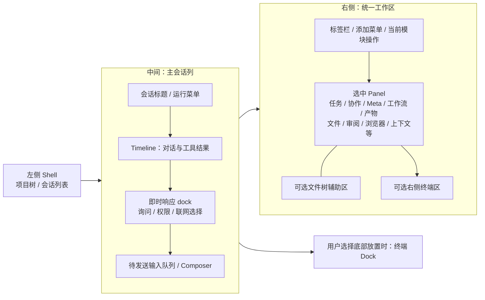

# 会话 UI 对齐与统一右侧栏实施方案

日期：2026-11-09。基线：`v2-dev`，`0486d8bd06a13b5c9797fb976124f60af300662f`。

本文是[现行 V2 总计划](/home/keer/workspace/aigcfroge-v2/docs/research/upstream-v2-sync/2026-10-25-v2-alignment-execution-plan.md)的会话 UI 专项附件。用户已明确要求对齐上游布局，并以会话详情页现有右侧栏作为统一、可插拔的底座。本次交付实施方案；源码实现按下列小节推进。任务状态只维护在[未交付账本](/home/keer/workspace/aigcfroge-v2/docs/technical-debt.md)，既有 Meta 接受记录保持。

审批状态：**按 CLAUDE 与第一性原理审查、完成减法修订后批准。** [审批记录](/home/keer/workspace/aigcfroge-v2/docs/review/v2-implementation-approval-2026-11-09-unified-right-sidebar.md)明确新增结构、实际风险与验收范围。默认一个真实管理扩展贡献五个独立 Panel；RS03 完成五类功能右侧可达后立即执行 RS06 主列归位；基准按改动选择；复用现宿主的 Custom 输出不设置两用例前置。

## 1. 结论与第一性依据

统一右侧栏采用现有 `Extension Host → Panel → createRegion → SideRegion → RegionContent` 链路。任务、协作、Meta、工作流和产物接入与文件、审阅、浏览器相同的宿主。输入响应 dock 保留即时输入和即时决策；持续管理内容移出对话正文。

### 1.1 事实 fact

- F1：当前源码在 Timeline 与 Composer 之间挂载 `SessionTaskPanel`，其展开内容包含任务、协作、Meta、工作流和 Work 产物。[挂载决定](/home/keer/workspace/aigcfroge-v2/packages/app/src/session/screen.tsx:359)、[内容组合](/home/keer/workspace/aigcfroge-v2/packages/app/src/session/tasks/session-task-panel.tsx:95)。
- F2：上游 `anomalyco/opencode` 的 `v2` 核对版本为 `4617210822bdbb31e5749751afbfb4584ccedac8`，对应位置直接连接 Timeline 与 Composer。[上游固定版本](/home/keer/.codex/outputs/2026-11-09/dock-ui-audit/upstream-dock-comparison.md)、[上游源码](https://github.com/anomalyco/opencode/blob/4617210822bdbb31e5749751afbfb4584ccedac8/packages/app/src/session/screen.tsx#L353-L362)。RS00 开始时重新核对远端，记录新增差异，保持本次比较版本可追溯。
- F3：右侧已有真实的 File、Review、Browser 消费者；`createRegion` 按 `region` 收集 Panel，生成实例，合并存储标签并选择实际面板。[集合与身份决定](/home/keer/workspace/aigcfroge-v2/packages/app/src/runtime/extension/panels.tsx:98)。
- F4：文件树处于同一 `SideRegion` 的辅助区，通过 `session.panel.sidebar` Slot 提供；终端通过 DockRegion 在右侧下部或底部显示。[文件树贡献](/home/keer/workspace/aigcfroge-v2/packages/gui-extensions/src/file/renderer.tsx:438)、[辅助区挂载](/home/keer/workspace/aigcfroge-v2/packages/app/src/runtime/extension/side-region.tsx:249)、[终端贡献](/home/keer/workspace/aigcfroge-v2/packages/gui-extensions/src/terminal/renderer.tsx:144)。
- F5：Question 与 WebSearch 共用一种 Form 选择，Permission 独立选取，可与 Form 同时存在；任一请求阻塞普通输入。[关系决定](/home/keer/workspace/aigcfroge-v2/packages/app/src/session/requests/model.ts:64)。
- F6：Task 与兼容 Todo 从同一任务 owner 发布，不能据名称创建两个编辑源。[投影决定](/home/keer/workspace/aigcfroge-v2/packages/core/src/session/task.ts:423)。

### 1.2 原因假设 hypothesis 与推导 inference

H1：持续管理 UI 占据主对话列，是输入框上方管理区过大的直接布局原因。若成立，展开管理区时应减少 Timeline 的可用高度；从主列删除挂载并在右侧打开相同能力后，该纵向占用应消失。

I1：F1、F2 与实际 flex/CSS 位置支持 H1；这是可由 RS06 前后几何检查裁决的推导，尚未冒充修改后的桌面结果。模块功能复杂度不要求其必须占用主列。

I2：F3 已提供多个真实消费者，统一宿主具有已出现的复用依据。新增第二注册表、布局缓存或事件总线没有对应的必要用例。F4 支持同一右侧工作区有不同承载位置，统一职责不要求把终端与文件树强制改成普通标签。

### 1.3 推荐 recommendation

复用现有右侧宿主，补最小 SDK 接缝，迁移五个管理模块，并使模块的显示、打开和业务执行相互独立。所有模块共用数据来源、位置身份和宿主生命周期；每个模块保留自己的操作、草稿、结果及权限责任。

这项改变修订的是本地 `SessionTaskPanel` 的页面位置，影响会话 UI 与 GUI 接入；Task、Delegation、Meta、Workflow 的执行语义保持由现有 owner 决定。本方案及 DESIGN 的索引记录这次位置变更，不将源码现状反向当作产品规范。

## 2. 页面位置：桌面会话详情页



图中的即时响应和普通输入按真实请求状态切换；并非所有节点同时显示。

| 位置 | 显示内容 | 交互与归属 |
| --- | --- | --- |
| 左侧 Shell | 项目树、会话列表与现有导航 | 继续由 Shell 管理。本次右栏统一为后续全平台装配提供一个完成样本 |
| 中间顶部 | 会话标题、当前运行状态、运行菜单 | 沿现有标题与运行入口；不添加一排管理模块按钮 |
| 中间主体 | 对话、工具输出、持续 SSE 更新 | 主会话列随右栏开关获得空间，不挂载全量管理面板 |
| 中间底部，即时响应区 | 询问、权限、联网选择 | 保留请求选择与提交机制；Permission 可与一种 Form 共同显示 |
| 中间底部，输入区 | 排队输入、普通/Shell Composer、附件与控制 | 请求消除后恢复草稿与光标；子会话和 Location 恢复保留原分支 |
| 右侧顶部 | 现有标签栏、`+` 添加菜单、当前面板操作与收起入口 | 延续上游结构；标签可复用、选择、排序、关闭及恢复，等级规则沿现宿主 |
| 右侧主体 | 当前选中的管理或资源 Panel | 首期一个活动主 Panel；其内部可用列表与详情组织数据 |
| 右侧主体的辅助区 | 可选文件树：全部文件/变更文件 | 保留现有 Slot、开关与尺寸；服务文件、审阅及其它主面板 |
| 右侧下部 | side placement 的终端 | 与上方 Panel 共存，复用原分隔和高度控制 |
| 工作区底部 | bottom placement 的终端 | 仅按用户现有终端设置放置，不复制第二个 PTY |
| 全局 Shell | Toast、上传通知、可选 DebugBar | 各自沿当前 Slot/通知 owner |

新管理 Panel 默认作为可添加项，不把五个面板同时展开，也不因收到 SSE 强制打开右栏。已有会话优先恢复其标签、选择与宽度；首次使用沿现有 Review/File fallback。用户从 `+` 选择任务时，打开任务标签；从协作中的 Task/结果链接打开对应右栏视图或既有子会话路线。

## 3. 模块位置与迁移矩阵

| 模块 | 当前位置 | 目标位置与内容 | 可用条件/现有 owner |
| --- | --- | --- | --- |
| 全量任务编辑 | 中间 TaskPanel | 右侧“任务”Panel：列表、创建、编辑、状态、优先级、结果引用 | 已有 Session；Client `data.session.task` 与 Core SessionTask |
| Todos | 兼容投影，当前无独立 dock UI | 在“任务”中消费同源任务；确有产品需要时增加筛选或展示方式 | Task owner；不新增 Todo 编辑库 |
| 协作与委派 | 中间 TaskPanel | 右侧“协作”Panel：参与者、轮次、来源、回执、全文结果、控制 | Client Delegation/receipt；Task 链接跳转任务 Panel |
| Meta 检查 | TaskPanel 内独立组件 | 右侧“Meta”Panel：统筹状态、已记录使用量、项目记忆与已有操作 | 是否存在 Meta controller 沿真实数据；普通 Build 不因此启动 Meta |
| 工作流运行 | Work/Custom 的 TaskPanel | 右侧“工作流运行”Panel：采用来源/版本、步骤、运行、取消与重试 | 保留 WorkflowRunPanel 的根会话、模式、controller 与来源条件 |
| Work 产物 | Work 的 TaskPanel | 右侧“产物”Panel：候选、目标文件、确认、写入、应用、读回和打开 | 现 WorkArtifact owner；Custom 另按 RS09 接入 |
| Git/变更审阅 | 现有 Review Panel 与文件树 changes | 同一右侧“审阅”Panel：复用现有差异、评论和已有操作 | 项目/仓库及 Changes 合同；新增完整 Git 管理功能须有单独业务任务 |
| 文件查看/预览与行评论 | 现有 File Panel | 右侧资源标签；同路径重复打开复用，多个文件可并存；评论沿 Composer 上下文 | File extension、screen.file、既有路径解析；正文编辑器另按实际功能核对 |
| 文件树 | 右侧辅助 Slot | 同一右侧工作区可选辅助区；保留全部/变更两个页签 | File extension；独立显示开关，引用实际 Session 目录 |
| 内置浏览器 | 现有 Browser Panel | 右侧浏览器资源标签；保留多页、选中、检查及文件预览能力 | 当前桌面能力，Web 可用性沿原 IPC 状态表达 |
| 终端 | DockRegion，默认 side | 右侧下部/用户选择的底部 | 现 Terminal 与 PTY owner；不强制改为主 Panel |
| 上下文/Token | 标题入口及 Context Panel | 继续在统一右侧 Context Panel | 当前 Instructions/上下文读模型，不造统计缓存 |
| 会话详情 | 标题详情入口与窄窗抽屉 | 保留现有入口，共享现 SDK 生命周期 | Details 的桌面 list 为空，不为本次统一额外新建详情标签 |
| 资产候选审阅 | 现有候选 Panels | 保持右侧，沿现有 `+`/Command 入口 | Skill/Command/Prompt/Agent/MCP/Plugin/Workflow 提案 owner；库存页独立 |
| BTW 辅助会话 | 现 BTW Panel | 保留同宿主的辅助会话模块 | 已有 Session/BTW；不与协作历史合并 |
| 正在运行的子智能体/命令 | 标题运行菜单/Timeline 指示 | 保留紧凑运行入口；需要管理历史时进入协作或已有详情 | 真实 BackgroundTask/Job/Session 数据 |
| 询问、权限、联网选择 | Composer response dock | 继续在中间输入区，要求即时回应 | 原 request tree/model；不搬到可能被收起的右栏 |
| 待发送消息队列 | Composer 上方 | 继续紧靠输入框 | durable inbox/queue；不放进业务任务清单 |
| 后续 Custom 生成内容 | 尚未形成通用 UI 产物接入 | 同一右侧宿主：文件、浏览器或正式产物模块 | 已采用组合、实际 producer/资源身份；按 RS09 形成具体合同 |

“Git 相关”在本期指已有 Review/Changes 的插拔与布局归一；提交、分支管理、历史图等如尚无对应实现，需要另列其功能任务，不能靠新增标签声明完成。

## 4. 统一架构与代码落点

### 4.1 宿主职责

| 职责 | 现有代码位置 | 本期处理 |
| --- | --- | --- |
| Panel 合同 | [SDK registries](/home/keer/workspace/aigcfroge-v2/packages/gui-extensions/src/sdk/registries.ts:230) | 复用 list/render/focus/close/wide/mobile/legacy |
| 模块实例与选择 | [createRegion](/home/keer/workspace/aigcfroge-v2/packages/app/src/runtime/extension/panels.tsx:98) | 复用 provider 集合、stable key、stored strip、fallback；不按模块名写分支 |
| 可见性与挂载 | [RegionContent](/home/keer/workspace/aigcfroge-v2/packages/app/src/runtime/extension/panels.tsx:258) | 模块消费 frame.visible；维持局部 Suspense 和 group 规则 |
| 标签、添加菜单、辅助区 | [SideRegion](/home/keer/workspace/aigcfroge-v2/packages/app/src/runtime/extension/side-region.tsx:37) | 管理模块通过同一个 `session.panel` MenuItem 入口 |
| Panel identity | [panelKey](/home/keer/workspace/aigcfroge-v2/packages/app/src/runtime/extension/panel-keys.ts:4) | `extension:tab-id`；每会话的任务/协作/Meta 各一个管理标签，资源按既有 ID 多实例 |
| 位置与存储 | [stateKey](/home/keer/workspace/aigcfroge-v2/packages/app/src/runtime/extension/host-apis.tsx:505) | 复用 server scope＋directory＋Session identity；不持久化第二份领域列表 |
| 打开/预览/选择 | [Layout.open](/home/keer/workspace/aigcfroge-v2/packages/app/src/runtime/extension/host-apis.tsx:654) | 管理标签复用打开；按真实窄屏意图选择 open/select/background |
| 迁移与去重 | [Tabs.remap](/home/keer/workspace/aigcfroge-v2/packages/app/src/shell/state/layout.tsx:667) | Panel.legacy/normalize 走原规则，不手写第二迁移器 |
| 宽度 | [sessionPanelWidthMax](/home/keer/workspace/aigcfroge-v2/packages/app/src/session/session-panel-width.ts:11) | 沿现有 450px 主列、480px 侧栏、split 情形 800px 的决定函数；新增管理视图默认普通宽度 |
| 扩展撤销 | [instance.dispose](/home/keer/workspace/aigcfroge-v2/packages/app/src/runtime/extension/host.tsx:752) | 原 signal/cleanup 回收贡献和资源 |

上述数值是当前实现事实，不是新增设备无关门槛。RS07 通过实际宽窄窗口检查布局，必要调整仍在这个 owner 内完成。文件树辅助区已有 240–480px 范围，仍沿原尺寸责任处理。

### 4.2 模块职责与迁移目录

将管理视图迁到 `packages/gui-extensions/src/session-management/`，默认一个真实内置扩展，注册任务、协作、Meta、工作流、产物五个独立 Panel。每个 Panel 有自己的菜单、显示偏好和 UI 状态；视图文件按实际领域拆分，不要求五份 Extension.define/setup/contract。Panel.list 只返回该 Panel 的实际 tab ID，继续使用现 `extension:tab-id` 身份。

这一扩展沿现 `Extension.define`、`renderer.tsx`、CSS Style 和 i18n 结构接入，数据访问仍走原 Client/Schema/SDK。只有出现独立发布、硬依赖或整个扩展需要独立启禁的真实需求时，才拆 Extension。SDK 与宿主代码不识别模块 ID；内置清单在既有 `src/renderer.ts`/必要的 `src/main.ts` 合法边界登记，不为纯 renderer 视图新增 main 生命周期。

- Task CRUD 与 Delegation UI 目前共处 `session-task-panel.tsx`，按真实数据和操作域拆为任务与协作两个视图。
- Meta、WorkflowRun、WorkArtifact 已有独立组件，迁移其数据消费和动作，不再嵌套于 Tasks。
- 关闭/隐藏管理视图时保留尚未提交的编辑草稿；草稿只保存 UI 输入与原 revision，不复制 Task 真源。切 Session、重连、显式取消及重新加载沿原身份处理。
- 草稿、当前在飞操作的原 token/pending、已收到的 ACK 和失败结果保存在各模块按 `session.key` 隔离的 UI store，生命周期长于单个 Panel render。原请求在模块 owner 下结算；面板卸载不丢掉 pending，复开从这份状态恢复，直到原请求完成才能再次执行相同操作。现 [WorkArtifact cleanup](/home/keer/workspace/aigcfroge-v2/packages/app/src/session/tasks/work-artifact-panel.tsx:266) 与 [Task mutate 卸载检查](/home/keer/workspace/aigcfroge-v2/packages/app/src/session/tasks/session-task-panel.tsx:298) 是此项调整的实际触发点。token/pending/ACK 留在扩展拥有的内存 UI 状态；可序列化草稿按既有 session store 保存，不新增持久执行日志、通用 mutation 服务或业务结果库。
- 已经发出的写操作由原 API/领域 owner 完成；重新打开视图先读取原 ACK/结果，不能再发一次 create/run/apply。整页重载后的业务结果继续从既有领域查询与原 ACK 处理读取，不把前端 pending 标志宣称为持久执行事实。
- 重量 UI 用 lazy、局部 Suspense；隐藏视图不启动额外查询或轮询。现共享 SSE/Data 不为每个模块新建连接。

迁移已有英文文本保持字节一致，并携带已存在的各语言翻译；新增 copy 只加英文源，继续运行时 fallback。App 的通用异常显示 helper 如确需跨包复用，提取现有小型解析/显示边界到合适共享 util，不让 GUI import App，也不新增错误显示服务层。

### 4.3 已证实的两个 SDK 接缝

迁移不能直接搬文件：当前管理组件依赖 App 的 `useData`、`useServerSDK`、`useLanguage`、`useOpenSessionRoute` 与路径工具，而 GUI 包禁止反向导入 App。

已有 [ServerRef.data/client/connected](/home/keer/workspace/aigcfroge-v2/packages/gui-extensions/src/sdk/host-apis.ts:13) 覆盖原 Data/API/SSE；File/Links 合同覆盖解析与打开文件；i18n 使用 ctx.t/ctx.plural；响应式改用 GUI 包已经提供的 createKeyed/createLatest。

尚需两项最小、可复用接缝：

1. **关联会话导航。** 当前 [Sessions](/home/keer/workspace/aigcfroge-v2/packages/gui-extensions/src/sdk/host-apis.ts:615) 只有 list/current。补一个接受明确来源 SessionRef、目标 Session ID 及可选 reveal 的导航操作，App 实现委托 [useOpenSessionRoute 的现有记忆/路由责任](/home/keer/workspace/aigcfroge-v2/packages/app/src/session/session-identity-header.tsx:292)。Task/协作、Meta、Workflow 均已有真实子会话导航消费者。操作只导航，不创建或执行 Session。
2. **连接代次读取。** 迁移组件现用 `sdk.connection.attempt()` 区分重连前后的迟到响应；SDK 提供原数值的只读 live getter，App `runtime/extension/host-apis.tsx` 与 `runtime/extension/mounted-session.ts` 的两个 ServerRef 工厂一致接入。复用原连接代次，不新增计数器或第二连接状态机。Task/Meta/Workflow 的现有 owner 比较是实际依据。

确切名称、TSDoc、调用形状与失败状态在 RS01 的小接口差分中确定，不能把本节设计字段写成当前可调用 API。变更 SDK 时同步 README/source-checked 示例与最强宿主测试。

接缝与第一个真实管理 Panel 同片接入验证；后继消费者复用它。RS01 的类型/文档与 adapter 检查不要求尚未迁移的 RS02/RS03 消费者先全部运行，避免倒置依赖。无需为证明接缝新建演示扩展或回调框架。

## 5. 可插拔：明确四种动作

| 动作 | 用户位置 | 系统效果 |
| --- | --- | --- |
| 添加/打开面板 | 右侧 `+`、现有 Command、资源链接 | 打开或选择某标签；单例复用，文件/浏览器多实例沿资源身份 |
| 收起右侧栏/关闭标签 | 右侧收起入口、可关闭标签的关闭按钮 | 收回工作面，保存原布局或关闭视图；管理 Panel.close 不调用 Task.cancel |
| 隐藏某 UI 模块 | 既有 SettingsPage 中由模块拥有的显示选项 | 一致撤回该模块的菜单、Panel/Slot 显示贡献；保留业务数据和相关业务能力 |
| 停用整个扩展 | 扩展管理 | 走 manager/host 的启禁、依赖与 cleanup；不等于仅隐藏 UI |

正式“模块显示”入口放在 Settings → General，沿 [SettingsPage](/home/keer/workspace/aigcfroge-v2/packages/gui-extensions/src/sdk/registries.ts:328) 已支持的 `page: general`、`section: general` rows 添加各模块显示选项；发布构建同样可用。当前 manager 开关界面位于 Development settings，不能把它当作已交付的正式 UI 管理页。各扩展持有自己的显示偏好，不新增宿主业务设置真源或未存在的“模块管理页面节”。

显示偏好属于界面配置，按扩展现有 storage 声明管理；标签/顺序/选中属于每会话 Layout。后续 Custom 组合的 UI 模块选择属于采用组合的配置与来源，不能拿全局 extension enabled 布尔值替代。

隐藏模块只撤回该视图与入口，保留原已存标签及顺序；恢复时沿 createRegion 的 selection/fallback，尊重隐藏期间用户的新选择。新管理 Panel 使用可恢复的普通标签；旧 transient 标签仍按原规则处理，不另外缓存隐藏标签或强行恢复旧选中项。

首期保留上游 Review pinned 等级和默认入口；允许通过其模块显示设置移除它的 UI 贡献。这样已有默认布局保持，用户仍能拔除审阅工作面。文件树通过已有开关及 File 模块显示配置处理；终端继续使用原显示与 placement 设置。

每个模块定义自己的实际能力条件。无项目时审阅、缺 IPC 时浏览器等不可用原因沿原合同表达；用户打开空任务列表仍可创建任务。模块开关本身不检查模型路由，不触发 provider preflight。

资源模块的显示设置必须参与实际链接路由：隐藏 Browser 后，其 UI `canOpen` 与 Command 不再宣称能展示页面，File 的原 HTML 路由回退到可见 File viewer。明确指向已隐藏 File/Browser 的用户操作提供重新显示的现有设置入口或可恢复响应，不能发送到已撤回的 Panel。依据是 [File.openResolvedFile](/home/keer/workspace/aigcfroge-v2/packages/gui-extensions/src/file/renderer.tsx:563) 在 Browser active/canOpen 时转交 Browser，而 [Browser canOpen](/home/keer/workspace/aigcfroge-v2/packages/gui-extensions/src/browser/renderer.tsx:49) 未读取显示设置；相关模块内联动即可，不新增中央开关状态机。

## 6. 数据、生命周期与按需防御

| 风险类型与触发条件 | 已有证据/owner | 必要处理 |
| --- | --- | --- |
| Session/服务切换后的迟到结果误写当前视图 | TaskPanel controlOwner、Meta identity、Workflow scope 及 SDK live ServerRef | 保留原 Session/Client/连接代次比较，在拥有异步结果的边界判断 |
| Task 同伴 SSE 更新后用旧 revision 覆盖 | 原 Task CAS 与 stale draft keeper | 保留旧草稿，要求显式重载或按原冲突处理，不叠加新全局校验 |
| 切标签卸载组件后 pending/ACK 丢失、复开重复 create/apply | Task mutate 的卸载检查、WorkArtifact cleanup；Client data.session.artifact.apply 直接返回原 API | 每模块同 Session 的在飞 token/pending/ACK 留在比 render 更长的 UI owner，原请求只结算一次 |
| 隐藏/停用后资源未回收 | host.dispose、Panel visibility、Browser embed/Terminal 生命周期 | 使用原 signal/onCleanup，可见性控制视图查询；业务取消仍由原动作触发 |
| 隐藏 Browser 后 File 链接仍转交不可见页面 | File.openResolvedFile 与 Browser.canOpen 的实际分支 | 显示偏好参与原可用性/链接路由，保留 File fallback 与明确恢复入口 |
| 迁移后打开文件/浏览器越过既有路径或 IPC 边界 | File/Browser 合同与相关 keeper | 复用已收窄资源和原 Link/IPC，不新增路径拼接或重复鉴权 |
| 隐藏 Panel 的延迟 chunk/refetch 使整个 Session Suspense | GUI Suspense 规则与原 RegionContent | lazy 使用局部边界，读取 latest/显式 loading；不让 Timeline 被重挂载 |

SSE 的读取和同步复用 `ServerRef.data`；在面板中不注册第二条 session 事件总线。类型化的内部值不再层层校验。权限继续在现有业务操作边界判定一次，打开面板不另申请业务执行权限。

普通单标签切换会沿现有 RegionContent 挂载/清理；需要跨视图保留的表单草稿归模块 session-scoped UI store，保留原 revision 与 stale 信息。Browser/File 继续使用原 group；不为了保活所有新面板而给它们统一添加 group。

## 7. 底部 dock 的最终职责

本次删除 `screen.tsx` 中 TaskPanel 主列挂载后，中间结构回到 Timeline → Composer response/input region。

保留以下真实分支：

1. Question、WebSearch 选择一种 Form；Permission 独立，可同时显示。
2. 任一 pending request 仍 blocked；问题最小化只缩小 UI，不解除请求。
3. blocked 时普通 Composer/Queue 不显示，草稿保持；子会话继续保留返回父会话入口。
4. 排队输入只在有 pending user/queue 时显示，维持紧凑滚动、编辑/重排/steer/移除语义。
5. LocationMissing 用现有恢复卡替换队列与编辑区。
6. 附件、Agent/Model/Variant、发送/停止、Shell、`/`/`@` 属于原 Composer，继续留在输入区。

TaskPanel 的旧 CSS、展开按钮、无消费者 imports 在所有右侧入口可用后删除。不得仅隐藏旧 DOM 而保留重复订阅，也不得为了缩小 dock 把独立阻塞请求覆盖掉。

## 8. 后续 Custom 的接入方式

Custom 首页继续以“选择已有组合并启动会话”为首要任务。会话详情使用相同主对话列与同一右侧宿主，按实际已采用组合和已产生结果显示模块。

按三类已有承载能力规划后续内容：

- 代码、Markdown、文本、数据文件：使用 File Panel 与文件资源身份；进入审阅时使用原 Review/Changes。
- 可在内置浏览器展示的实际页面：通过 File/Browser 的正式路径/URL 合同打开，沿原 native embed 生命周期。
- 具有业务结果、采用、导出或来源信息的结构化产物：由正式产物模块消费现有 producer/结果引用。现 WorkArtifact 依赖 WorkContract，仅修改 mode 判断不足以支持 Custom，需核对真实来源与消费者。

后续若 Custom 产生新的专用面板，继续注册同一 Panel 合同，并从实际已采用版本/资源读取数据。模块预设、用户当前布局与组合执行快照分别归原 owner；查看或调整布局不隐式采用新执行版本。

当前 [ExtensionRoot](/home/keer/workspace/aigcfroge-v2/packages/app/src/runtime/extension/root.tsx:41) 仅加载内置 renderer，安装 `.ocdx` 只运行 main。Custom 有一个明确 producer 和实际输出，就可以复用 File/Browser/Panel 并按该链验收。只有确需引入新的共享抽象时，才适用“两个已经无抽象运行并通过验证的真实用例”条件；不把它用作复用既有宿主的前置门槛。任意生成 UI 作为外部 renderer 插件加载另按实际需求完善安装格式、版本、执行与撤销合同，不预建表单引擎、布局 DSL 或通用 UI 解释器。

## 9. 实施任务与依赖

本专项共 **10 项 RS 任务**：**RS00–RS08 为本期 9 项，RS09 为后续 Custom 内容接入 1 项**。RS 是本附件的小节标识，不重编号原 B/MC。每小节一个实施者，共享宿主文件按原 S1 状态核对后由 Root 统筹。

| ID | 具体交付与代码位置 | 完成证据 | 前置 |
| --- | --- | --- | --- |
| RS00 | 固定已核对源码与上游版本；按实际差额核远端；生产 streaming 与主列几何基线，其它基准按改动选择 | 当前源码/产物、原始 benchmark、位置记录；独立于现用户桌面 | 无 |
| RS01 | 固定现宿主接入；按真实调用补 Session 导航与原连接代次读取；落 SDK host-apis、App adapters、README | 原函数映射、类型/文档/adapter 检查；与首个 Panel 同片完成实际消费验证 | RS00；可与 RS02 同片 |
| RS02 | 一个管理扩展注册 Task/Collaboration 两个 Panel/MenuItem；迁原 CRUD、全文结果、协作控制和状态 | 第一个可操作右侧路径、原 CAS/ACK/SSE/结果/导航正确；迁入的旧主列分支同片退出 | RS01 接缝 |
| RS03 | 在同扩展接入 Meta/WorkflowRun/WorkArtifact；迁 CSS/i18n，按真实能力 list/render | 五类管理功能均可从右侧访问；原来源/版本/使用量/记忆/工作流/产物操作保留 | RS02 |
| RS04 | File/Review/Browser/Context/Details/候选面板接入清单核对；文件树辅助区与终端 side/bottom 保持同 workspace 布局 | 原资源多实例、diff、树、Browser、PTY 与右栏共存行为通过 | RS01、RS03 |
| RS05 | 正式可用模块显示设置；新模块单例与标签存储/顺序/关闭/恢复；旧 key 只在实际改名时迁移 | 发布构建可隐藏/恢复；去重、重载、迟到 storage、跨会话/服务隔离通过 | RS02–RS04 |
| RS06 | 五类功能右侧可达后立即移除 screen 的 TaskPanel 主列挂载；删除无消费者旧聚合 UI；复用 request/queue/composer | 无主列 TASKS；有请求时正确响应；无请求时草稿/光标/发送停止正常 | RS03；不等待 RS04/RS05 |
| RS07 | 窄窗 MobilePanel、右栏宽度、长标签/结果、明暗、键盘/focus、现 i18n 与滚动修整 | Desktop 与 <768px 场景；活动面板控制宽度；Timeline 不重挂载 | RS04、RS05、RS06 |
| RS08 | 按影响整合 keeper、同条件基准、同源 App/CLI/Desktop 与隔离桌面验收；更新入口与账本 | 精确通过/失败记录、源码产物一致、功能位置和主列几何接受 | RS07 |
| RS09 | 在 B06 新 Custom 后续范围核对明确 producer 的实际输出，直接复用 File/Browser/Artifacts；确有缺口才补最小合同 | 声明的输出类型从组合采用→实际结果→同右侧消费→重开/来源版本的完整链 | 本期底座；相应 Custom producer |

交付顺序：RS00 → RS01/RS02 首个右侧纵链 → RS03 → RS06 主列归位 → RS04 → RS05 → RS07 → RS08；RS09 在 Custom 对应 producer 可运行后接入。RS 编号保持任务身份，实际顺序由以上依赖决定；不必先做一次聚合 TaskPanel 移植再整体重做。具体 Custom 新产物功能由 RS09 接受。

## 10. 验收矩阵与测试位置

| 合同 | 最强现有验证位置 | 实施检查 |
| --- | --- | --- |
| 主列、右侧位置与活动宽度 | [side-panels keeper](/home/keer/workspace/aigcfroge-v2/packages/app/e2e/regression/side-panels.spec.ts:23)、[宽度决定](/home/keer/workspace/aigcfroge-v2/packages/app/src/session/session-panel-width.ts:11) | 无聚合 TASKS；管理模块只在右侧；收起后主列获得空间；隐藏 wide 不控制宽度 |
| 询问、权限、光标恢复 | [request docks keeper](/home/keer/workspace/aigcfroge-v2/packages/app/e2e/regression/session-request-docks.spec.ts:13)、[question component test](/home/keer/workspace/aigcfroge-v2/packages/app/component-tests/session-question-dock.spec.ts:1) | Form/Permission 正确并存；最小化仍阻塞；恢复草稿光标 |
| Task/协作/Meta/工作流 | [现有管理 keeper](/home/keer/workspace/aigcfroge-v2/packages/app/e2e/regression/session-header.spec.ts:372) | 更新现 keeper 到 Panel 入口，不复制领域逻辑；CRUD/CAS、读回失败 ACK、SSE stale、全文和来源保持 |
| Work 产物和排队输入 | [review keeper](/home/keer/workspace/aigcfroge-v2/packages/app/e2e/regression/review.spec.ts:13)、[queue keeper](/home/keer/workspace/aigcfroge-v2/packages/app/e2e/regression/session-queue.spec.ts:1) | 产物 apply/读回/文件打开；面板关闭复开时 pending/ACK 保持；原队列编辑与发送语义 |
| 宿主启禁、依赖、存储延迟 | [extension-host](/home/keer/workspace/aigcfroge-v2/packages/app/component-tests/extension-host.spec.ts:1)、[extension-graph](/home/keer/workspace/aigcfroge-v2/packages/app/component-tests/extension-graph.spec.ts:1) | 显示设置、贡献撤销、重载、缺可选 provider 和 storage 加载；不每模块重复一套宿主测试 |
| 浏览器/文件/审阅/终端 | [side-panels keeper](/home/keer/workspace/aigcfroge-v2/packages/app/e2e/regression/side-panels.spec.ts:119)与对应模块 keeper | 多资源标签、路径解析、真实 embed/IPC、PTY side/bottom、树与审阅继续可用 |
| Session 性能与稳定性 | [性能入口](/home/keer/workspace/aigcfroge-v2/packages/app/e2e/performance/README.md:1) | production、串行、同条件 streaming 与几何；改变缓存/路由/挂载时加 tabs，改变启动/首屏加载时加 entry |

每个合同只由最强适用 keeper 验证一次。既有宿主/领域结果保持已接受状态；更新实际迁移入口、可见性、状态归属及新增接缝的定向用例。共同源码未变化时，不为每个模块重跑同一宿主套件。

默认性能检查为 streaming 的右栏开/关与主列几何；只有缓存/路由/Panel 挂载或启动/首屏加载发生实际变化时，分别加入 tabs/entry。保留同条件前后原始记录，不要求每片三个性能套件全跑。具体命令从受影响包执行，当前入口如下，测试文件/用例按该片差异筛选：

```bash
bun run typecheck
bun run typecheck:e2e
bun run test:e2e:built regression/side-panels.spec.ts regression/session-request-docks.spec.ts regression/session-header.spec.ts regression/review.spec.ts regression/session-queue.spec.ts
PLAYWRIGHT_STORYBOOK_PORT=3294 bun run test:components extension-host.spec.ts extension-graph.spec.ts session-question-dock.spec.ts --workers=1 --retries=0
bunx playwright test --config e2e/performance/playwright.config.ts timeline/session-timeline-benchmark.spec.ts --workers=1 --retries=0
```

按实际改动选用：`bun run bench:tabs --repeat-each=3`、`bun run bench:entry --repeat-each=3`。三次是采样示例，不是统一门槛或性能改善证明；具体采样与同条件比较记录在该片。

以上 cwd 均为 `/home/keer/workspace/aigcfroge-v2/packages/app`；GUI 类型从 `/home/keer/workspace/aigcfroge-v2/packages/gui-extensions` 执行 `bun run typecheck`。按本次改动筛选 keeper 场景，不每小节反复跑完整资产回归。组件端口 3294 为命令示例，RS00 核对后固定该片独立端口；E2E/benchmark 使用现 `PLAYWRIGHT_PORT` 和匹配 fixture/产物。检查串行，保存原始退出码与失败记录。基准不使用机器相关硬阈值，不把短样本宣称为性能改善。

最终验收覆盖桌面常用宽窗、<768px 窄窗、明暗主题、长内容、键盘导航、Session A/B/服务切换、断连/重连、迟到存储与重开。现用户手测窗口继续运行；实施与验收使用隔离环境。纯布局/现有数据回放不需要新模型请求；确需证明改变后的实际执行链时，在该片任务单中固定可用模型与有限请求，不重验全部 MC。

## 11. 简单实现与健壮架构的对冲

| 候选 | 结果 | 取舍 |
| --- | --- | --- |
| 仅把完整 TaskPanel 搬到右侧一个标签 | 可移除主列占用，但五类管理功能仍捆绑、不能单独插拔 | 可作过渡定位检查，不能作为本专项完成态；遗留耦合计入实际技术债 |
| 复用已有宿主，一个真实管理扩展贡献五个独立视图，按需要补现有 SDK 接缝 | 得到统一布局、独立模块和现 owner 的完整消费 | 本方案选择；不新建宿主或通用 Runtime |
| 新建万能插件注册、布局 DSL、UI 解释器和独立状态总线 | 尚无已运行的第二类必要用例，新增维护与状态责任 | 先按真实 Custom 输出验证，存在确定缺口时再最小扩展 |

所选方案保留的具体后继项为：任意辅助区模块承载、外部 renderer bundle 安装运行、Custom 专用新产物类型与组合级 UI 模块采用。负责方分别为 GUI/Root 与 B06/产物 owner，解除条件是对应真实第二消费者或实际 producer 和完整生命周期证据，统一登记在原账本。

这些是后继能力范围，当前未引入对应执行入口，不作为 RS00–RS08 的防御或完成门槛。普通 UI 迁移不重验全部 MC，不增加模型路由预检或新的业务权限确认。

## 12. 本方案交付的验证状态

本轮依据固定源码、实际决定函数、既有上游比较和两个并行只读核对形成方案。文档链接、引用行、任务计数、允许差异与原 WIP 保存由确定性脚本核验；方案中的源码改动、桌面位置与未来 Custom 接入按 RS 任务执行后取得运行证据。本轮未改生产 UI、未启动或操作用户桌面、未发模型请求。

调查工件：[底部模块清单](/home/keer/.codex/outputs/2026-11-09/dock-ui-audit/local-dock-inventory.md)、[上游对照](/home/keer/.codex/outputs/2026-11-09/dock-ui-audit/upstream-dock-comparison.md)、[宿主合同核对](/home/keer/.codex/outputs/2026-11-09/unified-right-sidebar-plan/host-contract-review.md)、[模块迁移核对](/home/keer/.codex/outputs/2026-11-09/unified-right-sidebar-plan/module-migration-review.md)。
