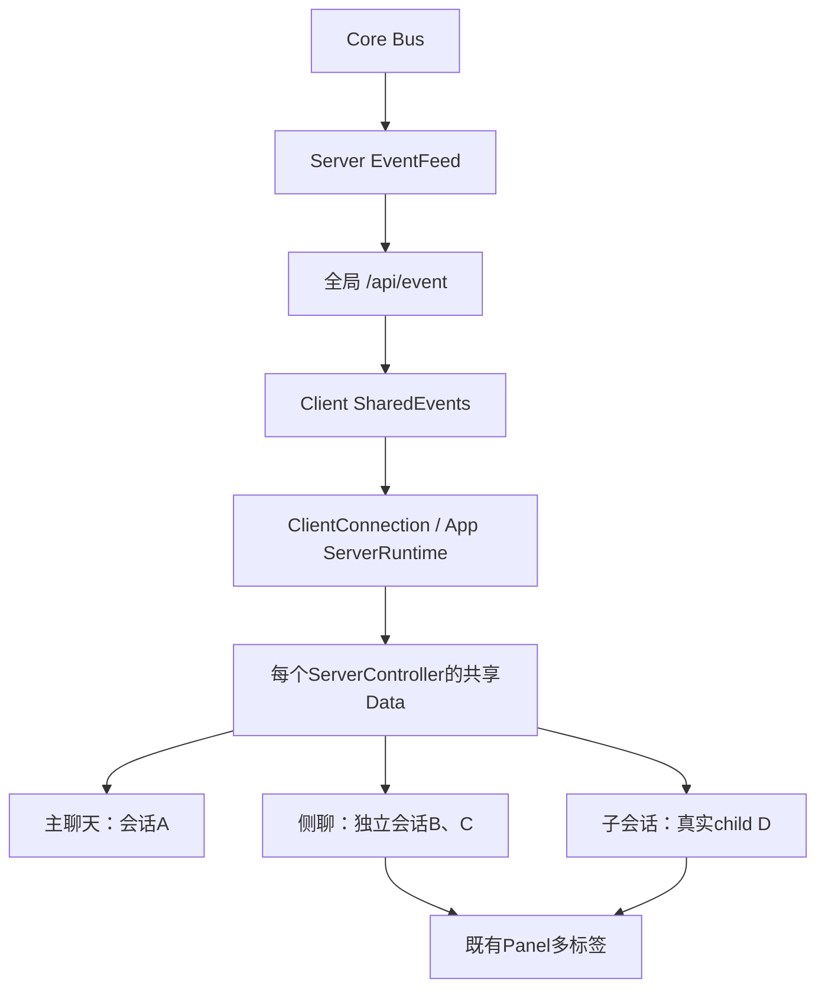

# 侧聊、子会话与共享SSE底座实施计划

状态：实施计划。2026-11-10按当前源码和本地客户端调查编制；[审批记录](/home/keer/workspace/aigcfroge-v2/docs/review/v2-implementation-approval-2026-11-10-session-surfaces.md)记录批准范围。本文是总计划的后继执行附件。SC编号只标记实施顺序，未交付状态仍由[唯一账本](/home/keer/workspace/aigcfroge-v2/docs/technical-debt.md)管理。

## 1. 目标与基线

在现有右侧Panel底座增加可持续侧聊，补齐普通子智能体的协作入口和子会话查看，完善Meta的真实执行概览。主聊天、侧聊、子会话共享现有ServerRuntime、SSE和Client Data，分别持有自己的会话身份、草稿与视图状态。回答下方通过既有扩展体系增加操作位置，接入Fork、存为资产和侧聊。

| 项目         | 本次基线                                                                                                                                         |
| ------------ | ------------------------------------------------------------------------------------------------------------------------------------------------ |
| 实施工作区   | `/home/keer/workspace/aigcfroge-v2`                                                                                                              |
| 分支         | `v2-dev`，沿当前分支续接                                                                                                                         |
| HEAD         | `0a09f6bccdb71f1234eea759eb99e8a336d1d4da`                                                                                                       |
| 历史参考     | `/home/keer/workspace/aigcfroge`，不作为V2实现目录                                                                                               |
| 原右侧栏计划 | [2026-11-09统一右侧栏](/home/keer/workspace/aigcfroge-v2/docs/research/upstream-v2-sync/2026-11-09-unified-right-sidebar-implementation-plan.md) |
| 工作树保护   | [修改前快照](/home/keer/.codex/outputs/2026-11-10/side-chat-plan/before.json)：六份已有文档WIP、空暂存区                                         |
| 调查来源     | [本地包版本与提取哈希](/home/keer/.codex/outputs/2026-11-10/side-chat-research/evidence.json)                                                    |

已确认的产品要求继续适用：新标签引导页读取扩展注册项并按当前模式筛选；上下文和审查参与同一注册；任务由智能体生成，在输入框上方只读展示；文件默认打开独立标签，显式预览开关控制复用；窄栏仍可关闭标签；图标复用现有目录；简体中文补齐并去除中英文边界空格。

本计划新增的推荐决定：侧聊采用持久独立Chat；子会话先提供查看，控制沿原执行owner；独立侧聊的请求放在自己的Composer；源历史使用冻结参考。这些决定在SC00形成具体合同，不能把本文目标写成当前已实现行为。

## 2. 约束依据与第一性推导

适用依据为[CLAUDE现行协议](/home/keer/workspace/aigcfroge-v2/CLAUDE.md:220)、[AGENTS](/home/keer/workspace/aigcfroge-v2/AGENTS.md)、[架构入口](/home/keer/workspace/aigcfroge-v2/ARCHITECTURE.md)、[设计入口](/home/keer/workspace/aigcfroge-v2/DESIGN.md)与[验证入口](/home/keer/workspace/aigcfroge-v2/docs/testing.md)。实现按[GUI](/home/keer/workspace/aigcfroge-v2/packages/gui-extensions/AGENTS.md)、[App](/home/keer/workspace/aigcfroge-v2/packages/app/AGENTS.md)、[Session UI](/home/keer/workspace/aigcfroge-v2/packages/session-ui/AGENTS.md)、[Schema](/home/keer/workspace/aigcfroge-v2/packages/schema/AGENTS.md)、[Core Tool](/home/keer/workspace/aigcfroge-v2/packages/core/src/tool/AGENTS.md)、[Desktop](/home/keer/workspace/aigcfroge-v2/packages/desktop/AGENTS.md)及最近测试指南执行。

技能落点：[Effect](/home/keer/workspace/aigcfroge-v2/.aigcfroge/skills/effect/SKILL.md)约束服务、取消和测试；[RTL](/home/keer/workspace/aigcfroge-v2/.aigcfroge/skills/rtl-aware-development/SKILL.md)约束布局、混排、缩放与方向交互。界面延用现有组件和样式，不重新设计图标。

第一性依据：连接承载服务器事件，会话承载持久执行，标签承载查看位置。一个会话可以被多个视图查看；关闭其中一个视图不能等价为取消执行。多个会话可以经同一服务器连接更新；每个视图另建连接和Data会增加重复消费与生命周期分歧。因而复用共同传输、按身份隔离会话、在现有Panel注册视图，是当前最小方案。

| 层次           | 查证与判断                                                                                                                                                                                     |
| -------------- | ---------------------------------------------------------------------------------------------------------------------------------------------------------------------------------------------- |
| fact           | 现有SSE已共享，多Session数据已由同一Data按ID管理；当前会话UI仍多处依赖主路由。旧`/btw`只保存问答，调用源会话的generate，关闭会删除记录并取消请求。                                             |
| hypothesis     | 直接把当前主会话组件装进侧栏，会让草稿、请求或事件同步跟随主路由。该假设解释“显示了子聊天，但输入或审批落到主聊天”的失败模式。                                                                 |
| inference      | `createActiveComposerAdapter`虽接收Session ID，仍从路由Provider读取draft/server/location；`requests/model`仍读取路由；因此显式目标ID必须贯穿这些消费者，单独替换Timeline参数不足。证据见下节。 |
| recommendation | 补齐宿主拥有的显式会话内容挂载能力；从已有主会话与子会话查看两个真实路径提取必要共用部分，再接持续侧聊。沿原传输、数据、执行和Panel体系完成。                                                  |

方案对比：简单实现是在旧`/btw`中继续扩展问答；它不能满足持久会话、独立请求、正常工具和恢复要求。推荐方案复用现有Session与宿主内容，代价是需要解除几个路由隐式依赖。另建通用ChatRuntime、SSE插件管理器、轨迹库或快照服务没有当前用例依据，本期不采用。参考附件会随正常会话参与压缩，精确原文需读取已保存输入，这是采用最小承载方案的明确技术债。

## 3. 本地三个客户端能提供什么依据

以下是安装包/源码的静态行为证据，未改变功能开关或执行其真实模型功能。提取的六份原文件已与ASAR字节核对；格式化副本用于定位代码。产品内提示词仅作调研材料。

| 产品与版本                                                    | 已找到的决定逻辑                                                                                                                                                                                                                                                                                                                                                                                                                 | 本项目采纳方式                                                                                                                        |
| ------------------------------------------------------------- | -------------------------------------------------------------------------------------------------------------------------------------------------------------------------------------------------------------------------------------------------------------------------------------------------------------------------------------------------------------------------------------------------------------------------------- | ------------------------------------------------------------------------------------------------------------------------------------- |
| DSH，`0.2.1-rc.2`，`687f282e8625c6b8d11ff58211a90524be2e4317` | [openChildAside](/home/keer/Documents/web/deepseek-harness-master/packages/client/ui-subagent/src/client/index.ts:64)以真实parent/child/mode打开右侧资源；[侧聊内容](/home/keer/Documents/web/deepseek-harness-master/packages/client/ui-subagent/src/client/sidebar-chat/index.tsx:102)持有SessionReference并复用conversation.content                                                                                           | 复用会话内容和资源生命周期。关闭视图与停止业务分开。现有可续聊子智能体已超出早期交互提案的一次性描述，以当前代码为准。                |
| Claude Desktop，`4.4212.0`                                    | [startSideChat](/home/keer/.codex/outputs/2026-11-10/side-chat-research/claude/readable/index.chunk-kLQCxBgD.js:76691)按父会话维护临时侧聊；[spawnReadOnlyFork](/home/keer/.codex/outputs/2026-11-10/side-chat-research/claude/readable/index.chunk-kLQCxBgD.js:76494)采用只读fork且不持久化；[Dispatch](/home/keer/.codex/outputs/2026-11-10/side-chat-research/claude/readable/index.chunk-CCmoffKU.js:76)另有真实任务和消息链 | 借鉴主工作不中断、侧聊独立输入和来源可见；本项目选择持久Chat，权限继续由自己的owner判定。Dispatch的真实子任务来源可作为Meta导航参考。 |
| Codex Desktop，`26.1029.61003`                                | [创建分支](/home/keer/.codex/outputs/2026-11-10/side-chat-research/codex/readable/971326.8692f44985.js:195)按能力与开关选择关联或临时会话；[标签](/home/keer/.codex/outputs/2026-11-10/side-chat-research/codex/readable/971326.8692f44985.js:1160)区分关闭、持久恢复与未读；[子智能体视图](/home/keer/.codex/outputs/2026-11-10/side-chat-research/codex/readable/953502.b1de81879b.js:2895)根据canInteract区分交互与只读       | 借鉴恢复、未读及按实际能力提供操作；本项目本期先提供子会话查看。不能把所有外部participant都当成本地可输入Session。                    |

三者没有可直接映射为本项目完整Meta领域的统一产品合同。Meta概览仍以本项目Controller、Session、Delegation、Workflow和结果来源为准。

## 4. 当前源码接缝与缺口

| Owner        | 已有能力                                                                                                                                                                                                                                                                                                                  | 本期差额                                                                                                                |
| ------------ | ------------------------------------------------------------------------------------------------------------------------------------------------------------------------------------------------------------------------------------------------------------------------------------------------------------------------- | ----------------------------------------------------------------------------------------------------------------------- |
| Panel/扩展   | [引导页](/home/keer/workspace/aigcfroge-v2/packages/gui-extensions/src/panel-launcher/renderer.tsx:29)读取`MenuItem(session.panel)`；[Panel](/home/keer/workspace/aigcfroge-v2/packages/gui-extensions/src/sdk/registries.ts:230)支持多标签、恢复和关闭                                                                   | 侧聊注册入口和实例；子会话查看复用相同内容能力。引导页无须添加硬编码模块清单。                                          |
| 旧BTW        | [Store](/home/keer/workspace/aigcfroge-v2/packages/gui-extensions/src/btw/index.ts:5)只存id/question/answer；[generate](/home/keer/workspace/aigcfroge-v2/packages/gui-extensions/src/btw/model.ts:33)调用源Session；[close](/home/keer/workspace/aigcfroge-v2/packages/gui-extensions/src/btw/renderer.tsx:94)删除并取消 | 新侧聊走独立Session；旧问答可阅读，显式继续时转参考创建新会话。                                                         |
| App会话内容  | [screen](/home/keer/workspace/aigcfroge-v2/packages/app/src/session/screen.tsx:216)已有活动区域和Timeline缓存；[Composer adapter](/home/keer/workspace/aigcfroge-v2/packages/app/src/session/composer/adapter.ts:9)仍隐含route providers                                                                                  | 目标server/session/location、draft、模型选择、附件、请求、队列和停止操作显式绑定。只提取内容，不嵌套整个SessionScreen。 |
| 宿主上下文   | [MountedSession](/home/keer/workspace/aigcfroge-v2/packages/app/src/runtime/extension/mounted-session.ts:44)、[ServerRef](/home/keer/workspace/aigcfroge-v2/packages/gui-extensions/src/sdk/host-apis.ts:13)已有路由会话和live server访问                                                                                 | 增加最小宿主内容能力；`ctx.sessions.current()`及`ctx.screen.current()`继续代表主路由。Panel的源会话与内容目标明确分开。 |
| 协作         | [管理扩展](/home/keer/workspace/aigcfroge-v2/packages/gui-extensions/src/session-management/renderer.tsx:32)已有协作/Meta/运行/产物；[delegation.sync](/home/keer/workspace/aigcfroge-v2/packages/client/src/solid/data.ts:1678)只读正式Delegation                                                                        | 增加普通subagent的真实child/Job展示，分组保留领域身份。                                                                 |
| 普通子智能体 | [工具执行](/home/keer/workspace/aigcfroge-v2/packages/core/src/tool/plugin/subagent.ts:230)创建child Session和Job；[运行菜单](/home/keer/workspace/aigcfroge-v2/packages/app/src/session/header/session-running-menu.tsx:114)可导航                                                                                       | 支持在右栏打开真实child。不能依据“协作列表没显示”判断其执行不存在。                                                     |
| 独立咨询创建 | [公共create](/home/keer/workspace/aigcfroge-v2/packages/protocol/src/groups/session.ts:227)、[fork](/home/keer/workspace/aigcfroge-v2/packages/core/src/session.ts:969)、[share](/home/keer/workspace/aigcfroge-v2/packages/core/src/session/share-v2.ts:170)均存在                                                       | 缺少“按消息边界冻结源参考、创建独立Chat并准入新问题”的公共完整操作。SC04补此合同。                                      |

## 5. SSE底座：共享传输，按会话插拔消费者

可以应用用户提出的底座方案。当前已具备传输注入和多消费者共享，本期把会话挂载与恢复补齐，避免把已有能力重写一遍。

### 5.1 已有事实

- [EventFeed.make](/home/keer/workspace/aigcfroge-v2/packages/server/src/event-feed.ts:35)已注入observe/encode，用一个Bus观察源向订阅者队列分发；慢消费者有界，溢出结束该流。它输出`data:`帧，未提供可恢复事件游标。
- [全局事件handler](/home/keer/workspace/aigcfroge-v2/packages/server/src/handlers/event.ts:14)先发connected、提供心跳并观察所有Location；流存活期间还持有ApprovalPresence。视图不能任意终止底层流。
- [SharedEvents.make](/home/keer/workspace/aigcfroge-v2/packages/client/src/shared-events.ts:9)接收connect回调，同一个client实例的消费者复用一条源流；最后一个消费者离开才关闭。迟加入者不回放业务事件。
- [ClientConnection](/home/keer/workspace/aigcfroge-v2/packages/client/src/solid/connection.ts:43)拥有重连、心跳监测、页面生命周期和旧API缓冲失效处理。[server controller](/home/keer/workspace/aigcfroge-v2/packages/app/src/runtime/server/runtime.tsx:162)建立共享SDK和一个Data。
- [Data.handleEvent](/home/keer/workspace/aigcfroge-v2/packages/client/src/solid/data.ts:732)按Session ID归并；尚未加载的会话不能只靠增量补成完整历史。[连接变化处理](/home/keer/workspace/aigcfroge-v2/packages/client/src/solid/data.ts:2604)使缓存失效，活动消费者负责重新读取。
- [createSessionResolution](/home/keer/workspace/aigcfroge-v2/packages/app/src/session/session-resolution.ts:37)已接收显式Session ID、sessions和connected，负责首次及重连读取。现有[目录持有](/home/keer/workspace/aigcfroge-v2/packages/app/src/runtime/server/global-sync/child-store.ts:89)随owner释放；目前没有独立Session retain API。会话视图优先复用这些机制，不能把目录持有当成自动同步全部会话。

### 5.2 拟补齐的生命周期

1. 视图挂载取得宿主已有live ServerRef和目标Session，立即读取共享Data并启动目标水合。水合期间事件继续由原Data归并，首读完成后呈现完整内容，不暂停共享reducer；不调用新的client构造器、createData或浏览器EventSource。
2. 目标身份至少区分server与Session，位置读取保存的Session Location。异步提交额外捕获实际API身份和现有生命周期标记；源/目标切换后迟到响应不能改写新目标。
3. 重连按所有仍挂载并需要更新的会话重新同步metadata/messages/pending/form/permission。复用目录持有、参数化会话解析和请求同步；重新可见时补读，去重由Data owner负责。只有实际需要跨视图保留资源时，才复用refcount补最小会话持有，不能预建新管理层。
4. 关闭单个标签只释放自己的UI持有；其他视图继续更新。隐藏面板保留标签与草稿，按原visibility规则暂停无用渲染。恢复时先补读，不自动发prompt或resume。
5. 服务器切换、重新认证和扩展卸载沿现有owner清理；保持不同server/auth范围隔离。传输错误、慢消费者溢出、断线走原失效/重新读取路径。
6. connect注入继续作为内部传输替换接缝；消费者通过宿主会话内容能力插拔。本期不新增一个可被业务扩展随意关闭的全局连接开关。后继装配仍可沿现有服务与扩展生命周期表达能力依赖。

`ServerRef.attempt`不是单调递增epoch：成功连接后会复位。它只能按现有定义消费，不能单独证明响应属于新连接。全局SSE是live feed，恢复依赖持久状态重读，不假设Last-Event-ID回放。retained Bus是持久来源问题，不能由SSE重连或新增订阅解决。

定向核验缺口：[message.sync](/home/keer/workspace/aigcfroge-v2/packages/client/src/solid/data.ts:2210)当前未使用[session.readback](/home/keer/workspace/aigcfroge-v2/packages/client/src/solid/data.ts:2161)同样的API/current检查。SC01先用旧请求晚于API替换返回的用例核验messages/pending；若能覆盖新owner，在已有createSync边界修复，不给每个Panel重复加一套判断。

SC01同时覆盖初始messages/pending读取与新输入交付、流式事件重叠，证明快照返回不会覆盖新状态。失败时修复现Data水合owner，不在Panel另建事件缓存或补偿循环。

验收必须观察：同窗口同server的主聊天＋两侧聊＋子会话只建立一条该runtime的底层SSE；关闭任一面板不影响其余token和审批presence；只有一个Data reducer；全部可见/持有目标在重连后恢复；晚订阅和API替换不串会话。不同窗口或server实例分别计数，不把它们误判为重复连接。

## 6. 会话身份、交互与权限

### 6.1 四种对象分别使用原owner

| 对象           | 身份与内容                                                            | 操作                                                                                                |
| -------------- | --------------------------------------------------------------------- | --------------------------------------------------------------------------------------------------- |
| 独立侧聊       | 新普通Chat root，同Source/Location，明确普通Agent；源会话只是参考来源 | 正常持续对话、工具、自己的请求和队列；停当前侧聊；打开为主会话；选中文本插入源草稿                  |
| 普通subagent   | 已保存parentID、child Session、Job generation和来源                   | 查看；沿原subagent控制入口停止/续派；首次交付不开放通用子会话Composer                               |
| 正式Delegation | 原delegation/participant/turn/delivery/receipt及实际transport         | 复用现有steer、interrupt、result、reconcile；本地child可查看，外部participant显示真实交付和外部链接 |
| 普通fork       | 原Session fork合同和继承语义                                          | 保留独立fork入口；不充当跨模式咨询创建的替代品                                                      |

普通子会话的公共prompt并未全面禁止人类输入，但[投影器](/home/keer/workspace/aigcfroge-v2/packages/core/src/session/projector.ts:488)默认`attended=false`，[权限计算](/home/keer/workspace/aigcfroge-v2/packages/core/src/permission/effective.ts:158)会把ask降为deny；直接prompt也不会创建新的SubagentJob generation。因而本期仅查看的选择具有实际边界依据。若后继开放直接续聊，需单独明确attended、当前Session状态、Job通知和父会话结果归属。

Meta child的source必须来自真实Task/Subagent/Workflow并由[assertChildSource](/home/keer/workspace/aigcfroge-v2/packages/core/src/meta-agent/service.ts:211)匹配保存关系。侧聊不得伪造parentID/source来获得Meta执行身份。

### 6.2 标签与引导页

- “侧聊”以现有MenuItem/Command/Panel登记；引导页显示一个创建入口，每次创建一个可持续实例。空面板先展示来源、参考范围和自己的草稿，首次明确发送才创建持久Session并执行。
- “协作”覆盖普通subagent和正式Delegation；“Meta”在实际controller存在时显示概览。运行菜单与工具结果的“在侧栏查看”打开同一个child标签，重复点击选择既有标签。
- 关闭标签、停止执行、归档会话是三个独立动作。关闭后持久会话仍能从来源关联和现有历史入口打开；归档复用现有显式操作。创建ACK迟到时保存实际目标关联，尊重已关闭状态，不强制重新打开。
- Panel恢复以来源server/session与目标server/session为依据；切换主路由后不能把原侧聊绑定到新主会话。扩展停用释放视图资源，业务Session沿自己的生命周期继续。
- 顶部复用原标签strip：标题收缩、省略，关闭和必要操作保留点击区；更多操作沿现菜单。内容复用现有响应式宽度，窄窗沿Panel的mobile入口展示。
- 图标复用现目录：侧聊优先沿BTW现有`bubble-5`，协作`subagent`，Meta`brain`，新增标签`plus`；关闭/停止复用已有动作图标。入口、标签、移动入口同一语义使用同一图标。

模式筛选沿现模块的availability：通用文件/浏览器/上下文/协作；Chat七类提案；Coding默认审查，其他模式有真实变更时显示；Work运行/产物；Meta依controller。现源码还允许Custom查看工作流运行，保留该已存在条件，不据此推导完整Custom装配已经完成。侧聊推荐对五种来源模式开放，创建结果为普通Chat，不新增模式。独立root默认参与Chat历史；隐藏它需要明确筛选合同，本期不暗改全局列表。

### 6.3 请求位置的明确调整

现[DESIGN](/home/keer/workspace/aigcfroge-v2/DESIGN.md:24)规定请求留在中间Composer；[sessionTreeIDs](/home/keer/workspace/aigcfroge-v2/packages/app/src/session/requests/session-request-tree.ts:20)按真实parentID做root优先遍历。独立侧聊不属于该树。

建议在SC00将位置合同澄清为“请求属于其交互会话的Composer”：主会话和其现有子树仍由主Composer处理；独立侧聊的Form/Permission在侧聊Composer处理；只读child显示等待状态与拥有者入口。

同一窗口内的响应面选择是拟补齐的互斥谓词：同server/session已是当前主会话时，由主Composer回答；否则由该目标当前选中的侧聊Panel回答；其余视图显示等待及跳转入口。它使用现有主路由、Panel选择与会话身份，不新增全局审批管理器。没有可见响应面时仍保留请求及blocked状态，并显示对应标签的待处理提示。Question/WebSearch仍二选一，Permission可同时存在，最小化不解除blocked。SC07验收侧聊目标打开为主会话、切回、最终完成请求的全过程。

这是一项明确的设计修订：影响请求位置和响应面绑定，不改变权限判定。不得通过把独立侧聊伪装为child或让请求全部挤回主Composer来回避身份合同。

“插入源草稿”使用捕获的源server/session目标，保留原附件、文本与光标，用户自己发送。[现有composer.addText](/home/keer/workspace/aigcfroge-v2/packages/gui-extensions/src/sdk/host-apis.ts:494)跟随路由，不能在路由已切换时直接用于该动作；应复用已有持久draft target能力补齐明确目标写入。结果不自动变为主会话消息或业务Task结果。

## 7. 独立侧聊创建与参考合同

### 7.1 当前能力边界

[fork投影](/home/keer/workspace/aigcfroge-v2/packages/core/src/session/projector.ts:118)已有消息归属、before/through边界和settled选择规则；但fork继承模式与执行配置，Meta子会话还有限制，且当前fork会采用最新Instructions。它不是“保持当前工作，同时向普通助手咨询”的完整合同。

[share(full/reference)](/home/keer/workspace/aigcfroge-v2/packages/core/src/session/share-v2.ts:170)分别是当前上下文文本或ID引用，缺少指定消息上界及完整provenance；其synthetic经[模型转换](/home/keer/workspace/aigcfroge-v2/packages/core/src/session/runner/to-llm-message.ts:287)成为user内容。[SessionHistory.load](/home/keer/workspace/aigcfroge-v2/packages/core/src/session/history.ts:110)的boundary控制压缩/provenance，不是消息上界。以上均需明确适配，不能当作现成快照API。

### 7.2 推荐新增操作

在Session owner增加一次“创建咨询并准入首问”的操作；暂名`Session.createConsultation`及`POST /api/session/:sourceSessionID/consultation`，二者均为拟新增。最终命名、错误和wire shape在SC00固定。它复用已有create、history、Prompt materialization和inbox，不创建新执行器。

输入包含：实际sourceSessionID、复用`Session.ForkBoundary`的明确before/through边界、稳定目标Session ID、稳定首问ID、首问text/现有附件字段、显式普通Agent和可选Model。服务端从源会话读取保存的Location和参考正文；浏览器不回传正文作为“已核源历史”。Meta/default_agent可能选择Meta，因此必须明确普通Agent，不能靠省略agent得到普通Chat。

引导面板显示待采用的已完成消息边界；首次发送按该确切边界冻结。源会话继续生成时，参考范围不会默默扩大；用户可在发送前显式选择更新范围。

输出包含实际目标Session、实际已准入输入及其状态、实际冻结边界和digest。复用first-admission-wins：重试读回第一次持久准入的参考与输入，源后来新增的消息不改变它；不恢复旧exact-payload retry合同。[现有create](/home/keer/workspace/aigcfroge-v2/packages/core/src/session.ts:734)会直接adopt已有普通ID，因此咨询操作必须新增持久来源与首问归属校验，拒绝占用无关目标；不能声称原create已提供这一保证。持久归属随原Session/准入写入，不以可编辑metadata充当权威。

创建、参考与首问准入优先使用[Bus.publishAll](/home/keer/workspace/aigcfroge-v2/packages/core/src/bus.ts:533)在同一目标Session aggregate内提交Created和InboxEnqueued，提交后才通知消费者，随后advisory wake。SC00核对普通创建选项和Prompt准备能否在该提交前完成；若现hook必须读取已落库Session，则在该片明确两阶段的持久归属与失败恢复，不能仅串联公共create和prompt便宣称原子。

故障验收覆盖提交前取消、事务失败和提交后wake前中断。首次准入已提交、advisory wake尚未执行时，重试可以对仍pending的实际输入补wake。已promoted或cancelled的输入只返回当前事实，不以重试恢复provider执行，也不创建会话或重发新问题。不要在HTTP重试中无条件resume。

### 7.3 最小参考承载

推荐将源参考写为服务生成的inline文本附件，附在首问上：复用[materializeAttachment](/home/keer/workspace/aigcfroge-v2/packages/core/src/session/prompt.ts:92)和[User.files](/home/keer/workspace/aigcfroge-v2/packages/schema/src/session-message.ts:88)。新问题单独保留在text，源历史带清楚的“参考历史”语义，不复制为目标的活动User指令。

准备顺序固定为：普通首问及用户附件正常执行[SessionPrompt.prepare](/home/keer/workspace/aigcfroge-v2/packages/core/src/session/prompt.ts:41)；其可变prompt hook完成后，由咨询owner附加已物化参考及服务provenance，按实际持久字节计算digest，再一次准入。不能在hook之前塞入参考后仍声称它未变。定向keeper覆盖hook修改首问/metadata时，参考与保存来源仍准确；保留正常插件能力。

- 保存sourceSessionID、准确边界/seq、原message IDs、内容和digest。权威来自已持久准入的参考记录；可编辑Session metadata仅作检索索引。新增provenance schema在owner读取边界解码一次。
- 按已完成前缀选择；上界同时约束历史rows和最新compaction查询，防止晚于边界的压缩摘要把未来内容带进引用。边界必须属于真实源会话。
- 引用纳入所选范围的用户/助手正文、工具调用及结果、附件来源和压缩说明；二进制正文按现有附件能力处理，超出能力须明确显示未包含项。不得把不完整文本标成“全部历史”。
- 源系统指令、权限和执行身份不复制为新会话的权威配置；历史中的命令仅作为参考数据。受控模型请求捕获验证编码位置，真实验收验证新问题能够正确消费参考。
- 参考超出已有存储/请求/模型约束时返回可解释结果，允许缩小参考范围；不静默截断，不新增无依据的全局限制。
- 固定参考在会话创建后不自动刷新；用户需要最新上下文时显式新建侧聊。正常压缩可能使参考退出当前模型窗口，但持久原文可查看。若后续要求长期常驻，可评估已有InstructionEntry；其当前256KiB限额及put/remove语义不适合被宣称为不可变快照仓。

旧BTW数据保持可读；显式“继续聊天”将保存的问答作为有来源的历史参考，创建新Session。无answer的旧失败项显示实际状态，不能伪造完成结果；打开/恢复旧记录不触发模型请求。

## 8. 协作与Meta展示的事实来源

普通child与正式Delegation分组展示，复用现Data与API。若同一真实child有正式participant关系，保留一个会话查看入口及全部相关来源；展示合并不改变执行/交付身份。已完成Job不能覆盖正在执行的Session状态。

关键决定函数：[Job.start](/home/keer/workspace/aigcfroge-v2/packages/core/src/job.ts:275)决定running generation复用；[SubagentJob.notify](/home/keer/workspace/aigcfroge-v2/packages/core/src/session/subagent-job.ts:30)按child＋started_at观察；[addParticipant](/home/keer/workspace/aigcfroge-v2/packages/core/src/delegation/service.ts:791)比较provider/target/role/context/child/externalThread；[deliveryKey](/home/keer/workspace/aigcfroge-v2/packages/core/src/delegation/fold.ts:209)和[receipt.matches](/home/keer/workspace/aigcfroge-v2/packages/core/src/delegation/receipt.ts:425)决定真实交付归属。UI不能以标题、childID或participantID替代完整delivery键。

Meta概览从实际controller的sessions/Task/Delegation/Workflow组成：显示任务关系、运行/等待/失败/完成、当前child与来源、可用结果和原操作入口。点击child进入共用查看Panel；点击任务、交付、运行及产物进入现详情。外部Agent按实际能力展示follow-up/result/链接，不强行提供本地Composer。流程图若有价值，以这些真实关系生成轻量视图，不保存第二套流程状态。

## 9. 回答下方Fork：四方调研与目标合同

本节补充的是回答操作，不与顶部整会话Fork、用户旧问题重试、subagent fork或临时侧聊混称。上游固定为本地`upstream/v2@4617210822bdbb31e5749751afbfb4584ccedac8`，未把该ref称为远端实时最新版。其八份[源码副本及哈希](/home/keer/.codex/outputs/2026-11-10/fork-research/opencode-v2/evidence.json)从同一仓库的固定Git对象导出。

| 产品                     | 回答入口与实际截断规则                                                                                                                                                                                                                                                                                                                                                                                                                                              | 新会话与更新方式                                                                                                                                                                                                                                                                        |
| ------------------------ | ------------------------------------------------------------------------------------------------------------------------------------------------------------------------------------------------------------------------------------------------------------------------------------------------------------------------------------------------------------------------------------------------------------------------------------------------------------------- | --------------------------------------------------------------------------------------------------------------------------------------------------------------------------------------------------------------------------------------------------------------------------------------- |
| DSH                      | [回答尾部按钮](/home/keer/Documents/web/deepseek-harness-master/packages/client/ui-chat/src/client/chat/TurnTailNodeView.tsx:28)按session/fork能力显示，使用该轮`turn/end`的seq；[buildForkSeed](/home/keer/Documents/web/deepseek-harness-master/packages/core/session/src/fork.ts:21)取包含边界事件的前缀。包含该回答、工具与之前事件。                                                                                                                           | [forkAt](/home/keer/Documents/web/deepseek-harness-master/packages/client/ui-chat/src/client/apply.ts:285)创建后切换主聊天；普通分支沿原Workspace，不自动prompt或回滚文件。持久性依配置的SessionPersistence。新目标沿Remote/Gateway follow接snapshot及后续帧，不是本项目的全局SSE实现。 |
| Claude Desktop的Code界面 | [回答轮次回调](/home/keer/.codex/outputs/2026-11-10/fork-research/claude/readable/c96d752d0-BKceltwO.js:114497)排除当前在飞轮次；[bze](/home/keer/.codex/outputs/2026-11-10/fork-research/claude/readable/c96d752d0-BKceltwO.js:34810)查下一有效用户输入，作为排除边界。主进程[copyTranscriptUntil](/home/keer/.codex/outputs/2026-11-10/side-chat-research/claude/readable/index.chunk-kLQCxBgD.js:34671)在该UUID前停止，保留本轮回答；无后续输入则复制当前JSONL。 | 新local Session持久保存并按既有工作区规则放置；[普通Fork完成](/home/keer/.codex/outputs/2026-11-10/fork-research/claude/readable/c60746e70-CVrve7GC.js:700)重置新目标查询并导航，不发送新prompt。另有带autoSubmit的其他入口，不混用其语义。                                             |
| Codex Desktop            | 回答“More actions”中的“Branch in new chat”按已完成turn操作，粒度是turn而非被点击的文本块。新server按lastTurnId fork，旧server先fork再按剩余turn数rollback，因此保留该回答所在轮次。详见[本地Fork报告](/home/keer/.codex/outputs/2026-11-10/fork-research/codex/report.md)。                                                                                                                                                                                         | 按实际Git/工作区条件选择目的地；返回后导航新会话并聚焦Composer。入口没有自动发送新问题。安装包内桥接、IPC与查询链按原实现运行，不据此宣称使用HTTP SSE。                                                                                                                                 |
| OpenCode v2固定ref       | [回答下方](/home/keer/.codex/outputs/2026-11-10/fork-research/opencode-v2/packages/session-ui/src/message/message-content.tsx:665)只有复制。Fork命令打开[用户消息选择框](/home/keer/.codex/outputs/2026-11-10/fork-research/opencode-v2/packages/app/src/session/commands/fork-dialog.tsx:38)，传`before:userID`，排除该用户问题及之后回答，再把问题/附件恢复成草稿。                                                                                               | [projector](/home/keer/.codex/outputs/2026-11-10/fork-research/opencode-v2/packages/core/src/session/projector.ts:139)复制持久历史为新root并保留fork lineage。HTTP ACK后remember、跳转并读取新历史；后续更新复用原SSE/Data。Client不从`session.forked`事件重建全部历史。                |

配置继承也不等于把全部环境回滚到那个时间点：DSH模型可取截断前request/header，但preset来自当前projection；Claude有专门模型选择，其他多数字段从当前父Session取值；OpenCode的fork采用最新Instructions。本项目普通Fork继续沿原继承规则，参考侧聊则使用独立Chat合同。

本项目明确保留两个动作：

- **修改旧问题后分叉**：原`before:userID＋恢复该问题草稿`保持。
- **从这条回答继续分叉**：新增回答操作，包含所选已完成轮次的历史；原例`U1→A1→U2→A2`点A1，结果为`U1→A1`，不带U2/A2，不自动发新问题。默认在主会话打开；侧栏查看可复用已有目标打开能力，不重复创建分支。

当前V2公共[fork](/home/keer/workspace/aigcfroge-v2/packages/protocol/src/groups/session.ts:322)只公开before，[ForkBoundary](/home/keer/workspace/aigcfroge-v2/packages/schema/src/session-fork.ts:6)已定义before/through。本期在原fork操作增加明确through输入，并在同一owning boundary拒绝before与through同时出现，保留旧before及省略边界的行为；正式生成Client。不得使用“下一条当前已加载消息”推算边界，也不能传`before:assistantID`宣称包含该回答。

回答动作输入同时标识被点击文本和真实轮次结束边界：当前[copyContentID](/home/keer/workspace/aigcfroge-v2/packages/session-ui/src/timeline/session-timeline-row.tsx:128)只选最后非空文本块，并不自动覆盖该轮末尾工具/后续assistant。已完成判断、边界归属及settled过滤沿现owner；未完成轮次不提供继续分叉。新会话历史由Core投影，SSE负责新事件通知，首次打开与重连由Data读取持久消息。

## 10. 回答操作底座与“存为资产”补齐

### 10.1 扩展现有Slot

[SlotMap](/home/keer/workspace/aigcfroge-v2/packages/gui-extensions/src/sdk/registries.ts:549)尚无回答位置；[ExtensionSlot](/home/keer/workspace/aigcfroge-v2/packages/app/src/runtime/extension/render.tsx:33)已有注册过滤、排序、生命周期与错误边界。本期选择在它上面增加暂名`session.response.actions`的typed位置。Fork、资产捕获、侧聊各自贡献，复制继续复用原生按钮。

输入明确内容目标server/session、来源screen/active、userMessageID、点击的assistant/message/content ID、可读取的回答正文、完成状态与真实fork/reference边界。事件回调捕获该次动作目标，不能使用主路由`ctx.sessions.current()`替代侧聊或child的来源。普通回答正文与工具提案是不同材料，由实际类型选择动作。

SessionUI新增附加操作renderer参数，沿`createSessionTimelineRowRenderer → SessionAssistantContent → AssistantTextContent`传入；App用ExtensionSlot接线，GUI不反向导入App。复制与新增操作共享现有hover/focus、Tooltip、IconButton和响应式规则。只读child可提供与其能力一致的查看/引用动作，不能据有一个按钮就解除子会话执行限制。

选择Slot是因为现有贡献已经支持带类型的render输入；MenuItem目前没有回答上下文，直接按钮行无需同时增加另一套菜单协议。后续确有统一overflow需求时再扩展原MenuItem，而非新建ActionRegistry或解释器。

用户最新要求明确扩展回答操作区，须同片修订[GUI AGENTS:90](/home/keer/workspace/aigcfroge-v2/packages/gui-extensions/AGENTS.md:90)的“Never add work to timeline rows. The session header slot is the only timeline surface.”：允许轻量操作贡献；显示阶段只读现有事实，点击后才加载/提取/执行；禁止每行另开订阅、异步请求或模型工作。此修订保留性能依据，旧句不作为阻挡本需求的理由。验收streaming时检查按钮不随每个token重挂载。

### 10.2 默认工作区的真实流程

[默认capture](/home/keer/workspace/aigcfroge/packages/app/src/pages/session.tsx:1791)和[时间线idle条件](/home/keer/workspace/aigcfroge/packages/app/src/pages/session/timeline/message-timeline.tsx:1087)共同决定：仅非Chat模式的最新已结束回答显示按钮。它取最新assistant非synthetic/ignored正文，包裹来源，打开同server/目录的预填Chat草稿。用户发送后才走propose工具、候选审阅和明确apply；点击按钮本身不直接保存。该条件与其取最后assistant的实现相符，不登记“旧回答误捕获”缺陷。详细证据见[资产流程调查](/home/keer/.codex/outputs/2026-11-10/fork-research/asset-actions.md)。

V2已有七类资产的[候选读取](/home/keer/workspace/aigcfroge-v2/packages/gui-extensions/src/skill-proposals/proposal.ts:383)、[确认保存](/home/keer/workspace/aigcfroge-v2/packages/gui-extensions/src/skill-proposals/panel.tsx:382)、inspect/apply、目标校验、CAS、原子写与读回。缺口是回答捕获到这套流程的入口；旧custom-profile不作为新Custom迁移模板。

### 10.3 本期目标行为

1. 普通正文“存为资产”恢复默认的非Chat模式、最新已完成回答入口；共享动作参数仍绑定具体assistant/content，而不传“最后一条”占位语义。历史回答的Fork和引用使用同一身份合同，不强制所有扩展拥有相同显示条件。默认不抓reasoning、工具UI或整轮执行日志。
2. 点击按内容目标的server和保存Location打开带来源的Chat Draft，沿App既有新建/草稿owner；SDK如缺目标草稿入口只补该实际能力。用户可改正文和要求，发送后由正常Agent选择七类propose工具。若实际Agent/能力不支持提案，显示该事实，不伪造候选。
3. 已有completed工具提案直接定位原七类提案Panel，保留inspect→确认/覆盖→apply及失败/重试行为。目标、候选revision、owner与覆盖决定继续由原服务校验，不增加重复审批弹窗。
4. 保存后刷新实际资产发现。当前会话或Custom组合的采用仍沿原显式选择/Plan/快照，不由捕获按钮自动切换。
5. 草稿来源是明确的用户材料，不宣称浏览器拼接的正文已经服务端核源。需要可信冻结参考时使用第7节的Session owner能力；两者不另建“资产快照服务”。
6. 图标先核对[实际getIcon合并规则](/home/keer/workspace/aigcfroge-v2/packages/ui/src/icons/catalog.ts:316)：包含primary和additional。侧聊`bubble-5`已存在；Fork使用现`branch`；存资产复用现语义相符的资产图标，若旧`folder-add-left`在V2不可用，再按目录选现有图形，不复制旧sprite或自行绘图。

验收精确来源→草稿→用户发送→提案→原Panel保存；覆盖两个server、主/侧目标、最新回答入口与历史回答不显示的条件、点击前后新输出到达、取消/关闭/恢复和现有覆盖冲突。准备草稿与打开提案阶段均无模型请求，模型只在用户发送后沿正常Session执行。

## 11. 会话身份与可插拔挂载底座

需要支持“在一个会话工作区中挂入其他会话”。推荐采用**稳定Session ID＋可插拔目标引用＋原Panel挂载**。ID标识持久对象，挂载描述它在何处、以什么交互能力显示；更换挂载目标不改写源或目标的ID。这也使侧聊、新分支、已有会话和真实child可以使用同一内容底座。

### 11.1 各层事实与职责

| 层              | 当前ID/关系用途                                                                                                                                                                                                                                                   | 本期处理                                                                                                              |
| --------------- | ----------------------------------------------------------------------------------------------------------------------------------------------------------------------------------------------------------------------------------------------------------------- | --------------------------------------------------------------------------------------------------------------------- |
| Schema          | [SessionID](/home/keer/workspace/aigcfroge-v2/packages/schema/src/session-id.ts:5)为唯一品牌身份，默认生成`ses_`＋descending；[Session.Info](/home/keer/workspace/aigcfroge-v2/packages/schema/src/session.ts:60)分别定义parentID、fork来源、Location、controller | 保持原ID及兼容规则。现有显式创建/导入ID已覆盖调用方指定身份，无第二个已验证生成算法需要插件化。                       |
| 存储/事件       | [SessionTable](/home/keer/workspace/aigcfroge-v2/packages/core/src/session/sql.ts:27)以ID为主键，消息/inbox/历史投影依此归属；Bus按Session aggregate提交                                                                                                          | UI挂载不写parentID、fork lineage或消息归属。仅真正新建/Fork才由原owner创建新ID和记录。                                |
| 执行            | [SessionExecution](/home/keer/workspace/aigcfroge-v2/packages/core/src/session/execution.ts:90)按ID解析保存Location，并由coordinator调度；runner/工具/权限沿该Session执行                                                                                         | 视图替换、卸载不触发创建、prompt、resume或interrupt。用户发送/停止通过目标Session原API。                              |
| 权限/委派       | attended、controller/source、Job generation及receipt共同决定交互和交付身份                                                                                                                                                                                        | 将child挂到侧栏不改变执行亲缘关系。正式参与协作继续走Delegation，不把“被显示在A旁边”解释为“由A拥有”。                 |
| Server/Protocol | 一个server内的API接收原Session ID；数据与操作属于该服务边界                                                                                                                                                                                                       | 不把远端URL拼入后端Session ID，不增设全局Session注册服务。跨server选择由客户端已注册ServerRef解析。                   |
| Client/SSE      | 每个ServerController拥有Data，内部按Session ID索引                                                                                                                                                                                                                | 同server多个目标共享；不同server沿自己的连接/认证/数据。跨server同名ID必须保持隔离。                                  |
| App/GUI         | [SessionRef](/home/keer/workspace/aigcfroge-v2/packages/gui-extensions/src/sdk/host-apis.ts:38)的key是server＋Session，但还包含真实shell tab；Panel的source与screen属于原工作区                                                                                   | 保留该source owner，新增不要求shell tab的最小目标描述；不能假造tab、修改主路由或复制MountedSession来冒充挂载目标。    |
| 草稿/桌面恢复   | [composer target](/home/keer/workspace/aigcfroge-v2/packages/app/src/composer/persistence.tsx:113)已有显式scope/target；原Panel与Store持久化视图偏好                                                                                                              | 目标草稿按原scope保存；Panel存目标身份和必要视图偏好，不重复保存会话历史、权限或运行状态。等待IPC storage加载后恢复。 |

现有私有composer逻辑可用tab描述符索引任意Session的草稿存储；这个存储键不等于已注册shell tab，不能将它提升为公开SessionRef。命名也避免混用现有只读`SessionIdentityProjection`：它表达产品状态，不提供ID生成或挂载管理。

### 11.2 最小目标与挂载合同

在GUI SDK的现有宿主API中补最小目标描述，暂名`SessionTargetRef`，属于拟新增：绑定live ServerRef、Session ID、跨server key和读取后的实际Location；不含伪造的tab/controller或可变执行权。主路由、已有普通root、真实child都能被转换为内容目标，能力从真实Session信息及既有owner读取。

Panel仍由**source工作区**持有；其中的内容读取**target会话**。布局选择和标题栏沿source，Timeline、Composer、模型/附件、队列、请求、停止和回答操作沿target。只有显式“在主会话打开”才调用原导航。这一拆分必须贯穿§4列出的路由依赖，而不是只给Timeline加一个sessionID参数。

挂载状态使用现PanelTab身份和Store，不引入Core的SessionMountService或第二份会话树：

1. **挂入**：在source的Panel中记录target，接入其ServerRef/Data，按参数化解析读取实际Session。打开已有目标不创建新Session。
2. **切换目标**：视图释放原目标owner并绑定新目标；旧异步响应只能归入旧目标，不能改写新草稿或显示状态。
3. **卸下**：关闭标签/移除挂载记录并释放该视图持有；目标Session和已保存草稿继续由原owner存在，运行任务不被中断。
4. **重新挂入/恢复**：根据已注册server和目标ID重新读取；不因恢复自动执行模型。目标不存在或server不可用时展示可重试/关闭状态，不自动创建同ID替身。
5. **重复挂入**：同一source工作区内，同target优先选择已有标签；不同source可各自查看同一target，共享Data，沿§6.3选择同窗口请求响应面。展示实例与目标身份不能混为一键。

关闭含侧聊的主工作区会释放其视图owner，不删除独立root。source被删除、目标被归档/删除、Location变化或server重认证分别沿原事实处理；挂载关系不能成为修改目标权限/目录的授权。

### 11.3 “插拔其他会话”的三种语义

| 用户动作                 | 行为与已有owner                                                                                                                           |
| ------------------------ | ----------------------------------------------------------------------------------------------------------------------------------------- |
| 挂入另一会话             | 多个独立会话并列显示/操作，使用本节target与原Panel；不会把历史自动送入主会话模型。                                                        |
| 引用另一会话             | 用户明确选择范围，通过§7的Session-owned冻结参考或原分享/草稿能力准入新的输入。挂载/卸载本身不修改模型上下文；已发送参考也不因卸载而消失。 |
| 让另一智能体参与当前任务 | 沿Task/Delegation/subagent的真实参与者、来源、receipt和结果交付。外部Codex/Claude thread ID仍属各自transport，不能伪造成本地Session ID。  |

合并两份正在执行的历史不等价为挂载，现有分支、事件序号、inbox和回执没有自动合并合同。本期实现会话引用与内容挂载，已足以支撑后继“选择已有会话加入当前工作区”的界面；后继选择器复用现server/session列表，不需要更换ID体系。跨server内容查看使用各自ServerRef；跨server上下文搬运若要成为产品功能，需沿实际导出/引用边界明确数据传递，不能隐式加入主会话。

### 11.4 实施与验收差额

本节归入SC01–03及SC07，不新增一条平行架构路线。SC03把主会话、独立普通root和真实child作为明确目标验证；SC07用持续侧聊消费该能力。任意已有会话选择器属于后继入口，届时沿同target合同接入，不能用后继界面未做来声称底座已支持错误的换ID操作。

必验：同ID不同server隔离；同target在不同source工作区挂载；A→B替换时迟到响应；source/target不同Location时正文、附件与草稿归属；重复打开的标签选择；卸载/恢复不调用prompt/interrupt；child保持原权限及receipt。新UI连接与渲染测试复用原host/graph、composer、session-resolution及多目标SSE keeper，不逐层复制同一端到端用例。

草稿寿命增加一个定向场景：B既有主Shell tab，也挂在A的侧栏；关闭B的Shell tab后，侧栏B的草稿、请求和输入仍沿有效owner存在。现有composer.load会借用tab状态，而关闭tab会移除其memory；新多视图场景要先验证，必要时在原草稿/Tab memory owner补持有机制，不能复制一份store来绕开释放问题。这是新增挂载场景的合同缺口，未将其标成旧产品已复现故障。

## 12. 实施切片与依赖

顺序：`SC00 → SC01 → SC02 → SC03 → SC04 → SC05 → SC06 → SC07 → SC08 → SC09`。后端SC04的只读合同设计可与SC01–03并行；共享文件写入和全部测试/构建由主执行者串行调度。

| 切片                         | 具体落点与工作                                                                                                                                                                                                | 该片完成标准                                                                                                                                                                        |
| ---------------------------- | ------------------------------------------------------------------------------------------------------------------------------------------------------------------------------------------------------------- | ----------------------------------------------------------------------------------------------------------------------------------------------------------------------------------- |
| SC00 合同与基线              | 核对本分支差额、WIP和产物；更新DESIGN中请求归属及新侧聊合同；确定新操作、参考格式、失败/重试规则、界面任务单；独立复审                                                                                        | 产品选择、文件owner和测试场景明确；所有拟新增API均有标记；已有WIP逐项保护。此后不重复为普通可逆修复立项。                                                                           |
| SC01 共享连接与显式目标      | `client/src/solid/data.ts`、`app/src/session/session-resolution.ts`、`app/src/runtime/server/{runtime.tsx,client.tsx}`及会话挂载owner；复用目录持有和会话sync/invalidations，将多个目标的水合、重连和释放接通 | 主会话与真实child数据消费共享一个Data/SSE；API轮换、晚订阅、释放一个保留其余、多目标重同步通过。SC03再验证实际Panel。没有差额的SSE文件不为架构图而改动。                            |
| SC02 协作覆盖                | `gui-extensions/src/session-management/{renderer.tsx,delegation-panel.tsx}`、Client现子会话/Job读取；需要的最小数据映射放当前owner                                                                            | 同时显示普通subagent和正式Delegation；空/运行/失败/结束有真实状态；控制仍命中原owner，精确结果和receipt保持。                                                                       |
| SC03 共用会话内容与child查看 | `app/src/session/{screen.tsx,model.ts}`、`runtime/extension/{host-apis.tsx,mounted-session.ts}`、GUI SDK及session-management；补§11目标引用，连接运行菜单/工具结果                                            | 主Timeline、独立root与只读child使用同一内容实现；不嵌套全屏Shell，不伪造SessionRef.tab，不改主current语义；相同目标复用标签、关闭不停止；路由/附件/草稿/焦点不串目标。SDK文档同片。 |
| SC04 持久咨询创建            | `schema/src/session*`与Prompt合同、`protocol/src/groups/session.ts`、`core/src/session.ts`和`session/{history.ts,prompt.ts}`、`server/src/handlers/session.ts`；正式Client生成                                | 普通五模式及Meta来源均可建立普通Chat root；边界与引用准确；源会话没有新inbox/claim/模型调用；首问准入先于wake；重复、取消、故障恢复不重复创建/执行。                                |
| SC05 回答操作与Fork          | SDK SlotMap、App timeline桥接、SessionUI renderer；原Protocol/Core fork补through，生成Client；会话管理扩展贡献Fork动作                                                                                        | 两种Fork边界各正确；回答整轮不被文本块边界截短；新分支持久、可导航、无自动prompt；原复制反馈不变；轻量Slot规范及SDK文档同片。                                                       |
| SC06 存为资产                | `skill-proposals`贡献回答捕获/现提案跳转；App既有new-session/draft owner及所需最小SDK入口                                                                                                                     | 非Chat最新已完成回答准确预填Chat草稿，用户发送后七类提案沿原链；明确保存、冲突和发现/采用边界；异步目标及多server身份不串，取消不写文件。                                           |
| SC07 侧聊交互                | 复用并演进`gui-extensions/src/btw/`，登记Panel/MenuItem/Command及回答Slot；App现composer persistence、adapter、selection、requests、queue与SDK目标访问                                                        | 多侧聊持续输入、流式/停止、附件、询问/权限、未读、恢复、插入源草稿成立；新旧存储兼容；打开和恢复零模型调用；窄栏关闭按钮与中文输入正常。                                            |
| SC08 Meta与模式联动          | `session-management/meta-agent-panel.tsx`与原协作/运行/产物导航；使用现Meta服务及Data                                                                                                                         | 按真实controller展示；普通child、Delegation、Workflow能追到原详情；模式引导正确，Task只读dock不回退；无模拟进度。                                                                   |
| SC09 集成与桌面              | 受影响包检查、App production性能、匹配本轮源码的CLI与Desktop、隔离原生验收；原账本登记接受或剩余缺口                                                                                                          | 所有核心场景有实际工件；同源UI/CLI与真实调用一致；历史retained Bus问题在其owner修复并验收后才可关闭对应执行合同。                                                                   |

每片先复用最近keeper构造可信红证，再做最小改动和绿证。必要新增抽象随两个真实消费者落地；不能只增加一个未使用的通用接口。实施会话主执行者负责SDK/宿主共享接缝、合并与测试槽；可委派GUI/Backend子智能体处理独占文件。当前规划会话的Root逐片审查并放行下一片，独立Reviewer辅助只读复核。文件发生交叉时交回单一owner，不并发修改同文件。

## 13. 验证矩阵与交付

以下是实施时运行的检查，本次计划编制未运行产品测试或模型。

| 合同                            | 最强验证owner与现有keeper                                                                                                                                                                                                                      |
| ------------------------------- | ---------------------------------------------------------------------------------------------------------------------------------------------------------------------------------------------------------------------------------------------- |
| SSE共享、容量、取消、晚订阅     | [client/shared-events.test](/home/keer/workspace/aigcfroge-v2/packages/client/test/shared-events.test.ts:94)：扩展同源多消费者及卸载场景                                                                                                       |
| 重连/心跳/API轮换、无replay假设 | [solid-connection.test](/home/keer/workspace/aigcfroge-v2/packages/client/test/solid-connection.test.ts:71)与[App server client.test](/home/keer/workspace/aigcfroge-v2/packages/app/src/runtime/server/client.test.ts:25)：增加多目标失效恢复 |
| ApprovalPresence与SSE错误       | [approval-stream.test](/home/keer/workspace/aigcfroge-v2/packages/server/test/approval-stream.test.ts:125)、[sse-failure.test](/home/keer/workspace/aigcfroge-v2/packages/server/test/sse-failure.test.ts)：区分全局live流与session.log持久流  |
| 创建/边界/首问/取消/恢复        | Core `session-create.test.ts`、`session-generate.test.ts`及新操作最近owner；真实SQLite、受控模型请求捕获；Schema/Server/Client证明wire字段和错误映射                                                                                           |
| 原子智能体与Meta/Delegation     | Core `tool-subagent.test.ts`、`subagent-lifetime.test.ts`、`delegation-execution.test.ts`、`permission.test.ts`：保留source、attended、Job generation、writeback与receipt匹配                                                                  |
| Panel与草稿/请求/关闭           | App `btw-sidebar.spec.ts`、`subagent-child-navigation.spec.ts`、`side-panels.spec.ts`、`session-request-docks.spec.ts`、composer/extension-host/extension-graph component tests                                                                |
| 回答操作/Fork/资产              | SDK `registries.typecheck`；原Fork Core/Server keeper扩展through；App真实点击证明边界、无自动执行、草稿来源及提案保存；资产CAS/目标/读回沿原七类owner，不把默认工作区旧测试当V2通过                                                            |
| 可见体验                        | 中英文/既有locale恢复、中文IME组合输入、长标题和窄宽度、暗亮主题、键盘与RTL混排；使用真实状态和点击验证，不以截图代替关闭/停止合同                                                                                                             |
| 性能                            | 匹配源码与production产物的streaming三场景；挂载/路由变化补tabs，启动依赖变化补entry；增加主＋两侧聊同时流式场景，检查重复订阅/渲染、历史抖动和草稿焦点                                                                                         |
| 同源桌面                        | 新CLI＋App＋Electron绑定同次源码，独立profile/Source；主聊天持续运行时打开、发送、停止、关闭、恢复侧聊；普通subagent、正式Delegation、Meta各验真实对应链路                                                                                     |

命令通过[实际manifest和验证入口](/home/keer/workspace/aigcfroge-v2/docs/testing.md:18)选取，使用`/home/keer/workspace/aigcfroge-v2/script/bun`。Core走`run --cwd=packages/core test`包wrapper；App分别运行`typecheck`和`typecheck:e2e`；公开合同变更正式运行Client `generate`和Protocol生成检查；GUI SDK变更同步TSDoc/README source blocks并运行sdk-docs。禁止手改生成文件或从根运行产品测试。测试/构建串行，E2E使用workers=1、retries=0，不靠固定sleep等待完成。

每片按实际影响选择owner测试，不按模块/主题重复整套。性能记录原始样本和同条件源码/产物，不设置机器相关阈值，不声称少量样本证明改善。类型通过不替代行为验证，受控模型与真实provider结果分别报告。

本期有后端新增，SC09必须重新构建同源CLI；Desktop prebuild显式使用`AIGCFROGE_CLI_DIST`指向该产物，避免dev/beta默认下载旧CLI。真实验收任务单记录实际Source、构建哈希、隔离库、模型和请求预算，依据当时用户授权完成，不接管当前手测桌面。

### 13.1 已知执行缺口

原[账本记录](/home/keer/workspace/aigcfroge-v2/docs/technical-debt.md:33)保存两个实测错误：`Child source does not match its saved owner and binding`、`Persistent delegations require retained Bus events`。原库event和delegation计数为零，非保留Bus是待查假设，不能只凭错误文字认定唯一根因。

在SC02/SC04前核对真实启动组合的retainsEvents与source绑定；修复落原Bus/装配/Meta/Delegation owner，捕获失败→修复→真实工具成功证据。它阻挡相关真实执行接受，不阻挡文档、只读界面和共享连接接入。不得以模拟子智能体日志、第二条Bus、放宽source匹配或SSE自动重连替代修复。

### 13.2 最终交付条件

1. 新标签引导页可创建持久侧聊，并按模式显示适用模块。
2. 主聊天与多侧聊独立运行、独立草稿和请求；共享连接/数据且不串目标。
3. 普通子智能体和正式Delegation均可见，真实child可在侧栏查看，控制和结果保持原owner。
4. Meta显示可追溯的执行关系，状态来自实际领域数据。
5. 关闭、停止、恢复语义清楚；中文输入、窄栏关闭、统一图标和旧记录兼容通过。
6. 参考边界、重试、准入、恢复和真实同源桌面链路有工件，未完成项沿原账本记录owner和解除条件。
7. 回答下方通过原Slot体系贡献Fork/资产/侧聊；分支包含所选完成回答，资产准确进入原提案审阅保存链。
8. 会话目标可挂载/替换/卸载/恢复，沿稳定ID和已有ServerRef解析；source布局与target内容职责清楚，执行亲缘和持久归属保持正确。

本次文档交付检查路径/行号、manifest事实、协议差额、独立复审及WIP哈希；代码行为的接受由上述实施验证产生。

## 14. 实施会话与逐片审批

用户已明确要求：本计划审批通过后，新建使用`gpt-6.1-sol`、`max`思考的会话实施，由当前Root负责每个小节审批。新会话沿`/home/keer/workspace/aigcfroge-v2`和`v2-dev`工作，即使应用中所选项目默认目录仍是历史`aigcfroge`，也必须为命令与写入显式指定V2路径。

首次派发SC00。每片完成后，实施会话提交实际文件差异、合同结果、命令/cwd/退出码、源码与证据身份，以及确切待处理问题；Root核对决定函数、适用协议、定向验证和现场保护，明确接受后派发下一片。普通可逆修复在该片内自主完成，不逐次向用户重复申请许可，不以无证据的假想风险扩张门禁。代码审查意见与测试结果分别记录，模型判断不能代替执行工件。

SC00固定咨询提交方案、目标挂载/草稿寿命、请求响应面和回答Slot的确切合同，并形成后续任务单。真实模型与桌面验收预算由Root随相应片任务单确定，使用隔离现场与已授权模型；文档片不运行模型。已接受计划不代表提前接受代码，新的实际问题在对应owner修复并验证。
