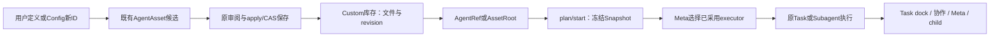

# Meta任务权限、Build委派展示与Custom智能体实施方案

编写日期：2026-11-11；实施更新：2026-11-12。状态：MA00–MA05实现、定向工程检查及真实Build／Custom双链验收完成。最终桌面版本为`2.0.26-dev-ma-20261112-v2`，本期Source模型HTTP实际11／批准11；全工作树lint的383条诊断保留在原账本。见[审批记录](/home/keer/workspace/aigcfroge-v2/docs/review/v2-implementation-approval-2026-11-11-meta-tasks-custom-agents.md)。

本文是[总路线](/home/keer/workspace/aigcfroge-v2/docs/research/upstream-v2-sync/2026-10-25-v2-alignment-execution-plan.md)与[会话工作面计划](/home/keer/workspace/aigcfroge-v2/docs/research/upstream-v2-sync/2026-11-10-side-chat-subagent-implementation-plan.md)的后继附件。原SC00–SC09已完成接受；本轮补充Meta任务权限、真实委派导航和用户智能体的模式边界。实施状态继续由[唯一账本](/home/keer/workspace/aigcfroge-v2/docs/technical-debt.md)记录。

| 输入       | 核对结果                                                                                                                                                                                                                                                                                                                                                    |
| ---------- | ----------------------------------------------------------------------------------------------------------------------------------------------------------------------------------------------------------------------------------------------------------------------------------------------------------------------------------------------------------- |
| 实施工作区 | `/home/keer/workspace/aigcfroge-v2`                                                                                                                                                                                                                                                                                                                         |
| 当前分支   | `v2-dev`                                                                                                                                                                                                                                                                                                                                                    |
| 当前HEAD   | `0a09f6bccdb71f1234eea759eb99e8a336d1d4da`                                                                                                                                                                                                                                                                                                                  |
| 历史参考   | `/home/keer/workspace/aigcfroge`                                                                                                                                                                                                                                                                                                                            |
| 本次交付   | Meta现代任务权限与执行认领保护、用户Agent来源及模式边界、Custom库存／冻结采用、Task到原Tool的导航；工程和真实链验收分别记录                                                                                                                                                                                                                                 |
| 适用协议   | [AGENTS](/home/keer/workspace/aigcfroge-v2/AGENTS.md)、[CLAUDE](/home/keer/workspace/aigcfroge-v2/CLAUDE.md)、[架构](/home/keer/workspace/aigcfroge-v2/ARCHITECTURE.md)、[设计](/home/keer/workspace/aigcfroge-v2/DESIGN.md)、[验证](/home/keer/workspace/aigcfroge-v2/docs/testing.md)、[V2合同权威](/home/keer/workspace/aigcfroge-v2/specs/v2/README.md) |

## 1. 产品结论与已确认边界

Meta需要使用真实任务管理工具，维护计划并委派Build。输入框上方的dock继续显示智能体自动生成的任务及进度；详细执行、参与者、来源、结果和控制复用右侧“协作”“Meta”与现有子会话内容。

用户自建智能体通过既有定义、资产保存和Custom组合采用链路接入。Custom显示其库存和已采用执行成员；普通模式的智能体列表、直接选择及Meta直接委派保持现有内置池。

2026-11-11用户明确选择：**保留Work显式工作流执行；普通列表和直接委派中的用户智能体仅限Custom。** 已发布Work工作流中的明确引用由该Run的冻结快照执行，子会话继承Work模式和原权限上限。

五个产品模式是`chat / coding / work / assistant / custom`，由[ProductMode.ID](/home/keer/workspace/aigcfroge-v2/packages/schema/src/product-mode.ts:5)定义。Meta是智能体与controller身份，不能增加一个“Meta模式”，也不能把`Agent.Info.mode`误当成产品模式。

第一性依据：

1. 计划项承载意图；执行绑定承载一次真实工作及其结算资格。自动编辑计划不能破坏已认领的执行绑定。
2. 定义保存、目录展示、组合采用、实际执行是四个不同状态。保存一个Agent不能同时授予跨模式执行能力。
3. 产品模式决定工作面和候选范围，Agent角色决定根／子身份，Permission决定具体操作，executor决定执行方式；四者分别沿已有owner计算。
4. 同一Session中的多个视图消费同一任务、委派和事件流。新UI入口不需要第二任务表、Meta状态树或SSE连接。

## 2. 已有Meta → Build展示及实际缺口

| 调用方式                      | 现有领域链路                                                                     | 当前可见UI                                                                            | 本轮实现                                                         |
| ----------------------------- | -------------------------------------------------------------------------------- | ------------------------------------------------------------------------------------- | ---------------------------------------------------------------- |
| `task(subagent_type="build")` | 创建或采用父Task，捕获Task ID／revision／原Tool source，再创建participant与child | 自动任务dock、协作委派／参与者／回执、Meta controller／executor／来源、共享子会话内容 | 从真实父Task打开原委派、子会话及精确结果；保留不同attempt        |
| `subagent(agent="build")`     | 创建child并执行Session.prompt／SubagentJob，返回实际sessionID与状态              | Timeline调用记录、协作中的普通子智能体分组、Meta概览与子会话查看                      | 保持原查看与导航；需要父计划节点时由Meta显式使用Task或已有计划项 |
| Work的前台Workflow Task       | 实际选中的Work Meta根，采用已发布步骤、冻结Snapshot和父Task绑定                  | 工作流运行、协作／Meta来源、子会话及结果                                              | 与父Task导航贯通；保留Run、步骤和冻结版本身份                    |

决定函数与消费者：

- [Task创建／采用](/home/keer/workspace/aigcfroge-v2/packages/core/src/tool/plugin/task.ts:2019)、[捕获父Task绑定](/home/keer/workspace/aigcfroge-v2/packages/core/src/tool/plugin/task.ts:2065)、[participant到child及controller source](/home/keer/workspace/aigcfroge-v2/packages/core/src/delegation/execution.ts:1173)。
- [普通Subagent创建](/home/keer/workspace/aigcfroge-v2/packages/core/src/tool/plugin/subagent.ts:230)、[prompt与Job](/home/keer/workspace/aigcfroge-v2/packages/core/src/tool/plugin/subagent.ts:251)、[输出metadata](/home/keer/workspace/aigcfroge-v2/packages/core/src/tool/plugin/subagent.ts:303)。该路径没有创建SessionTask，不能把缺少dock节点归因于UI漏同步。
- [dock](/home/keer/workspace/aigcfroge-v2/packages/app/src/session/composer/session-todo-dock.tsx:10)、[普通调用分组](/home/keer/workspace/aigcfroge-v2/packages/gui-extensions/src/session-management/delegation-panel.tsx:97)、[结果读取](/home/keer/workspace/aigcfroge-v2/packages/gui-extensions/src/session-management/delegation-panel.tsx:201)、[Meta来源导航](/home/keer/workspace/aigcfroge-v2/packages/gui-extensions/src/session-management/meta-agent-panel.tsx:547)。
- [共享子会话Panel](/home/keer/workspace/aigcfroge-v2/packages/gui-extensions/src/session-management/session-panel.tsx:101)接入[宿主内容](/home/keer/workspace/aigcfroge-v2/packages/app/src/runtime/extension/host-apis.tsx:949)与[Session内容](/home/keer/workspace/aigcfroge-v2/packages/app/src/session/content.tsx:345)。

结论：Meta委派Build已经有真实UI；本轮修复的是任务权限与任务到委派的可追溯导航，无须另造专有执行框架。

## 3. 实施前“无todo工具”的根因与修复

下表保留2026-11-11实施前调查时点；当前五项现代任务工具状态见后表。

| 层次           | 证据与结论                                                                                                                                                                                                                                                                                                                                                               |
| -------------- | ------------------------------------------------------------------------------------------------------------------------------------------------------------------------------------------------------------------------------------------------------------------------------------------------------------------------------------------------------------------------ |
| fact           | 用户测试Session `ses_e35910fa9ffeZJMu86JrBJEJL0`的模式为Coding、agent为Meta、tier为propose，任务表为零行。用户报告完成6轮文件核验，但任务创建、取消和失败标记均未执行。                                                                                                                                                                                                  |
| fact           | [内置注册](/home/keer/workspace/aigcfroge-v2/packages/core/src/plugin/internal.ts:374)已经包含`task_create / task_update / task_delete / task_reorder / taskwrite / todowrite`。[Meta定义](/home/keer/workspace/aigcfroge-v2/packages/core/src/plugin/agent.ts:270)以`* deny`开始，没有任务清单管理allow。                                                               |
| fact           | [Tool.snapshot](/home/keer/workspace/aigcfroge-v2/packages/core/src/tool.ts:282)过滤整项工具；[whollyDisabled](/home/keer/workspace/aigcfroge-v2/packages/core/src/tool.ts:419)以最后匹配action、resource为`*`且effect为deny裁决。[PermissionEffective](/home/keer/workspace/aigcfroge-v2/packages/core/src/permission/effective.ts:113)计算档位与规则，并重放显式deny。 |
| hypothesis     | Meta基线缺少清单管理allow，使工具在模型请求构建时消失。该原因可同时解释“有task委派能力”“能弹question”“任务清单工具缺失”。                                                                                                                                                                                                                                                |
| inference      | 注册存在，Meta规则命中整项过滤，测试恰使用Coding／Meta／propose；证据支持权限过滤原因。UI空任务是未产生Task的结果。                                                                                                                                                                                                                                                      |
| recommendation | 为内置Meta增加五项现代任务管理allow，同时在SessionTask自动写边界保护执行占用项；用真实请求工具快照与Task事件验证完整链路。                                                                                                                                                                                                                                               |

MA01已在原Meta定义增加五项现代任务allow。当前有效规则由[PermissionEffective.compute](/home/keer/workspace/aigcfroge-v2/packages/core/src/permission/effective.ts:72)决定，[五模式／两档位keeper](/home/keer/workspace/aigcfroge-v2/packages/core/test/agent.test.ts:93)检查以下结果及Session显式deny：

| 组合                                       | 五项现代清单工具的当前状态                   |
| ------------------------------------------ | -------------------------------------------- |
| Coding／Build或Plan，propose或full         | 可见                                         |
| Coding／Meta，propose或full                | allow；原真实工具快照keeper已执行            |
| Chat／Work／Assistant的Meta，propose或full | allow；不增加新的权限预检                    |
| Custom已采用Meta，propose或full            | 原非只读allow上限仍改判ask；显式deny仍为deny |

`todowrite`仍为兼容路径，没有新增Meta基线allow。Custom权限消费实际采用快照；已运行的受控模型keeper与真实Flash运行分别记录，见§9。

## 4. 模式 × 来源 × 角色 × 执行方式

### 4.1 模式边界

| 模式      | 普通智能体列表／根选择                                 | Meta直接委派池                               | 用户定义的执行入口                               |
| --------- | ------------------------------------------------------ | -------------------------------------------- | ------------------------------------------------ |
| Coding    | 现有内置Agent；Build／Plan／Meta入口保留               | 符合子角色、hidden及现权限规则的内置Agent    | 用户Agent转至Custom采用                          |
| Chat      | 现有内置Agent与Chat操作约束                            | 符合该会话现权限的内置Agent                  | 可沿既有资产生产／保存链生成定义；执行在Custom   |
| Work      | 现有内置Agent；前台Workflow／Judge仍要求实际选中Meta根 | 普通直接委派只读内置池                       | 已发布Workflow中明确绑定的冻结Agent可由原Run执行 |
| Assistant | 现有内置Agent及Assistant工作面                         | 现有权限允许的内置Agent                      | 用户Agent转至Custom采用；个人记忆等沿原owner     |
| Custom    | 内置Build／Plan／Meta根与有效用户资产根；库存独立显示  | 当前已采用快照中明确绑定、角色适用的executor | 资产引用 → plan/start → 冻结Snapshot → 原执行链  |

上表不重写各模式的工具权限。`Agent.availableForDelegation`的角色／hidden／Permission判断继续生效，[决定函数](/home/keer/workspace/aigcfroge-v2/packages/core/src/agent.ts:126)补来源与产品模式条件；Custom继续由[selectAgent](/home/keer/workspace/aigcfroge-v2/packages/core/src/session/composition.ts:670)及[唯一匹配](/home/keer/workspace/aigcfroge-v2/packages/core/src/session/composition.ts:734)消费冻结成员。

Work例外由[frozenRun](/home/keer/workspace/aigcfroge-v2/packages/core/src/workflow/execution.ts:235)、[步骤选择owning.snapshot](/home/keer/workspace/aigcfroge-v2/packages/core/src/workflow/execution.ts:674)与[子会话创建](/home/keer/workspace/aigcfroge-v2/packages/core/src/workflow/execution.ts:692)决定。仅可信Workflow owner使用该入口；不向模型或HTTP开放一个“忽略模式”的开关。

### 4.2 智能体边界

| 概念               | 权威来源                                                      | 实施规则                                                                                                                                     |
| ------------------ | ------------------------------------------------------------- | -------------------------------------------------------------------------------------------------------------------------------------------- |
| 稳定身份与展示名称 | `Agent.Info.id / name`                                        | 执行用ID，名称用于展示；同名不构成同一Agent                                                                                                  |
| 定义来源           | 实际注册／资产转换边界                                        | 增加最小公开`originKind: builtin \| user`语义；Config多文档移除／重建保留原注册来源，不能仅依赖当前exists；保留已有文件／revision provenance |
| 根／子角色         | 既有`Agent.Info.mode: primary \| subagent \| all`             | primary用于根、subagent用于executor、all按真实入口使用；hidden沿现规则                                                                       |
| 适用产品模式       | 当前Session的`ProductMode`及已确认来源规则                    | 用户定义普通选择仅Custom；不再添加一份`allowedModes`配置                                                                                     |
| 模型与请求设置     | `Agent.Info.model / request`及现选择owner                     | 采用时保存实际定义；执行沿现解析及provider规则                                                                                               |
| 工具、Skill、MCP   | 既有注册、Composition bindings及捕获工具快照                  | 定义声明与真实可用能力分开；采用不绕过Permission                                                                                             |
| 权限               | Agent规则、Session规则、ProductMode／tier与原Permission owner | 不从展示注册、Agent名称或Build模板推导授权                                                                                                   |
| executor           | 现Composition／Delegation的实际执行定义                       | 内置本地Agent与外部executor沿原实现；新增显示行不能创建执行能力                                                                              |
| Session与Location  | 已保存Session、controller source、原placement                 | child继承原业务模式与Location；不把当前页面目录覆盖执行位置                                                                                  |

`AgentAsset.source`是提示词正文，不是来源分类；`native`不能用于区分内置与用户定义。App的[normalizeAgentList](/home/keer/workspace/aigcfroge-v2/packages/app/src/runtime/server/global-sync/utils.ts:15)现已保留`originKind / ordinaryModes`及文件版本provenance。现App的`name=Agent.id`寻址兼容保留，展示名称不能替代执行ID。

### 4.3 目录与执行同时接入

来源×模式决定函数由Core Agent owner拥有，结合角色、Permission与Custom冻结成员完成真实选择；Schema只声明公开数据合同，遵循[Schema包边界](/home/keer/workspace/aigcfroge-v2/packages/schema/AGENTS.md:3)。

现`agent.list`继续返回完整Location目录，在原`Agent.Info`公开读shape补Core计算的只读`ordinaryModes`投影，表示来源允许进入哪些普通模式目录。这是读数据，不是Config／资产的`allowedModes`配置，也不授予执行权限。App保留并消费该投影，再用现role／hidden及已采用成员筛选；不重写另一份来源规则。派生目录投影在公开读取时计算，不反向修改已采用Snapshot或其权限。

现[agent.list合同](/home/keer/workspace/aigcfroge-v2/packages/protocol/src/groups/agent.ts:10)与[Client locationResource](/home/keer/workspace/aigcfroge-v2/packages/client/src/solid/data.ts:1518)按Location缓存，[agent资源](/home/keer/workspace/aigcfroge-v2/packages/client/src/solid/data.ts:2636)保存完整列表。沿这一路径保留全量目录与投影，无需添加mode子缓存；不能用某Session的过滤列表覆盖同Location中其它模式。

覆盖真正的消费者：

- [Meta目录](/home/keer/workspace/aigcfroge-v2/packages/core/src/session/context.ts:291)与[Subagent目录](/home/keer/workspace/aigcfroge-v2/packages/core/src/tool/plugin/subagent.ts:333)。
- [普通Subagent直接解析](/home/keer/workspace/aigcfroge-v2/packages/core/src/tool/plugin/subagent.ts:147)、[Task目标解析](/home/keer/workspace/aigcfroge-v2/packages/core/src/tool/plugin/task.ts:1849)、[Judge目标解析](/home/keer/workspace/aigcfroge-v2/packages/core/src/tool/plugin/task.ts:777)、[委派协议目标](/home/keer/workspace/aigcfroge-v2/packages/core/src/tool/delegation-protocol.ts:64)。
- [Session创建](/home/keer/workspace/aigcfroge-v2/packages/core/src/session.ts:977)、[已选Agent上下文](/home/keer/workspace/aigcfroge-v2/packages/core/src/session/context.ts:180)、[App根／executor列表](/home/keer/workspace/aigcfroge-v2/packages/app/src/providers/models/selection.tsx:124)。

SessionContext与runner先沿已保存TaskBinding、Snapshot及controller来源识别真实Work Workflow child；它的内部输入、后续Step／Physical Attempt与原owner恢复继续使用冻结selection。来源×模式筛选用于普通目录和新增普通选择，不能再次用Work普通目录筛掉该Run已采用的用户executor。例外由原owner身份决定，不由调用者声明。

现`product-mode-agent-policy.ts`中的旧“Chat只能Meta／Custom只能Meta”表没有生产消费者，不能直接接入作为本轮规则。既有Build／Plan／Meta并列入口与Custom内置根继续受现行DESIGN约束。

## 5. Meta任务权限与执行占用项保护

### 5.1 五项allow

内置Meta已新增`task_create / task_update / task_delete / task_reorder / taskwrite`五项明确allow。`task`与`subagent`委派沿原规则。`todowrite`保持兼容，不新增基线allow；它不支持failed且按位置整表协调。

现Session显式deny仍优先；配置覆盖沿原顺序；Custom已冻结Meta权限在重新预览／采用前保持原版本。用户定义root即使名称或描述类似Meta，也使用自己的规则。

Meta指导文本已同步：先建立必要计划项，优先增量创建／更新；计划内容由模型维护，真实执行状态由owner结算。声明任务清单不等于已创建Task。

### 5.2 必须同片处理的写边界

只增加allow与提示词会引入一个已知冲突：Task调用捕获同一父Task的revision，而[updateTask](/home/keer/workspace/aigcfroge-v2/packages/core/src/session/task.ts:979)修改内容、优先级、摘要或状态都会加revision；[taskwrite](/home/keer/workspace/aigcfroge-v2/packages/core/src/session/task.ts:576)更新保留项并删除遗漏项；[reorder](/home/keer/workspace/aigcfroge-v2/packages/core/src/session/task.ts:1085)也会增加revision。

执行结算使用原Task revision CAS，见[实际结算](/home/keer/workspace/aigcfroge-v2/packages/core/src/delegation/execution.ts:1601)与[Workflow合同](/home/keer/workspace/aigcfroge-v2/specs/v2/tools.md:148)。[原native Job可以继续运行](/home/keer/workspace/aigcfroge-v2/packages/core/src/delegation/execution.ts:1532)，因此“清单改成功”不能视作“工作已取消”。

| 任务类型／操作                                         | 自动管理工具行为                                                                        |
| ------------------------------------------------------ | --------------------------------------------------------------------------------------- |
| 普通计划项，含无执行绑定的in_progress项                | 可以增量改内容／状态／优先级／摘要；完成、失败和取消可真实写入                          |
| 存在未结算执行认领的父Task、worker Task或aggregate父项 | 自动编辑／删除返回明确执行占用冲突；停止与结算走原Task／Job／Delegation／Workflow owner |
| 无关的新计划项或普通计划项                             | 即使同Session另有运行任务，也可增量修改                                                 |
| 整表write／legacy todowrite／reorder                   | 若实际改动会删除、重写或改revision于保护项，整次写入原子失败；不能先改部分项再报错      |
| 执行owner的CAS结算、取消、恢复                         | 保持原来源、expectedRevision和实际outcome；自动清单权限不能冒充该owner                  |
| 现显式HTTP任务编辑                                     | 保留其已定义的编辑／使旧claim失效语义；与自动管理路径明确区分，不暗改用户控制合同       |

首次认领必须与Task写入同事务锚定。当前Task行没有执行来源字段，普通Task／Judge先append或patch、随后才准入TaskLink，Workflow也先修改Task再写Run.task_binding；只扫描现有绑定会漏掉这个窗口，见[Task认领](/home/keer/workspace/aigcfroge-v2/packages/core/src/tool/plugin/task.ts:2019)、[Workflow准入](/home/keer/workspace/aigcfroge-v2/packages/core/src/workflow/execution.ts:1153)。

最小实现复用原KV保存Task ID、captured revision、原Tool source的窄claim定位，不另存任务正文或状态。沿[内部WriteOptions.commit](/home/keer/workspace/aigcfroge-v2/packages/core/src/session/task.ts:20)及[事务提交](/home/keer/workspace/aigcfroge-v2/packages/core/src/session/task.ts:1029)在首次append／patch时原子提交；append补同一内部hook或原owner的窄claim入口，再准入／唤醒执行。[现Delegation结算](/home/keer/workspace/aigcfroge-v2/packages/core/src/delegation/execution.ts:1601)已有同事务KV提交模式。

claim入口同时裁决未占用、同原source精确复用、不同source冲突。新Task调用不能通过再次patch同`parent_task_id`抢占仍运行的工作；Judge父／worker与Workflow沿同一Task写边界。已有TaskLink／Run／receipt仍决定执行与结果，background ACK完成不代表Job结束。

保护判断与自动写入在原writeLock／事务内完成。自动工具从真实Tool context传入内部管理来源；模型与HTTP输入不增加绕过参数。覆盖append以外的update／removeTask／reorder／replaceLegacy，以及`taskwrite`、full档位可能暴露的`todowrite`；普通无绑定in_progress项仍可完成。

锁序沿现owner锁 → Task写锁：[Workflow](/home/keer/workspace/aigcfroge-v2/packages/core/src/workflow/execution.ts:1064)已按此顺序准入。Task写锁内只读窄持久claim与原结果定位，不能反向调用取得Workflow／Delegation锁的控制命令。启动失败、取消和结算只释放同source／revision的claim；历史无新锚点的未结算执行沿原TaskLink／Run／receipt识别。崩溃后的未决claim沿原owner显式恢复／reconcile，不自动重发模型或替换结果。

复用现错误和ToolOutcome边界；需要区分执行占用时，在既有`TaskWriteError`增加窄原因及实际Task定位。同步`removeTask`的typed error与[task_delete的ToolFailure转换](/home/keer/workspace/aigcfroge-v2/packages/core/src/tool/task-delete.ts:52)，当前删除没有这条错误通道；显式HTTP编辑／删除继续现语义。只有无效输入、stale revision与实际执行占用触发对应拒绝。

这是复用现Task存储和写边界。有限技术债：保护项存在时，全列表重写或重排可能暂不可用；Meta仍可管理其它项。若以后需要保护项周围的稳定重排，应先证明不会改变执行claim的契约，再改原position／revision规则。

## 6. 用户智能体：创建、导入、发现与采用

### 6.1 统一接入现有资产链

| 来源路径                   | 本轮处理                                                                                                                                                                                                               |
| -------------------------- | ---------------------------------------------------------------------------------------------------------------------------------------------------------------------------------------------------------------------- |
| 产品内置AgentPlugin        | 在内置注册处标记builtin；现定义和角色保持                                                                                                                                                                              |
| Config修改或重新启用内置ID | 在Config transform开始前保存原注册来源；多文档先disabled移除、再重建同ID仍保留builtin；`exists`只说明当时是否在目录中                                                                                                  |
| Config创建新ID             | 标记user；Custom库存显示“待导入”，经明确资产候选保存取得引用后采用                                                                                                                                                     |
| AgentAsset保存             | [apply](/home/keer/workspace/aigcfroge-v2/packages/core/src/agent-asset-service.ts:241)负责CAS、写入与读回；[资产转换](/home/keer/workspace/aigcfroge-v2/packages/core/src/agent/asset-bridge.ts:40)标记user与文件版本 |
| 文件Agent／扩展定义        | 实际启用该producer时标记来源并执行同一模式规则；不因本方案主动启用尚未装配的loader                                                                                                                                     |
| Custom冻结执行成员         | [CompositionResolver](/home/keer/workspace/aigcfroge-v2/packages/core/src/composition-resolver.ts:306)与原selectAgent完成采用及执行选择                                                                                |

`registerAgentAssetTransform`有现成实现，但当前生产装配未接入其全局layer；`Agent.fileLayer`也依赖loader注入与功能flag。不能通过重新打开全局bridge实现Custom专属列表，否则会把用户Agent送回其它模式的共享池。

### 6.2 Config兼容的具体最小路径

MA03已从Config owner规范化合并的声明构造canonical `ConfigAgent.Info`候选，保留模型、request、角色、hidden、步骤、handoffs及有序权限规则；`system`进入资产正文。[原Config字段应用](/home/keer/workspace/aigcfroge-v2/packages/core/src/config/plugin/agent.ts:115)现已传递handoffs，[candidate](/home/keer/workspace/aigcfroge-v2/packages/core/src/config/plugin/agent.ts:125)复用`loadDocuments / declarations`，没有逆推当前Session／tier的临时授权。Config禁用／重建同时恢复静态默认值、原内置来源和注册顺序。

原`propose_agent_asset`已支持`{ configAgentID }`。仅导入路径将完整candidate捕获到真实Tool metadata，审阅及后续保存消费该候选；Config之后变化不会替换原提案。原四字段创建路径保持原metadata事实和CAS保存合同。

首期导入与创建／编辑复用**真实会话中的资产候选保存入口**；Custom首页负责库存、装配、预览与采用。已有[agent-asset.apply](/home/keer/workspace/aigcfroge-v2/packages/protocol/src/groups/agent-asset.ts:69)是Session作用域，不能为了调用它制造临时假Session。零库存时仍可显式启动内置Build／Plan／Meta的Custom会话，再生产或导入资产。

这是本轮选定的简单实现。技术债是Custom首页尚无脱离真实会话的独立资产写入口；若后续确认需要首页直接创建／导入，复用原Asset服务补Location管理入口，在原账本登记owner=Core Asset／Protocol／Custom UI、解除条件=实际首页独立写入需求及对应授权／CAS合同，不为本轮预建一套资产服务。

### 6.3 Custom列表与运行态

Custom采用两个真实视图：

- **可用定义库存**：有效用户资产、Config待导入项、无效项及来源／版本；可查看定义，并沿原会话提案入口创建／编辑／导入。
- **本会话已采用成员**：冻结root、executor、模型／工具绑定及引用版本；只从该Session的Snapshot读取可执行成员。

[现Custom form](/home/keer/workspace/aigcfroge-v2/packages/app/src/home/custom-composition.tsx:91)的固定内置root选择扩展为既有[Root union](/home/keer/workspace/aigcfroge-v2/packages/schema/src/composition.ts:45)支持的builtin／asset入口；executor复用`AgentRef`。保留无用户库存时的内置启动路径。

新增／编辑保存后刷新资产库存；有效引用进入预览，用户明确采用后更新Snapshot。运行中的成员、权限、Skill与工具bindings继续使用已采用版本。失效／漂移／同名歧义按原diagnostic和`matchingAgent`报告，不用最新同名定义补位。

库存移除或扩展卸载不删除历史Session，也不取消已执行Job；已选引用失效时由原依赖owner裁决新采用。用户资产名与内置身份碰撞、保留Meta资产名规则沿[原转换](/home/keer/workspace/aigcfroge-v2/packages/core/src/agent/asset-bridge.ts:40)与Composition唯一性规则处理。

### 6.4 历史与恢复

现已保存历史继续可读、可导航。规则更新不改变正在执行请求已捕获的Agent／Tool，也不在目录刷新时中断工作。新增普通prompt、人工switch或普通Meta直接委派若选择非Custom用户Agent，返回既有Agent／模式错误并提供Custom采用路径。Work Workflow owner向其冻结child准入的内部输入、后续Step／Physical Attempt，以及未结算输入的原owner续行／resume／reconcile继续沿原冻结selection；不能误按普通Work候选规则拒绝。

已有未结算Task、Job或Run恢复保持原来源、冻结输入、revision与恢复策略；Work已发布Run继续使用自己的Snapshot。旧数据缺少来源时，在原注册／冻结root及asset ref边界补足可追溯来源；不能按名称猜测或替换executor。不可恢复的历史依赖沿原错误报告，保留原结果。

## 7. Build能力复用与UI交互

| Build现能力                        | 自建Agent接入方式                                      | 实施owner                      |
| ---------------------------------- | ------------------------------------------------------ | ------------------------------ |
| 定义、系统正文、card、角色         | 原ConfigAgent／AgentAsset及Agent.Info                  | Schema／Core Agent             |
| 模型、variant、请求设置            | 资产定义与采用快照；原模型解析                         | Core／Client选择               |
| 内置工具、Code Mode、MCP、Skill    | 原注册与Composition bindings；每个模型请求捕获有效工具 | Core Tool／Composition／Runner |
| 权限询问与操作档位                 | 原PermissionEffective／Permission请求                  | Core／现请求dock               |
| Location、文件、Shell及写入        | 原Location服务与真实Agent权限                          | Core Location／Tool            |
| 输入、SSE、Timeline与工具结果      | 原durable inbox、runner、Client Data与Session content  | Core／Client／App              |
| 父Task、子会话、外部executor与回执 | 原Task、Subagent、Delegation与exact receipt            | Core执行owner／GUI             |
| 中断、失败、重试与恢复             | 原业务控制与冻结来源，结果不改写为成功                 | Core／协作与工作流Panel        |

自建Agent可以声明实际支持的这些能力；选择Build为模板不复制其全部授权。新增能力信息放进现定义与绑定，不再新增“Build兼容运行时”。

UI交互按以下路径落地：

1. Meta用现代工具创建计划：dock显示真实任务、计数和现折叠状态；没有任务时沿原空态。
2. Task委派运行后，关联任务可打开现协作或Meta中的原调用，显示实际Agent、child、attempt、状态及来源。
3. 点击child沿原Sessions.content／导航查看；结果沿[Data精确读](/home/keer/workspace/aigcfroge-v2/packages/client/src/solid/data.ts:1656)读取对应input／receipt，[领域查询](/home/keer/workspace/aigcfroge-v2/packages/core/src/delegation/execution.ts:4006)决定结果。
4. 询问／Permission沿真实请求owner呈现；子会话查看的readonly规则复用[Session内容](/home/keer/workspace/aigcfroge-v2/packages/app/src/session/content.tsx:229)。
5. 停止／重试使用现控制；任务dock只负责进度与导航。普通Subagent组当前没有Stop／Retry，保留[现回归合同](/home/keer/workspace/aigcfroge-v2/packages/app/e2e/regression/session-header.spec.ts:1043)与[标题运行菜单](/home/keer/workspace/aigcfroge-v2/packages/app/src/session/header/session-running-menu.tsx:132)。

父Task关联用实际Task ID／revision和原Tool source，再定位delegation／participant／input／attempt；不能按标题匹配，也不能只凭Task ID把多次执行折叠成一次。若现读模型缺少关联字段，优先补原Schema／查询的窄字段；不另存映射表。历史缺少真实关联时保持可查看但不生成推测链接。

现协作interrupt仅传delegationID，表示整条委派；[领域接口](/home/keer/workspace/aigcfroge-v2/packages/core/src/delegation/execution.ts:4551)另支持participantID。若以后添加单任务停止，必须沿实际participant／input定位，不能把当前整条停止改个文案充当单任务停止。

新标签引导页复用原`MenuItem / Panel`注册：[Meta入口要求controller，协作入口保持五模式通用](/home/keer/workspace/aigcfroge-v2/packages/gui-extensions/src/session-management/renderer.tsx:302)，协作内容读取真实委派／子会话数据；用户智能体库存与采用入口仅Custom出现。Work的冻结executor可在运行详情展示来源，但不会进入Work普通智能体选择池。

关闭Panel沿[renderer的绑定移除](/home/keer/workspace/aigcfroge-v2/packages/gui-extensions/src/session-management/renderer.tsx:273)；业务close沿[Delegation owner](/home/keer/workspace/aigcfroge-v2/packages/core/src/delegation/service.ts:1522)。标签关闭不等价为停止委派。

界面使用[现图标目录](/home/keer/workspace/aigcfroge-v2/packages/ui/src/icons/catalog.ts)、现语义Token与[RTL技能](/home/keer/workspace/aigcfroge-v2/.aigcfroge/skills/rtl-aware-development/SKILL.md)。保留已有英文与翻译；新增文案补英文源键及简体中文，中文与`MCP / Meta / Build`等边界不加空格。窄栏确保标题截断、操作不被挤走，键盘与焦点沿原组件。

### 7.1 顶部、底部与右侧插拔接缝

| 工作面             | 当前底座                                                                                                                                                                                                                             | 本轮接入及验证                                                              |
| ------------------ | ------------------------------------------------------------------------------------------------------------------------------------------------------------------------------------------------------------------------------------ | --------------------------------------------------------------------------- |
| 顶部Timeline贡献   | [`session.header` Slot](/home/keer/workspace/aigcfroge-v2/packages/gui-extensions/src/sdk/registries.ts:554)，[现挂载](/home/keer/workspace/aigcfroge-v2/packages/app/src/session/timeline/message-timeline.tsx:637)                 | 复用宿主排序、启禁和作用域；原header运行入口保留                            |
| 右侧加号／引导     | [`MenuItem(session.panel)`](/home/keer/workspace/aigcfroge-v2/packages/gui-extensions/src/panel-launcher/renderer.tsx:29)与模块真实注册条件                                                                                          | 新模块与模式条件走原入口，不硬写第二份模块表                                |
| 右侧Panel与child   | [`createRegion`](/home/keer/workspace/aigcfroge-v2/packages/app/src/runtime/extension/panels.tsx:98)及原Sessions.content                                                                                                             | 标签选择、复用、关闭、恢复；关闭仅撤销view持有                              |
| 回答下方动作       | [`session.response.actions` Slot](/home/keer/workspace/aigcfroge-v2/packages/gui-extensions/src/sdk/registries.ts:563)，[宿主目标捕获](/home/keer/workspace/aigcfroge-v2/packages/app/src/session/timeline/message-timeline.tsx:313) | 复用Fork／存资产／侧聊的真实target、source与内容边界                        |
| 底部Task／请求dock | [App固定挂载](/home/keer/workspace/aigcfroge-v2/packages/app/src/session/composer/region.tsx:334)                                                                                                                                    | 自动只读任务与即时请求；它不是Panel／Slot注册项，本轮不为统一名称将它插件化 |
| 窗口底部扩展       | [`window.bottom` Slot](/home/keer/workspace/aigcfroge-v2/packages/gui-extensions/src/sdk/registries.ts:552)                                                                                                                          | 复用注册撤销、贡献错误隔离；不把它当作Task执行owner                         |

所有这些视图共用原ServerRef、Data/SSE与Session身份。可插拔贡献共用Extension Host生命周期；固定Task／请求dock沿原Composer生命周期。顶／底／右侧保留各自语义与真实target，无需再包一层通用“顶底底座”。

## 8. 底座选择、错误与影响owner

简单方案是只改Meta allow、在前端过滤用户Agent并新增一个列表组件。它无法保护Task claim，直接目标仍能绕过列表；不能满足本轮验收。

采用方案是复用现Agent／Task／Composition／Data／Extension Host，补最小来源字段、现写边界和真实导航。这些接缝均有已有目录与执行、Task工具与委派、主／子Session视图两个以上真实消费者。新AgentList注册表、事件总线、Session ID插件层或通用解释器没有本轮新增依据。

后期如出现第二个可独立安装的列表提供者，再在现Extension Host中增加类型化显示贡献。显示贡献只接收已筛选库存与导航能力；执行资格仍由Core和冻结Composition裁决。本轮不发布尚无真实消费者的新列表SDK。

| Owner                                           | 本轮具体职责                                                                                   |
| ----------------------------------------------- | ---------------------------------------------------------------------------------------------- |
| Schema                                          | Agent来源与只读普通目录投影的wire shape；现Task／Composition绑定字段只有实际读缺口才补         |
| Core Agent／Config／Asset                       | 唯一来源×模式判断及读投影，保留内置配置覆盖／重建身份，完整声明到候选导入，避免重启全局asset桥 |
| Core Permission／Tool／SessionTask              | 五项allow、全工具快照、自动写占用项防护、真实错误与CAS                                         |
| Core Session／Context／Task／Subagent／Workflow | 根选择、目标解析与目录统一；Work owner的冻结例外；恢复原归属                                   |
| Protocol／Server                                | 改动涉及公开shape时对齐原HttpApi与errors；不添加重复路由                                       |
| Client                                          | 正式生成；normalize保留来源，Data继续同一读模型与共享SSE                                       |
| App                                             | 模式适用列表、Custom库存／采用、dock导航与共享Session内容                                      |
| GUI extensions                                  | 现协作／Meta／工作流来源及结果导航，模式化新标签入口，i18n                                     |
| 文档与测试owner                                 | 更新现Session／Tools跨模块合同、DESIGN与最近keeper；未交付项只入原账本                         |

错误继续区分：权限deny、模式／Agent不可用、stale revision、执行占用、资产引用失效、结果pending／failed／interrupted／unverified。失败保留原Tool content和真实来源。旧completed结果缺少完成证据时保持原unverified，不凭新UI赋予成功。

## 9. 实施小节与验证

顺序：`MA00 → MA01 → MA02 → MA03 → MA04 → MA05`。每片做到可运行纵链；测试／构建由主线串行，独立只读分析与不同文件owner可并行。

| 小节                   | 已落地内容与决定边界                                                                                                                                | 验证状态（分轮）                                                                                                                                                                                                                                                                                                                                                                      |
| ---------------------- | --------------------------------------------------------------------------------------------------------------------------------------------------- | ------------------------------------------------------------------------------------------------------------------------------------------------------------------------------------------------------------------------------------------------------------------------------------------------------------------------------------------------------------------------------------- |
| MA00：合同与底座基线   | canonical Reference延迟读取、四个原Storybook mock恢复真实Provider合同；原SC接受保持                                                                 | Schema 9 pass／0 fail；原host／graph 25 passed，见§9.2                                                                                                                                                                                                                                                                                                                                |
| MA01：Meta真任务链     | 五项allow、同事务KV claim、现代／legacy自动写保护、原source／revision结算和释放；无绑定计划仍可写；原HTTP编辑语义保持                               | [Core三文件](/home/keer/.codex/outputs/2026-11-11/meta-implementation/ma01-core-tasks-green.log)：144 pass／0 fail／1005 expect；[Meta与background定向](/home/keer/.codex/outputs/2026-11-11/meta-implementation/ma01-two-keepers-final.log)：2 pass／0 fail／40 expect                                                                                                               |
| MA02：来源与执行筛选   | `originKind`、Core唯一`ordinaryModes / assertOrdinaryMode`及公开投影；普通目录／直接目标同边界，Location目录完整；Custom和Work Workflow冻结选择保留 | [Core七文件](/home/keer/.codex/outputs/2026-11-11/meta-implementation/ma02-03-core-fixed.log)：227 pass／0 fail／1422 expect，含Config、Subagent、Session及Custom keeper                                                                                                                                                                                                              |
| MA03：Custom定义到执行 | 原真实会话创建／Config导入／CAS保存；Custom定义库存、asset root／executor选择、Profile引用、采用后冻结成员和版本；首页保持库存及采用职责            | [GUI提案](/home/keer/.codex/outputs/2026-11-11/meta-implementation/gui-proposal-tests.log)：247 pass／0 fail／979 expect；[Server最终源码两文件](/home/keer/.codex/outputs/2026-11-11/meta-implementation/server-tests-after-types.log)：31 pass／0 fail／421 expect；[Custom／dock／五模式引导](/home/keer/.codex/outputs/2026-11-11/meta-implementation/ma-ui-final.log)：12 passed |
| MA04：Task到Build UI   | 原Task metadata定位message／Tool call，每次执行单独导航；原协作／Meta／child消费结果；固定只读dock、原Slot／Panel和英文／中文文案                   | 上述12项UI覆盖采用／Profile CAS／Task来源／五模式；[宿主末轮](/home/keer/.codex/outputs/2026-11-11/meta-implementation/ma-host-final.log)25 passed；[来源回调反证](/home/keer/.codex/outputs/2026-11-11/meta-implementation/ma04-dock-mutation-red.log)1 failed；production前后各1项通过                                                                                              |
| MA05：完整接受         | 真实Build→父消费及用户Agent提案→保存→Custom采用→执行→父消费通过；CAS新采用与旧版本保持通过；修复实际Custom权限接缝后构建v2桌面并复验                | [真实报告](/home/keer/.codex/outputs/2026-11-11/meta-implementation/ma05-live-ready/native-live/report.json)exit0、Electron0；[最终工程及产物身份](/home/keer/.codex/outputs/2026-11-11/meta-implementation/engineering-final-acceptance.json)；Source HTTP11／11，修后API8／0、审批4／0、权限17／0与App／Core类型、CLI／Desktop构建通过                                              |

### 9.1 必须成立的行为断言

1. Coding／Meta／propose真实模型请求提供五个现代工具；任务create／in_progress／completed／failed／cancelled产生实际Task及同源dock更新。原显式deny仍能禁用指定工具。
2. 普通in_progress计划项可完成；运行中的执行占用父／worker／aggregate项不能被自动编辑、删除、整表遗漏或重排破坏。其它计划项仍可更新。
3. 用就绪信号覆盖Task写入后、child／Run绑定准入前的窗口，以及第二次委派同一parent_task_id；同source精确重试复用，不同source冲突。锁序无反向取锁；background ACK后仍保护实际运行Job。启动失败、取消／结算与显式恢复只释放原source／revision；legacy todowrite不能绕过边界。
4. Task委派Build后可由dock到原Tool、委派、child及精确结果；两个attempt分别可读。普通subagent不凭空生成父Task。
5. 用户Agent保存后在Custom库存出现；未采用时不进入执行池。选择asset root或executor后plan/start形成冻结快照，Meta可以按角色和真实权限委派。
6. Coding／Chat／Work／Assistant列表与目录不混入用户Agent；直接提交同一用户ID也返回模式边界错误。当前内置Build／Plan／Meta路径不回退。
7. Work显式已发布Workflow仍执行自己的冻结用户Agent：child.mode=work、原task_binding、Snapshot及权限上限正确；验证内部输入、多个Step／Physical Attempt与取消后的原owner恢复；不会把该Agent放入Work直接候选池。
8. 编辑用户定义后库存刷新，已运行Custom／Work Run保持原revision；显式新采用消费新revision。同名、缺依赖、stale CAS、失效引用报告实际原因。
9. 主会话、侧聊、child同server复用SSE与Data；请求交回真实owner，关闭视图不取消任务，切换模式／Session无目录、草稿或权限串用。
10. Config多文档禁用再重建内置ID仍为builtin，新增用户ID为user；候选完整保留handoffs及有序权限。两个模式同Location读取同一完整目录，App消费Core的ordinaryModes投影，直接执行仍受原owner裁决。
11. 顶部Slot、window.bottom与右侧Panel贡献可撤销并隔离异常；五模式引导、标签关闭／恢复、side／bottom终端及回答动作保留真实target。固定Task dock只读且与请求dock共存。

### 9.2 精确keeper与运行规则

- 执行占用与Task：优先扩展[Task更新keeper](/home/keer/workspace/aigcfroge-v2/packages/core/test/tool-task-update.test.ts:99)、[Task服务keeper](/home/keer/workspace/aigcfroge-v2/packages/core/test/session-task-service.test.ts:1610)、[legacy Todo keeper](/home/keer/workspace/aigcfroge-v2/packages/core/test/session-task-service.test.ts:379)、[Task来源／结算keeper](/home/keer/workspace/aigcfroge-v2/packages/core/test/tool-task.test.ts:2170)。
- 来源／Custom：扩展[Config覆盖](/home/keer/workspace/aigcfroge-v2/packages/core/test/config/agent.test.ts:384)、[资产桥碰撞](/home/keer/workspace/aigcfroge-v2/packages/core/test/agent-asset-bridge.test.ts:171)、[冻结成员](/home/keer/workspace/aigcfroge-v2/packages/core/test/session-composition.test.ts:200)、[Subagent冻结选择](/home/keer/workspace/aigcfroge-v2/packages/core/test/tool-subagent.test.ts:648)与[Custom UI](/home/keer/workspace/aigcfroge-v2/packages/app/e2e/regression/custom-profile.spec.ts)。
- Work例外：沿[Work入口拒绝](/home/keer/workspace/aigcfroge-v2/packages/core/test/tool-task.test.ts:858)、[Run与Task绑定](/home/keer/workspace/aigcfroge-v2/packages/core/test/tool-task.test.ts:954)、[原冻结输入取消／恢复](/home/keer/workspace/aigcfroge-v2/packages/core/test/tool-task.test.ts:1191)验证。`workflow-execution.test.ts:516`是Custom子会话测试，不能用它单独宣称Work通过。
- GUI导航：沿[header](/home/keer/workspace/aigcfroge-v2/packages/app/e2e/regression/session-header.spec.ts:743)、[child导航](/home/keer/workspace/aigcfroge-v2/packages/app/e2e/regression/subagent-child-navigation.spec.ts:53)、[任务dock](/home/keer/workspace/aigcfroge-v2/packages/app/e2e/regression/session-request-docks.spec.ts:388)扩展真实交互，复用原控件与readiness。
- 插拔宿主：沿[extension-host路由／持有](/home/keer/workspace/aigcfroge-v2/packages/app/component-tests/extension-host.spec.ts:193)、[注册撤销](/home/keer/workspace/aigcfroge-v2/packages/app/component-tests/extension-host.spec.ts:483)、[底部贡献异常隔离](/home/keer/workspace/aigcfroge-v2/packages/app/component-tests/extension-host.spec.ts:526)与[内置／optional provider矩阵](/home/keer/workspace/aigcfroge-v2/packages/app/component-tests/extension-graph.spec.ts:18)验证。
- 模块及回答动作：沿[新标签替换](/home/keer/workspace/aigcfroge-v2/packages/app/e2e/regression/side-panels.spec.ts:152)、[五模式](/home/keer/workspace/aigcfroge-v2/packages/app/e2e/regression/side-panels.spec.ts:358)、[标签关闭恢复](/home/keer/workspace/aigcfroge-v2/packages/app/e2e/regression/side-panels.spec.ts:610)、[窄栏关闭](/home/keer/workspace/aigcfroge-v2/packages/app/e2e/regression/side-panels.spec.ts:1137)、[side／bottom终端](/home/keer/workspace/aigcfroge-v2/packages/app/e2e/regression/side-panels.spec.ts:1282)、[回答Fork](/home/keer/workspace/aigcfroge-v2/packages/app/e2e/regression/new-session.spec.ts:63)、[回答存资产](/home/keer/workspace/aigcfroge-v2/packages/app/e2e/regression/side-panels.spec.ts:1704)验证；Desktop原[extension storage](/home/keer/workspace/aigcfroge-v2/packages/desktop/src/main/extension/storage.test.ts:56)持有持久偏好合同。

实施命令按[docs/testing.md](/home/keer/workspace/aigcfroge-v2/docs/testing.md)与当前package manifest执行，Core走`script/bun run --cwd=packages/core test`的包wrapper；定向文件参数沿该script支持的方式传入。测试不能从根裸跑；App另跑typecheck:e2e。公开Protocol／HttpApi变化后运行`script/bun run --cwd=packages/client generate`，保护既有生成WIP，正式生成而非手改。

2026-11-11审批测试发现两个确定前置：Storybook浏览器在[SessionEvent.Created](/home/keer/workspace/aigcfroge-v2/packages/schema/src/session-event.ts:74)读取尚未初始化的`SessionConsultation.Reference`；依赖预扫描发现原模拟层缺`CommentsProvider / FileProvider / LocalProvider / commandPaletteOptions`导出。MA00优先修复同一Schema引用初始化环及原模拟层合同，使用原canonical Schema和真实Provider接口，不复制schema、添加假Provider或放宽断言。解除条件为当前host／graph组件keeper运行到断言并exit0；两项owner与原始证据登记[唯一账本](/home/keer/workspace/aigcfroge-v2/docs/technical-debt.md)。

MA00已达到上述解除条件：`SessionEvent.Created`使用`Schema.suspend`延迟读取原canonical Reference；四个原Storybook mock承载真实Context和Provider状态。Schema定向keeper为9 pass／0 fail，`extension-host.spec.ts + extension-graph.spec.ts`实际进入断言并25 passed／exit0，见[Schema日志](/home/keer/.codex/outputs/2026-11-11/meta-implementation/ma00-schema.log)及[组件日志](/home/keer/.codex/outputs/2026-11-11/meta-implementation/ma00-components.log)。

Session／Timeline布局有实际改变时做对应production streaming／几何基准，不扩成全仓性能测试。MA04 production streaming[前](/home/keer/.codex/outputs/2026-11-11/meta-implementation/ma04-perf-before.log)／[后](/home/keer/.codex/outputs/2026-11-11/meta-implementation/ma04-perf-after.log)各1项通过；[比较记录](/home/keer/.codex/outputs/2026-11-11/meta-implementation/ma04-performance-comparison.json)的场景相同，bottom drift／blank均0，row／markdown均未替换，32个delta全部交付。单次样本初始内容观察633.1→748.0ms，完成1620.1→1682.1ms，保留原样本，不据此宣称性能提升。该基准阶段模型请求0；后续真实请求见§9.5。分轮有重叠，不相加。

### 9.3 当前工程接缝与待验收项

正式生成暴露原codegen缓存的实际问题：新增`ordinaryModes`后，`ProductMode`的必填引用与Session mode的解码默认引用共享了按原AST context计算的key，使Promise编码类型意外要求mode。最小修复在[原codegenAsts缓存](/home/keer/workspace/aigcfroge-v2/packages/httpapi-codegen/src/index.ts:1505)改为读取编码投影`output.context`，保持领域默认值。[两种遍历顺序keeper](/home/keer/workspace/aigcfroge-v2/packages/httpapi-codegen/test/generate.test.ts:1058)进入[112 pass／0 fail／407 expect](/home/keer/.codex/outputs/2026-11-11/meta-implementation/codegen-tests.log)；恢复旧key时两项失败，见[反证](/home/keer/.codex/outputs/2026-11-11/meta-implementation/codegen-mutation-red.log)。Client沿正式生成入口更新，[原runtime三文件](/home/keer/.codex/outputs/2026-11-11/meta-implementation/client-runtime-tests.log)为64 pass／0 fail／264 expect，没有手改生成结果。

本期没有增加权限预检、全局资产loader、列表注册表、SSE总线或执行循环。新增占用冲突只在原Task自动管理写边界触发；原显式HTTP编辑、PermissionEffective、Custom非只读ask上限和真实controller规则保持。Server的模式错误复用原`InvalidRequestError`映射；durable prompt准入和实际Agent上下文选择保持分离。

Server最初30 pass／1 fail的Custom启动400已定位为`meta_model_missing`。原用例通过`useOfflineCatalog`配置模型并在真实start中显式选择；Summary恢复原解码，HTTP按实际错误union映射，删除不适用于durable prompt准入和context投影读取的catch。Server最终类型exit0，修后31项／421 expect通过。私有Native首次无DISPLAY及首次Xvfb定位失败保留为历史；当前报告为exit0，CLI／Source／renderer版本均为`2.0.26-dev-ma-20261112-v1`，数据库写入私有state，未发送模型prompt。最后App／GUI／Desktop／E2E类型均exit0；元数据使用canonical String判定后的dock keeper为1 passed。最终CLI及Desktop构建exit0；最终Native报告exit0、Electron exit0、5模式按钮、pageerror 0，私有Source清理后3084端口释放，分离Source数字退出码未捕获。见[最终验收记录](/home/keer/.codex/outputs/2026-11-11/meta-implementation/engineering-final-acceptance.json)。

### 9.4 MA05本地补证（2026-11-12）

| 合同                                  | 本轮实际结果                                                                                                                                                                                                                                                                                                                                    | 原始证据                                                                                                                                                                                                                                                                                                                                                                                                |
| ------------------------------------- | ----------------------------------------------------------------------------------------------------------------------------------------------------------------------------------------------------------------------------------------------------------------------------------------------------------------------------------------------- | ------------------------------------------------------------------------------------------------------------------------------------------------------------------------------------------------------------------------------------------------------------------------------------------------------------------------------------------------------------------------------------------------------- |
| §9.1第8项：显式采用新版本             | 原Custom keeper扩展后1 passed（26.0s）：库存刷新至V2后显式选择、preview／start，新Session采用V2，旧Session仍显示V1，executor版本保持。该轮使用原API fixture和真实UI控件。                                                                                                                                                                       | [最终日志](/home/keer/.codex/outputs/2026-11-11/meta-implementation/ma05-item8-final.log)、[E2E类型复验日志](/home/keer/.codex/outputs/2026-11-11/meta-implementation/ma05-e2e-typecheck-green.log)、[原keeper](/home/keer/workspace/aigcfroge-v2/packages/app/e2e/regression/custom-profile.spec.ts:226)                                                                                               |
| §9.1第5／8项：原生保存、采用与CAS升级 | 私有Native使用原资产API保存直接fixture、原Custom UI选择Meta及用户executor并preview／start，再以旧revision执行CAS更新及显式新采用；命令exit0、Electron0、prompt0。旧Session持有`1c278445…`，库存及新Session为`59c25789…`，两个Session ID分别保留在报告。                                                                                         | [原生报告](/home/keer/.codex/outputs/2026-11-11/meta-implementation/ma05-live-ready/native-prepare-adoption/report.json)、[版本／快照记录](/home/keer/.codex/outputs/2026-11-11/meta-implementation/ma05-live-ready/native-prepare-adoption/explicit-revision-adoption.json)、[命令收据](/home/keer/.codex/outputs/2026-11-11/meta-implementation/ma05-live-ready/runtime/native-adoption-command.json) |
| §9.1第8项：引用、依赖与stale事实      | Root串行重跑3条既有Core keeper，exit0、3 pass／32 filtered／0 fail／280 expect、模型0。失效用户AgentRef在temporary／Profile的resolve／freeze均保留`agent_not_found`；声明依赖缺失报告`prompt_not_found / skill_not_found / command_not_found`；跨消费者7条stale事实保留source及expected／current revision。同名和Agent CAS沿原Server／GUI证据。 | [3项日志](/home/keer/.codex/outputs/2026-11-11/meta-implementation/ma05-agent-reference-keepers.log)、[精确源码与命令收据](/home/keer/.codex/outputs/2026-11-11/meta-implementation/ma05-agent-reference-command.json)、[Item8映射](/home/keer/.codex/outputs/2026-11-11/meta-implementation/ma05-live-ready/contract-evidence-map.json)                                                                |
| §9.1第6项：真实模式准入边界           | 私有Native prepare报告exit0、errors 0、prompt 0；同一用户Agent只出现在Custom目录，Coding／Chat／Work／Assistant直接提交该ID均返回400、`InvalidRequestError`、`field=agent`、`kind=agent_mode_unavailable`。原生Home→会话行重新打开同一Meta Session，标签活动且主Composer可编辑。                                                                | [Native报告](/home/keer/.codex/outputs/2026-11-11/meta-implementation/ma05-live-ready/native-prepare/report.json)、[prepare命令收据](/home/keer/.codex/outputs/2026-11-11/meta-implementation/ma05-live-ready/runtime/native-prepare-command.json)                                                                                                                                                      |
| 本期网关计数与终态                    | 本地TLS fixture exit0：两并发请求字节保持，收到`[DONE]`后不等待上游EOF，第三请求429；真实模型请求0。cap0检查的两个POST均429、reservation 0。                                                                                                                                                                                                    | [TLS检查](/home/keer/.codex/outputs/2026-11-11/meta-implementation/ma05-live-ready/runtime/gateway-local-check.json)、[cap0检查](/home/keer/.codex/outputs/2026-11-11/meta-implementation/ma05-live-ready/runtime/zero-cap-check.json)                                                                                                                                                                  |
| 本期记账核验                          | 原accounting-check命令exit0、真实模型0、Source reservation0；本地fixture有2个reservation、2条终态和1次cap拒绝，修改请求正文的核验反证被拒绝。                                                                                                                                                                                                   | [记账报告](/home/keer/.codex/outputs/2026-11-11/meta-implementation/ma05-live-ready/runtime/accounting-check.json)、[命令收据](/home/keer/.codex/outputs/2026-11-11/meta-implementation/ma05-live-ready/runtime/accounting-check-command.json)                                                                                                                                                          |

上述零模型补证阶段只扩展原Custom keeper；七轮准备脚本失败和修后[最终日志](/home/keer/.codex/outputs/2026-11-11/meta-implementation/ma05-live-ready/runtime/native-adoption-final.log)分别保留。后续真实链、实际接缝修复及最终预算结算见§9.5，分轮不相加。

### 9.5 真实双链与最终合同验收（2026-11-12）

Coding／Meta的实际模型请求包含`task_create / task_update / task_delete / task_reorder / taskwrite`。真实task_create保存pending、in_progress、completed、failed、cancelled五种状态；Build父项由原owner结算completed，dock读回同一组Task并通过来源按钮展开确切Tool。完整`MA05_BUILD_OK`进入父消费请求slot4，终答为`MA05_PARENT_CONSUMED: MA05_BUILD_OK`。

同次模型提案保存的`ma05_user_probe`由Custom页面选择为Meta的executor，原preview／start形成冻结快照。真实原生dock对该Tool来源的task权限执行Allow once并返回204，用户child完成`MA05_CUSTOM_OK`；原Tool全文进入父请求slot11，终答为`MA05_CUSTOM_PARENT_CONSUMED: MA05_CUSTOM_OK`。随后原CAS将库存revision从`47ba0972…`更新为`848eca22…`；显式新采用消费新revision，原已执行Session保持旧快照。

| §9.1项                           | 验收依据与结果                                                                                                                                                                                                                                                                                                                                                                                                                                                                                                 |
| -------------------------------- | -------------------------------------------------------------------------------------------------------------------------------------------------------------------------------------------------------------------------------------------------------------------------------------------------------------------------------------------------------------------------------------------------------------------------------------------------------------------------------------------------------------- |
| 1：真实任务工具及状态            | [真实请求／终态报告](/home/keer/.codex/outputs/2026-11-11/meta-implementation/ma05-live-ready/native-live/report.json)记录五工具及slot1／4／11；[Build执行与dock](/home/keer/.codex/outputs/2026-11-11/meta-implementation/ma05-live-ready/native-live/execution-build.json)保存五状态首写和结算。显式deny沿原Core keeper。                                                                                                                                                                                    |
| 2：普通计划可写、执行占用保护    | [Task三文件144／0](/home/keer/.codex/outputs/2026-11-11/meta-implementation/ma01-core-tasks-green.log)覆盖普通计划、自动更新／删除／整写／重排及真实worker claim，业务结算沿原owner。                                                                                                                                                                                                                                                                                                                          |
| 3：claim窗口、精确重试及释放     | 同144／0覆盖事务hook前claim、竞争source、exact retry、取消与source／revision释放，background ACK另由[2项定向](/home/keer/.codex/outputs/2026-11-11/meta-implementation/ma01-two-keepers-final.log)覆盖；[legacyOwned](/home/keer/workspace/aigcfroge-v2/packages/core/src/session/task.ts:523)只读原持久表，未在Task锁内取Workflow／Delegation锁。                                                                                                                                                             |
| 4：Task来源及精确结果            | [Build真实来源](/home/keer/.codex/outputs/2026-11-11/meta-implementation/ma05-live-ready/native-live/execution-build.json)与[Custom真实来源](/home/keer/.codex/outputs/2026-11-11/meta-implementation/ma05-live-ready/native-live/execution-ma05_user_probe.json)分别保存Task／Tool／Delegation／child及完整结果；最终[边界2／0](/home/keer/.codex/outputs/2026-11-11/meta-implementation/ma05-final-boundary-command.json)补普通subagent完成后父Task仍为空及Work两个执行绑定／旧结果保持的精确断言。          |
| 5：保存、采用、真实用户executor  | [保存记录](/home/keer/.codex/outputs/2026-11-11/meta-implementation/ma05-live-ready/native-live/agent-saved.json)及[成功Custom报告](/home/keer/.codex/outputs/2026-11-11/meta-implementation/ma05-live-ready/native-live/custom-result.json)；原冻结选择、未采用目标和deny边界由[Core227／0](/home/keer/.codex/outputs/2026-11-11/meta-implementation/ma02-03-core-fixed.log)覆盖。                                                                                                                            |
| 6：四非Custom模式边界            | [真实零模型Source准入](/home/keer/.codex/outputs/2026-11-11/meta-implementation/ma05-live-ready/native-prepare/report.json)：同一用户ID仅Custom目录出现，四种非Custom直接创建均400／agent_mode_unavailable。                                                                                                                                                                                                                                                                                                   |
| 7：Work显式冻结例外              | [原Task144／0](/home/keer/.codex/outputs/2026-11-11/meta-implementation/ma01-core-tasks-green.log)覆盖Work发布／取消／恢复；最终[边界2／0](/home/keer/.codex/outputs/2026-11-11/meta-implementation/ma05-final-boundary-command.json)明确断言child.mode=work、父read允许／write拒绝权限上限、冻结配置、新Tool绑定和3次受控模型调用。原Work普通目录保持内置池。                                                                                                                                                 |
| 8：版本及真实错误                | [成功链新旧快照](/home/keer/.codex/outputs/2026-11-11/meta-implementation/ma05-live-ready/native-live/explicit-revision-adoption.json)、[Core引用三项3／0](/home/keer/.codex/outputs/2026-11-11/meta-implementation/ma05-agent-reference-command.json)、[Agent同名／CAS的Server31／0](/home/keer/.codex/outputs/2026-11-11/meta-implementation/server-tests-after-types.log)及[GUI Agent247／0](/home/keer/.codex/outputs/2026-11-11/meta-implementation/gui-proposal-tests.log)，Profile CAS不替代Agent错误。 |
| 9：共享Data／SSE及请求owner      | [Client64／0](/home/keer/.codex/outputs/2026-11-11/meta-implementation/client-runtime-tests.log)覆盖共享源和最后subscriber释放，原SC03真实child／侧聊视图与请求owner证据保持；本次Custom原生权限reply204补齐真实消费。                                                                                                                                                                                                                                                                                         |
| 10：来源及完整Config声明         | [Config／Agent227／0](/home/keer/.codex/outputs/2026-11-11/meta-implementation/ma02-03-core-fixed.log)覆盖disable／recreate内置ID、用户来源、handoffs及有序权限；[Config keeper](/home/keer/workspace/aigcfroge-v2/packages/core/test/config/agent.test.ts:488)与本次同Location模式目录相互对应。                                                                                                                                                                                                              |
| 11：顶／底／右侧插拔及真实target | [原宿主25 passed](/home/keer/.codex/outputs/2026-11-11/meta-implementation/ma-host-final.log)覆盖scope撤销和异常隔离；[UI12 passed](/home/keer/.codex/outputs/2026-11-11/meta-implementation/ma-ui-final.log)及原SC面板／终端／回答动作合同保持，本次只读dock与请求dock继续共存。                                                                                                                                                                                                                              |

真实验收发现两处当前接缝：App请求未声明现有Custom审批能力；Permission从Location目录解析已冻结用户Agent。修复复用[createApiForServer](/home/keer/workspace/aigcfroge-v2/packages/app/src/runtime/server/api.ts:23)的原请求header与[Permission.configured](/home/keer/workspace/aigcfroge-v2/packages/core/src/permission.ts:197)的冻结选择。未知或缺配置目标沿明确deny／错误结果处理。修后API8／0、审批4／0、权限17／0、App／Core类型及CLI／Desktop构建exit0；最终同源桌面为`2.0.26-dev-ma-20261112-v2`，见[执行命令与产物记录](/home/keer/.codex/outputs/2026-11-11/meta-implementation/ma05-live-root-commands.json)。

用户分别批准新增8次和3次Source HTTP，本期实际11／11，均保留HTTP200终态；其中旧Custom逻辑失败及cap拒绝记录原样保留，HTTP完成不等同任务成功。外部SDK本期0；旧SC09仍为Source21／21、SDK5／8、总HTTP26／29、Query2／2。最终driver／Electron／网关exit0，3084及16861端口释放，分离Source数字退出码未捕获；用户服务未触及，见[清理收据](/home/keer/.codex/outputs/2026-11-11/meta-implementation/ma05-live-ready/runtime/live-cleanup.json)。[Root最终回读核验](/home/keer/.codex/outputs/2026-11-11/meta-implementation/ma05-root-final-live-verification.json)exit0、未新增模型请求；全文hash精确匹配slot4／11、五工具定义及Custom权限source对应Tool。最后两条边界keeper为2 pass／89 filtered／0 fail／47 expect，Core类型与两文件lint均exit0。

## 10. 完成判据与交付状态

本轮完成须同时满足：Meta可以管理真实计划并安全委派Build；dock和原侧栏可追溯实际执行；用户定义经过保存与采用在Custom运行；其它模式的普通目录及直接选择保持边界；Work显式冻结执行保持合同。

文档更新放回现权威owner：`specs/v2/session.md`说明模式／冻结／历史边界，`specs/v2/tools.md`说明自动任务编辑与执行认领关系，`DESIGN.md`记录Custom库存／采用及任务导航；公开types由Schema／Protocol及生成Client决定。实施中未完成的小节和有限技术债登记原账本的owner与解除条件，不能以计划文案代替完成。

MA00–MA05的本轮实现、工程检查及真实双链已完成，最新运行包为[desktop-fix](/home/keer/.codex/outputs/2026-11-11/meta-implementation/artifacts/desktop-fix/package.json)和同源cli-fix，版本`2.0.26-dev-ma-20261112-v2`。[最终验收记录](/home/keer/.codex/outputs/2026-11-11/meta-implementation/engineering-final-acceptance.json)绑定源码、命令、产物和11／11模型请求。全工作树lint最终exit1、383条诊断：234条有相同旧行证据，149条缺少本期前置快照；相应owner及解除条件继续留在原账本。首页独立资产写入口和后继独立列表provider保持既定技术债，未预建新框架。
