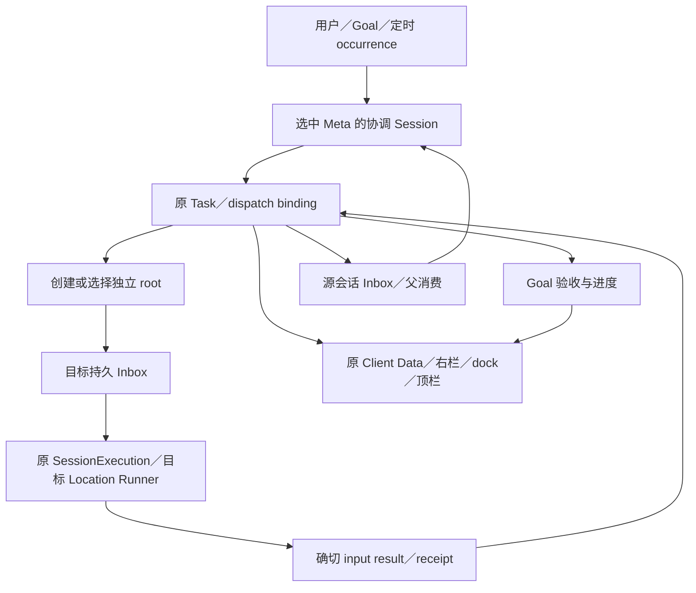

# Meta 跨模式主会话、目标任务与定时执行闭环方案

日期：2026-11-13。版本：1.2，Meta主动协调边界与SSE展示修订版，待人类审批。
目标工作区：/home/keer/workspace/aigcfroge-v2。分支：v2-dev。
调查 HEAD：0a09f6bccdb71f1234eea759eb99e8a336d1d4da。
性质：唯一 V2 总计划的实施附件；本文件定义本次增量范围、合同、批次与验收。功能状态仍由源码与验收工件决定。

## 1. 审批结论与范围

建议批准：Meta 作为跨模式协调者，在现有 Session、Task、Inbox、Execution、Workflow 与 GUI 宿主上完成独立主会话委派、持续目标和定时执行。保留 Chat、Coding、Work、Assistant、Custom 五模式；Build、Plan、Meta 等根智能体仍可按任务直接选择。

本次必须交付：

1. Meta 创建独立 root Session，进入全局顶部标签；目标模式、Location、Agent、模型、Custom 已采用组合有明确来源。
2. Meta独立主会话按需双向、会话间通信：A1委派A2；A2选中Meta时可主动回复A1，新增B1后Meta会话之间可选择对方输入、输出与跟进。Build／Plan执行收到的工作并经原任务机制回传结果，不拥有本片主动跨会话新建、关联和发送能力。保存发送/接收会话及每次输入、回复对应关系。
3. 一个协调会话持续推进 Goal，保存验收条件、任务进度、预算、停止原因及完成证据。
4. 一次和周期定时规则；目标可为已有会话、首次创建后复用、每轮新建独立主会话。
5. 补齐 Assistant Schedule HTTP、生产 timer 装配、提醒投递，以及 Work Task 到期执行闭环。
6. 仅Meta可用的主动协调入口、可收起右侧面板、Task dock点击详情、任务依赖图和往来时间线；同一批持久事实经SSE呈现在会话消息流，刷新/重连恢复。
7. 会话标题引用 chip，覆盖粘贴 Session ID、选择已有会话、持久草稿、发送、预览、改名与删除。
8. 新旧数据迁移、取消竞争、精确重试、冷恢复、同源 Desktop／CLI、全部受影响包与真实产品链验收。

审批选择见 §16。批准前本轮只编写与检查文档；批准后按 §12 顺序实施，不能以文档检查通过替代功能验收。

## 2. 依据、假设与当前事实

### 2.1 第一性依据

- 会话是执行上下文：历史、模式、Location、权限和输入队列属于它；窗口标签只决定展示。
- 任务是某次工作的责任与结果：跨会话委派必须能回答来源、目标、输入和结果分别是谁。
- 目标是完成条件：单次模型回复或某项任务结束不能证明总目标完成。
- 定时规则只决定何时触发；投递、模型运行和结果完成是不同事实。
- 重启后只有持久记录可作为恢复依据；进程消失不能证明外部工作未发生。
- 页面隐藏不能改变业务执行。所有展示从原 owner 投影，不新增另一份任务或历史缓存。

### 2.2 显式设计假设

| 编号 | 内容与依据                                                                                                                                       | 影响与验证                                                                                     |
| ---- | ------------------------------------------------------------------------------------------------------------------------------------------------ | ---------------------------------------------------------------------------------------------- |
| A01  | 本片支持同一已连接服务器内跨模式、跨已保存 Location；符合当前 SessionExecution 归属                                                              | 用不同工作目录和同名 Session／项目回放验证。跨服务器执行联邦列 §14，现有跨服务器查看继续保留   |
| A02  | 每个协调 Session 同时一个运行 Goal；可保存多个 Goal，切换时显式暂停前一个                                                                        | 降低同一logical Step的目标归属含混；用切换、恢复与排队验收。多Goal同时驱动同一协调Session留§14 |
| A03  | 手动新建的委派主会话立即打开顶部；定时后台生成的 root 保存于列表，用户点击再打开顶部                                                             | 防止周期运行持续抢焦点；验证 root 身份不依赖 tab 是否存在                                      |
| A04  | 新建 Coding 工作可选择现有工作目录或现有 Worktree 策略；既有会话保持自己的 Location                                                              | 不静默切用户分支；验证分支变化、目录失效和显式重新绑定                                         |
| A05  | 不静默添加用户未设置的 token 总预算；原 Agent steps 只约束每个工作边界，Goal 另支持显式 round／logical Step／Physical Attempt／token／时间总预算 | 预算停止依据配置与真实计量，不由模型猜测；用耗尽、缺 usage、同 logical Step 重试和在飞请求回放 |
| A06  | 本片主动跨会话能力限实际选中Meta且拥有合法root控制身份的会话；目标可为Meta或Build／Plan执行会话，规划与目标工具权限分别判定                      | 同一后端决定函数控制工具目录、执行准入与公开capability；验证Agent切换及旧controller保留        |

这些假设属于本次审批项，不能在实现过程中悄悄改成全局规范。

### 2.3 源码事实与缺口

| 编号 | 当前事实与决定函数                                                                                                                                                                                                                                                                               | 本片缺口                                                                                   |
| ---- | ------------------------------------------------------------------------------------------------------------------------------------------------------------------------------------------------------------------------------------------------------------------------------------------------ | ------------------------------------------------------------------------------------------ |
| F01  | [ordinaryModes](/home/keer/workspace/aigcfroge-v2/packages/core/src/agent.ts:150)允许内置 Meta 在五模式选择；用户 Agent 普通执行限已采用 Custom                                                                                                                                                  | 缺跨模式 root 路由，不需新增第六模式                                                       |
| F02  | [Session.create](/home/keer/workspace/aigcfroge-v2/packages/core/src/session.ts:959)与[投影](/home/keer/workspace/aigcfroge-v2/packages/core/src/session/projector.ts:477)优先 parent.mode                                                                                                       | 跨模式 root 不能通过 child.parentID 表达                                                   |
| F03  | [assertOwner](/home/keer/workspace/aigcfroge-v2/packages/core/src/meta-agent/service.ts:332)约束 Meta root／直属 child；[findBySession](/home/keer/workspace/aigcfroge-v2/packages/core/src/meta-agent/service.ts:940)按 Session 读取现关联                                                      | 不直接把独立 root attach 为源 Meta 的 worker，避免归属混淆                                 |
| F04  | [startCustom](/home/keer/workspace/aigcfroge-v2/packages/core/src/session.ts:688)采用冻结 Composition；[Workflow Task](/home/keer/workspace/aigcfroge-v2/packages/core/src/workflow/execution.ts:1091)有 Work／Meta 根条件                                                                       | 跨模式协调要进入目标原 owner，不绕过组合采用或 Workflow 执行合同                           |
| F05  | 普通 [create 重用 ID](/home/keer/workspace/aigcfroge-v2/packages/core/src/session.ts:915)直接返回旧 Session；[Inbox reconcile](/home/keer/workspace/aigcfroge-v2/packages/core/src/session/inbox.ts:159)采用首个 admission                                                                       | 新 dispatch 边界必须比较完整请求身份，不能把旧对象返回当成 exact retry 证明                |
| F06  | [Task claim](/home/keer/workspace/aigcfroge-v2/packages/core/src/session/task.ts:489)、[管理冲突](/home/keer/workspace/aigcfroge-v2/packages/core/src/session/task.ts:651)与原 CAS 已存在；[releaseOwned](/home/keer/workspace/aigcfroge-v2/packages/core/src/session/task.ts:514)删除在飞 claim | 当前 claim 仅作互斥；原 Task owner 新增不可覆盖的多轮 operation／receipt 记录              |
| F07  | [input result reader](/home/keer/workspace/aigcfroge-v2/packages/core/src/session/input-result.ts:20)取 input anchor 之后首个 terminal assistant                                                                                                                                                 | 独立可交互 root 混入 steer 时需要明确输入／结果边界，不能用 Session idle 结算              |
| F08  | [task_schedule](/home/keer/workspace/aigcfroge-v2/packages/core/src/tool/taskschedule.ts:156)保存定时字段；当前生产调用检索未找到 TaskTable 到期执行 adapter                                                                                                                                     | Work 调度执行为本片必交付                                                                  |
| F09  | [Assistant ScheduleHandler](/home/keer/workspace/aigcfroge-v2/packages/server/src/handlers/assistant-stubs.ts:73)六路由仍返回 not_implemented；[daemon](/home/keer/workspace/aigcfroge-v2/packages/core/src/session/schedule-service.ts:697)有定义，但未找到生产装配消费者                       | 修正上一轮“Assistant 已实际接线”的过满表述：现有的是可测原语，API／timer／执行投递都需闭环 |
| F10  | [Schedule schema](/home/keer/workspace/aigcfroge-v2/packages/schema/src/schedule.ts:22)目前仅 reminder；[Delivery](/home/keer/workspace/aigcfroge-v2/packages/core/src/session/schedule.sql.ts:40)按稳定 delivery_key 保存                                                                       | 周期规则要有每次 occurrence 身份，不能复用同一提醒 key 覆盖多次运行                        |
| F11  | core／schema／protocol／server／cli／tui 检索未发现产品 Goal 合同与驱动                                                                                                                                                                                                                          | 新增 Session-owned Goal，不能把当前 Codex 聊天的 /goal 当作本产品实现                      |
| F12  | 当前 Composer 尚无 Session 引用 part；已有 Server Data、MountedSession 和 target 草稿共享机制                                                                                                                                                                                                    | 增加 typed Session reference，沿现有存储与发送链传播                                       |

CodeGraph 本次返回 V2 未初始化，按协议降级为 rg 与精确源码读取。源码调查不是新功能运行验收。旧文档中的模式表、调度注释和历史绿色统计均不覆盖当前缺口。

## 3. 全部 25 包的职责与影响

清单由当前 packages/\*/package.json 生成，原始证据见[包清单](/home/keer/.codex/outputs/2026-11-13/meta-plan-approval/package-inventory.json)。下表区分领域改动、消费者检查与原样保留；不要求为“覆盖所有包”而制造无关代码变更。

| 包              | 本片职责／实际落点                                                                             | 验证责任                                               |
| --------------- | ---------------------------------------------------------------------------------------------- | ------------------------------------------------------ |
| schema          | Goal、dispatch readonly reference、Schedule target／run、Session reference 和 current 事件合同 | 编解码、optional、品牌／Schema identity、事件 manifest |
| protocol        | 原 session／session-instance／schedule 组扩展 Goal、dispatch、run API                          | HTTP 定义与正式 OpenAPI 生成；无 test 脚本             |
| core            | Session／Task binding、输入结果归属、Goal、Schedule、Permission、恢复与计量                    | 主领域、SQLite 事务、竞争与恢复                        |
| server          | 原 handler 调 Core；替换 Schedule stub；正式组装 daemon 与恢复                                 | 实际 HTTP、权限、错误、启动次数                        |
| client          | 正式生成 Promise／Effect API；Solid Data 消费事件和重连读取                                    | 生成零漂移、消费身份、迟到响应                         |
| cli             | 服务启动与 SessionRestart 顺序；目标／定时命令入口与工作目录来源                               | 不重复启动 timer；同源 CLI 产物                        |
| desktop         | 内置服务、IPC、窗口／tab 生命周期、通知与打包                                                  | raw IPC、私有库迁移、冷启动／清理                      |
| app             | Composer chip、Meta 按钮、dock→详情、全局 root tab、草稿／路由                                 | owning E2E、browser/unit、性能                         |
| gui-extensions  | 现管理扩展的 Goal／委派／定时内容、往来／依赖展示、SDK 接缝                                    | Host／Scope、Panel 关闭、target 身份                   |
| session-ui      | 共享对话中的引用与来源、目标内容渲染                                                           | 主侧同源、streaming 行身份                             |
| ui              | 复用 Select／Button／Popover／标签与图标；必要原语扩展                                         | 焦点、键盘、可访问名称                                 |
| theme           | 现语义 token／主题，必要新增只在原 owner                                                       | 明暗主题与截断／布局                                   |
| tui             | /goal、定时管理、Session 引用文本回退；消费原 Client/Data                                      | 终端交互，不复制调度服务                               |
| plugin          | 工具与命令接入；typed 合同公开可达性                                                           | 类型与注册／撤销；保持 canonical Schema                |
| plugin-browser  | 浏览器插件只消费公开合同                                                                       | 类型／连接，不能导入 Core 调度运行时                   |
| ai              | 原logical Step／Physical Attempt／usage请求计量作为证据                                        | 传输回放；不在AI增加Goal loop                          |
| codemode        | 工具命名空间显式暴露新增工具时核真实 schema                                                    | 兼容测试，不新建调度器                                 |
| httpapi-codegen | 新 union／optional／事件引用按原生成算法传播                                                   | 不同遍历顺序和编码 optional 回归                       |
| http-recorder   | 已有回放、脱敏与请求身份支撑 provider 验收                                                     | 不记录凭据，不另建 trace 真源                          |
| simulation      | 现领域模拟用于无真实费用的有限产品回放                                                         | 同公开合同，无 test-only production seam               |
| storybook       | 现 Session／Panel 组件情景与窄屏／长标题展示                                                   | build；本包无 test/typecheck 脚本                      |
| latex           | 产物／引用内容原渲染兼容                                                                       | 仅相关显示回归，不改执行职责                           |
| merman          | 若现图形能力适配可复用；任务图先由原 UI 投影关系                                               | 不把图形插件变成任务 owner                             |
| script          | 原生成、构建、lint、身份检查与发布脚本                                                         | manifest 仍存在，执行记录可追溯                        |
| util            | 现 Layer／平台／锁／时钟基础设施                                                               | 实际新复用需要才修改，不抽象一次调用                   |

依赖、HTTP 消费和生成关系分别沿[架构入口](/home/keer/workspace/aigcfroge-v2/ARCHITECTURE.md:45)核对；不重构成虚构的全包无环层次。所有包已核 manifest 与职责；具体受影响源码和测试按批次清单审计，未逐行审计全部 5934 个已冻结源文件。

## 4. 顶层关系与数据归属



独立 root 的 parentID 保持为空，mode／Location／controller 保持自己的真实值。它与协调 Session 的关系由 Task binding 表达。原 child、consultation、fork、Workflow、外部会话关系保留原含义。

Meta 的关联列表从原 controller／Meta association 加上本片 Task binding 的 root target 投影，按稳定 server+Session 身份去重；关系类型明确为 controlled_child、dispatched_root 或 reference。只有决定函数可以判定可执行归属，列表出现不授予控制权。

已由另一 Meta 控制的目标也可接收明确任务输入；每次输入有独立来源和原 Session 串行执行，不能改写它的 controller。只读引用与派发能力在 API／UI 中分开。

## 5. 独立主会话委派合同

本节所有新增字段与操作是设计候选，不是已经存在的 API。

### 5.1 目标与请求

2026-11-13用户确认倾向只由Meta主动跨会话协调。本片按该方向修订，后端唯一能力出口使用原SessionContext的真实agent选择与MetaAgentService.assertOwner：source无parent、有效root controller、当前选中Agent和本次实际执行Agent均为meta，才提供主动create/attach/dispatch/send/reply/followup入口。单凭旧controller存在、标题写Meta或客户端隐藏按钮不构成能力。Custom继续核已采用root与工具catalog，Permission仍判断具体动作。

| 发起方／动作                     | 新跨会话协调能力                                        | 原执行／展示合同                                                             |
| -------------------------------- | ------------------------------------------------------- | ---------------------------------------------------------------------------- |
| 当前Meta独立root                 | 可新建、关联、派发、读取选定输出、主动发送/回复/跟进    | 目标按自身模式和权限运行                                                     |
| Build／Plan独立root或原受控child | 本片主动协调入口不可用                                  | 可执行原任务、正常输出，原Task/Job/receipt自动回传来源；不要求先切Meta才结算 |
| 源Meta切换到Build／Plan          | 新协调操作停止准入，工具目录/按钮跟随真实capability撤出 | 既有operation、结果、SSE消息与只读侧栏保留                                   |
| Build／Plan切回Meta独立root      | 原合法controller或原switchAgent激活后的能力重新可用     | 不重建历史、不自动resume原暂停Goal或重发旧输入                               |

本边界限制智能体主动跨会话协调，包括新create/attach/dispatch/send/reply入口和现share工具的任意目标投递。share工具execute与root dispatch分支使用同一Meta能力出口；旧root没有controller时Build/Plan也不能绕过。用户手动新建/打开/分享链接、普通同模式subagent/Task、一般文本/文件引用以及系统Task/Job/receipt交付保留原合同。底层SessionShare/Session.prompt不按agent名称全局封禁，由可信模型调用/用户操作/系统回执来源分别走原边界。此处明确修订旧share任意Agent调用行为，影响share工具目录/execute、相关测试与已冻结Custom catalog的能力可用性；在本方案批准后同步specs/v2/tools.md与DESIGN/ARCHITECTURE相应条款，不借历史兼容恢复绕行。

typed调用来源分为model_tool（实际context.sessionID/agent/message/tool）、user_coordination（认证UI/CLI操作的source Session及服务读取的当前selection）、goal_round（保存Goal/round/source selection）、schedule_occurrence（保存rule/occurrence/source selection）、system_receipt（已绑定Task/operation结果）。前四类新增协调动作从源Session验证同一个Meta条件；非Tool入口不伪造context.agent，而由服务解析有效selection并记录。system_receipt只允许交付已保存结果，不提供任意payload/target可写入口。一般用户手动输入和分享链接继续其原API，与user_coordination入口分开。

拟公开的coordination capability是原SessionIdentity的派生字段，由同一Core条件函数提供available/reasons和当前选择事件身份；它不是客户端推测或新授权表。普通AgentSelected事件不重复持久化可推导capability，Client消费该事件立即撤销旧操作可用状态并重读SessionIdentity。能力响应仅在captured server/session/selection仍相同时采用，拒绝旧Meta响应覆盖新Build/Plan选择；permission/Custom catalog更新也沿原identity invalidation重读。工具snapshot、execute/API与UI读取同一决定函数各自所需投影，不持有更长寿命的旧能力快照。

当前session-instance.identity仍是stub，[真实handler](/home/keer/workspace/aigcfroge-v2/packages/server/src/handlers/session-instance-stubs.ts:68)与Client Data identity消费为MP01必交付：handler连接现SessionIdentityProjection.project，使用保存Location并保持requireSession路由归属；Client新增原Data owner内的identity同步、invalidation及迟到响应保护，不用前端controller推算。SSE AgentSelected后撤销旧capability直至新身份响应匹配，避免权限异步窗口。

Composer的Agent选项可能只是尚未提交的draft selection，[applySelection](/home/keer/workspace/aigcfroge-v2/packages/app/src/composer/submit.ts:505)在发送时才switchAgent。MP03据当前Composer pending selection先隐藏不适用的Meta动作；选择Meta但durable Agent尚未切换时，不宣称后端能力已生效。用户明确点击“启用Meta协调”沿原switchAgent激活并等身份/控制器读回后才执行动作。服务仍只相信durable选择，pending菜单不授予权限。已有draft、在飞输入和历史展示保持准确归属。

Agent切换在原事件/序列化边界生效。新operation在reservation时捕获source的实际Agent选择身份；尚未create/admit的操作在与原AgentSelected相同序列化边界比较该选择，切换后保存blocked/agent_changed，不继续发新任务。不能仅在锁外读一次agent后跨await仍准入。source actor固定为调用context.sessionID，模型传入的sourceSessionID仅表示contentSource，不得冒充发起方；SSE同时保存actor与选定输出来源。在飞目标已admitted时继续记录运行与回执；切换不是撤销已发生工作。read-only历史和原结果回传不以当前source Agent为Meta作为条件。恢复/Goal/定时的新跨root派发也使用该决定出口；历史授权不使Build/Plan拥有新的主动协调入口。切回Meta不重发blocked操作，用户显式resume时沿原operation判重与权限。

扩展原 task 工具／Task 执行入口，区分三个真实分支：

- child：保留现有普通同模式执行与复用合同。
- new_root：传入 target mode、Location、Agent／模型；Custom 使用原组合 preview／start 及 expectedPlanDigest。
- existing_root：指定准确 target Session，mode／Location 从已保存对象读取；不会根据当前输入框菜单切换该对象。

原 API 提供同一 typed dispatch 操作给工具与 UI／CLI 使用。read、followup、cancel 复用原 Task 管理与目标 Inbox；工具提供可发现的标题／模式／工作位置目录，不向模型暴露可伪造 execution reference 的 WriteInfo。

引用 title 是展示快照，执行身份始终为 server+Session ID。输入对象带固定 operationID／inputID、delivery、task source 和 expectedRevision；完全相同重试返回原结果，任一执行字段改变返回 typed conflict。

### 5.2 原 Task owner 内的持久 binding

确定基数为：一个 Task 可有多次 operation，一次 operation 对应一个固定目标输入和一个终态 receipt。followup 新建 operation／input ID，保留原 Task；显式创建另一任务才新建 Task。每次 operation 是可独立读取和取消的工作，只有 Task 当前认领的 operation 可以结算它的状态。

在原 Task 领域增加持久 operation 记录，按 source Session＋Task＋operationID 唯一，并为 target Session 和 Goal／Schedule 关联提供索引。现 KV claim 继续只负责在飞互斥，保存 current operation 引用；释放 claim 不删除 operation、准备输入或已保存 receipt。不在单值 claim 中存全部历史，也不新增第二套任务服务。

每条 operation 保存：

| 类别 | 必需身份／值                                                                                                                                                             |
| ---- | ------------------------------------------------------------------------------------------------------------------------------------------------------------------------ |
| 来源 | source Session、Task ID／claim revision、可信入口来源。Tool保留原messageID＋toolCallID；UI／CLI由认证服务产生operation来源；Goal和Schedule引用真实goal round／occurrence |
| 请求 | operationID、规范化 requestDigest、delivery、固定 inputID                                                                                                                |
| 目标 | target Session ID、mode、完整 Location、executor/model 或已采用 composition digest                                                                                       |
| 准备 | 首次准备后的实际 payload digest／保存引用，不在 exact retry 重新执行 hooks                                                                                               |
| 状态 | reserved、created、admitted、settled；cancel intent 与终答状态分开                                                                                                       |
| 回执 | 输入／结果关联、实际 outcome、result event/message、全文保存引用与 digest                                                                                                |
| 关联 | 可选 Goal ID／Schedule occurrence ID；展示只读 reference                                                                                                                 |

Permission.Source 当前只有 Tool 变体。本片增加 canonical operation 来源变体，携带服务已保存的 operation ID；来源详情从原 Task operation 读取。客户端只能请求动作，不能提交伪造的内部 claim／来源／receipt。原 Permission 请求显示、pending projection、回答 owner、CLI／TUI和历史缺来源兼容全部纳入MP01；Tool 来源字段和同源比较保留，operation来源比较精确ID。委派权限依旧由Permission唯一边界裁决。

后继 operation 的新 claim 按 Task 当前revision认领，旧 receipt始终只读。A完成→B追问不得替换A；A取消后的B必须新ID。Task已删除时保留 operation 的来源快照、结果和删除标记，避免级联删除破坏审计；目标会话被用户删除后正文按原用户删除语义处理，记录明确 unavailable，不虚构结果。

同Task已有A在飞时，普通followup B先保存waiting前驱operation与固定请求身份，不取第二claim、不创建/准入目标输入；A实际terminal并释放claim后按B保存请求和当前Task revision认领执行。多条followup保持提交顺序。即时steer是另一明确动作：沿原目标Session prompt加入当前membership，记录与A关联的steer input，不伪造第二Task operation claim。独立Task向同root派发仍按原target Inbox queue/steer语义与共享结果合同处理。取消waiting B只取消该后继，不能取消A。

### 5.3 提交与恢复次序

1. 先边界解码与认证，再以source Session＋Task＋operationID读已保存operation并比较完整requestDigest。命中即返回保存状态／receipt，包括settled／cancelled；不读取当前目标配置、不再运行hooks，也不重新认领。新operation只先核认证授权、当前Task revision／占用及请求结构，在原Task锁内同事务保存reservation与claim，固定目标和输入ID；不在锁内等待工具权限问询。读取已存结果仍沿原认证／数据访问边界。
2. 锁外使用已保存operation的真实来源执行原Permission.assert；批准后才解析目标配置、准备内容或创建会话。拒绝/取消写原operation终态并释放claim；pending权限重试挂接同operation，不重复问询。首次有效解析固定，prepare失败保存真实失败并释放。保存reservation本身不授权工具或执行外部副作用。
3. new_root 沿原 Session Created commit 保存目标和 binding.created；Custom 同时采用 snapshot。重新检查 cancel intent。
4. 目标原 Inbox 序列化边界提交固定输入和 binding.admitted；提交后 advisory wake。
5. 原 SessionExecution 执行；读取、展示与列表恢复不 wake。
6. 原 input result 与 receipt 确认指定工作终态，Task CAS 与 receipt 共同结算。
7. foreground Task沿原Tool等待并返回完整正文；background／UI／Goal／Schedule沿原Job观察并以固定operation通知ID进入源Inbox。回执声明delivery route，foreground不再复制完整完成通知；错误或等待状态沿原路径处理。源模型实际消费结果后记录consumer身份，不能把“已通知”计为“已消费”。

同服务器同库可共用现事务；跨 Location 的 hooks／FS 操作在数据库锁外。锁顺序必须在生产边界声明并用竞争回放验证，不在 Task lock 内调用会反向取得同锁的 Session／Bus 操作。

### 5.4 输入结果与取消

新增 root 可接收用户输入，故沿原 runner 的promotion／logical Step Started边界保存参与输入ID及其operation来源，terminal outcome指向实际完成的输入集合。它是不可从最后一条消息推导的新事实，投影可派生每个输入的结果；不逐条重复保存历史。

保留现Session规格的steer共享结果合同：同边界promote或之后安全边界加入的steer属于同一工作，终答可被多输入引用，但必须显示sharedInputs。queued属于之后的工作。只有显式取消／替换输入操作才标cancelled／superseded，不让模型判断“改变责任”。缺实际membership时返回unverified。共享终答表示一次执行结果，是否满足各自Task验收仍按Task／Goal证据判断。

指定input reader以该membership和terminal event裁决；普通child保留现receipt合同并回归。最小场景及预期为：

| 场景                             | 输入／结果关系                                    | 取消A行为                                  |
| -------------------------------- | ------------------------------------------------- | ------------------------------------------ |
| A工作中，B是queue                | A终答只引用A；下一工作引用B                       | A独占可用原interrupt，B保留原队列语义      |
| A/B在同安全边界作为steer promote | 同一结果引用A/B，明示共享                         | 取消A的后继；不自动interrupt B             |
| A已执行工具后，B steer加入       | B加入真实membership；同一终答保留A既有工具与B来源 | 同上，不能推断B无副作用                    |
| 显式替换A，B新operation          | A标superseded并保留历史；B独立输入身份            | 原取消边界裁决在飞A，不能抹去已发生事实    |
| 无新输入，A terminal             | A唯一结果引用                                     | 已terminal返回保存receipt，不重新interrupt |

Task结果全文可共享，但Physical Attempt计量只算一次；membership支持确定性的ownership与成本归因，不能两个任务各累加整份token。

取消的结果以实际边界裁决：

| 时点                                    | 行为                                                                                                                          |
| --------------------------------------- | ----------------------------------------------------------------------------------------------------------------------------- |
| reserved／created、尚未 admit           | 保存 cancel intent；目标若已建则保留；不启动模型                                                                              |
| 输入 pending                            | 用原 Inbox 与 promotion 同边界取消；重复取消幂等                                                                              |
| 已 promotion，当前工作只属于该 dispatch | 原目标 Session interrupt，等待实际清理／结果；请求 ACK 不冒充取消完成                                                         |
| 已夹入独立用户工作或另一来源输入        | 取消未执行后继与该 dispatch 的继续意图；Session-wide interrupt 返回明确 ownership conflict，UI 提供用户显式“停止整个目标会话” |
| 目标结果已保存，源 CAS 失败             | 保存结算冲突；只补本地结算，不重新跑目标                                                                                      |
| 断连／删除／目录失效                    | 保留准确身份与状态；按原 owner 取消或恢复，不能换目标后显示成功                                                               |

跨 root 通信本身可双向；任务等待依赖采用原 DAG 检查。禁止把对话往返误判成依赖环，也禁止一个任务等待自己。

2026-11-13用户补充定案：关联会话的输入/输出是按需双向通信，主动发起方限Meta。A1创建并委派A2后，若A2为Meta可主动回复A1；若A2为Build/Plan，其任务结果由原receipt回传A1。B1同理：Meta的A2→Meta的B1不需要先回A1转发；执行会话可以作为工作目标与输出来源，不提供主动任意会话发送入口。创建关系与通信关系分开。

每次发送保存source Session、target Session、固定message/input ID、可选Task/operation/Goal及replyTo消息/operation，沿目标原Inbox准入。replyTo指向确切被回复的通信，双方可看到“我发送了什么、对方回应哪一项”；多段回复和后续追问保留完整链。内容范围按reference、选定output/result或明确完整正文确定，不默认复制所有会话历史。

复用原Task派发、SessionShare内容投递与Inbox：分配工作走Task operation；反馈、提问或共享既有输出走原内容投递边界并附准确replyTo。目标默认queue，明确steer时走现安全边界。收到消息后由接收会话原执行链决定是否回复或开展下一步；回执只确认投递，不能触发自动再次回复，避免把双向反馈变成无条件循环。每次实际输出保留source/target/任务身份，关联列表和往来时间线从持久事实投影。

通信actor由可信调用边界固定为actorSessionID、actualAgent及原Tool或operation source；sourceSessionID与actor不同时source仅作为contentSourceSessionID读取，并保存精确message/result boundary。无外部contentSource的普通正文归actor。Meta A1把Build A2结果送B1，SSE显示“由A1发送，内容来自A2”，不能假称A2主动回复。replyTo必须属于已保存通信链且发送/接收关系匹配。exact retry先匹配保存send身份；首次固定所选output/result正文digest，重试不重新抓取latest output。普通反馈通信由原SessionShare owner持久化，不伪造Task operation；工作派发与系统receipt仍由原Task owner保存。

同服务器Meta的A1↔A2、A1↔B1、A2↔B1全部为本片必交付；另必验A1 Meta→A2 Build/Plan→A1自动任务结果回传。主动发送沿源Meta能力与Permission边界，执行工具沿目标规则；原受控child限制保持。不可用时显示准确状态，不通过伪造父子关系取得能力。

### 5.5 公共操作与上下层接线

本表是拟新增的canonical操作名；保留原retained端点为薄适配，不复制领域实现。路径沿现Protocol组和WorkspaceRouting规则确定，Schedule不放在会被误认成Session ID的固定/session子路径。

| 操作                                                            | 定义与provider                                                                                        | consumer／事件                                                                          |
| --------------------------------------------------------------- | ----------------------------------------------------------------------------------------------------- | --------------------------------------------------------------------------------------- |
| Task.dispatch、operations、operation、followup、cancelOperation | schema SessionTask operation；protocol原session-instance Task组；server Task handler→Core SessionTask | task工具、UI/CLI、原Client generate；operation状态和receipt current事件                 |
| Goal.get/list/set/edit/pause/resume/cancel/confirm              | schema SessionGoal；protocol原server.session组；server薄handler→Core Goal                             | Composer /goal、Meta Panel、TUI、Schedule目标；Goal updated current事件                 |
| Schedule.create/edit/pause/resume/cancel/runOnce/runs           | schema Schedule；protocol schedule组；替换Assistant stub→Core Schedule                                | task_schedule、GUI、CLI/TUI；Schedule updated、occurrence updated、Delivery current事件 |
| Session reference resolve/search                                | 复用Session list/read及PromptInput canonical reference                                                | Composer、Session UI、外部adapter文本降级；标题变化消费现Session事件                    |

Schema只保存browser-safe合同，runtime逻辑留Core。新增canonical current事件加入原event-manifest/durable-event-manifest与Protocol reachable清单，原Core私有Schedule事件合并引用canonical值；retained事件适配原App/TUI，不能复制schema identity。

每次公开合同变动同步packages/protocol/src/client.ts groupNames、Client script/build namespace reachable references、正式Promise/Effect生成与Client Solid Data/SharedEvents投影。read/list与mutation error都沿原认证/WorkspaceRouting；没有真实服务能力时准确unavailable，不用空成功响应。

现session-instance的share/unshare是公开分享链接接口且仍为stub，与本片share工具跨会话内容投递不是同一合同。本片不会把它改造成dispatch；结果回流只经原Task receipt／SessionShare内容owner，避免两个share语义混用。

新增dock接缝为typed TaskTargetRef（live server、sourceSessionID、taskID、可选operationID），由SessionTodoDock发出，App content透传原Session SDK action，session-management注册消费者并选择/打开对应Panel。App不直接认识extension ID或command ID；Meta按钮由现Command.featured注册并通过宿主能力呈现。source布局、target内容和operation执行身份不得混用。

### 5.6 每批文件落点与兼容消费者

补充通信操作清单：拟新增SessionCommunication.send/reply/list/read，以browser-safe actor/contentSource/target/replyTo/body reference/state合同定义于Schema；Protocol沿原Session组暴露认证操作，Server薄handler调用原SessionShare owner。Tool share复用其发送实现并进行Meta能力检查，UI/CLI仅在公开capability可用时呈现；Goal/Task回执以可信系统来源交付。通信的首次payload、sendID、inputID和reply链保存在原SessionShare所属持久记录；新communication事实进入canonical current事件、原SSE与Client Data投影，API readback和Timeline/Panel使用同一ID去重。MP01固定这组公共合同/派生SessionIdentity capability，MP02交付实际通信与回流，MP03完成SSE/消息/侧栏消费者；不等到最终UI阶段才设计后端消息归属。

下表是当前真实入口和拟新增领域模块清单，开批时按实际依赖冻结允许文件；新增模块落在既有包，不复制runtime。生成文件只由正式脚本更新。

| 批次    | 当前入口／拟新增模块                                                                                                                                                                                                 | 必须同步消费者                                                                                                                                                                          |
| ------- | -------------------------------------------------------------------------------------------------------------------------------------------------------------------------------------------------------------------- | --------------------------------------------------------------------------------------------------------------------------------------------------------------------------------------- |
| MP01    | core session/task.ts及原Task SQL/claim；拟新增session/task-operation模块和SQL；schema session-task.ts、permission.ts；protocol session-instance.ts；server Task handler                                              | Task Tool、Meta service、Delegation receipt/service、Workflow source、Permission pending/read/UI/TUI、client生成与Solid Task projection；所有直接读取source.messageID/id处按variant收窄 |
| MP02    | core session/inbox.ts、runner/llm.ts、input-result.ts、projector.ts、execution/restart.ts、delegation receipt/execution；schema session-event.ts                                                                     | 原当前事件/消息projection、SessionInputResult consumers、Task前台/后台、普通child、Workflow、consultation、share-v2、Meta记录                                                           |
| MP03    | app composer/schema.ts、editor/interaction.ts、persistence.tsx、提交/selection；session/content.tsx、composer/session-todo-dock.tsx、shell/tabs；gui-extensions sdk/registries.ts、session-management renderer/panel | PromptInput、server prompt preparation、Client Data、session-ui消息/引用、TUI文本回退；SDK文档/typecheck、现Host registry与Panel lifecycle                                              |
| MP04    | 拟新增schema session-goal.ts、core session/goal及SQL/条件裁决；protocol session.ts；server Session handler；原模型attempt/usage观察点                                                                                | Goal events/manifests、Client生成/Data、GUI Meta内容、CLI/TUI /goal、SessionRestart状态与scheduler Goal调用                                                                             |
| MP05    | core session/schedule-service.ts、schedule-core.ts、schedule.sql.ts、task写入口、tool/taskschedule.ts；schema schedule.ts；protocol schedule.ts；server assistant-stubs.ts/routes/process                            | 所有Task写API/tool、旧Reminder/Delivery、Client生成/Data、CLI生命周期、原Scope/Restart、Goal resume状态                                                                                 |
| MP06–07 | gui-extensions session-management与SDK、app Task/Goal/Schedule UI、desktop原IPC/storage/打包、cli构建、各owning测试                                                                                                  | web不依赖native IPC；Desktop/Source同源；old data可读；当前完整产品链与各平台能力状态                                                                                                   |

Permission.Source新增variant的影响必须查询定义与所有typed消费者，不能只修sameSource类型报错后结束。Task.operation public read携带结果引用，旧WriteInfo仍不接受claim/source/receipt，旧客户端未知字段沿原解码兼容。

## 6. Goal 持续执行合同

### 6.1 状态与验收

本片Goal协调入口与新round驱动绑定当前Meta合法独立root；Build/Plan可以作为worker执行原任务，不提供该协调Goal入口。切换到Build/Plan暂停新round，保存blocked/agent_changed原因，既有worker结果继续归属；切回Meta需显式resume，不自动续进。提醒与旧同模式执行型Schedule保持原owner，只有跨root协调型规则要求其source仍有Meta能力。

Goal 为 Session-owned 持久领域记录，最小字段为 ID、协调 Session／Meta 身份、objective、conditions、Task 引用、revision、status、预算、最后 round inputID、证据引用与时间。conditions保存conditionID、kind、预期值、关联Task/operation及证据producer引用；所有必需条件必须满足，取消/移除条件是显式Goal revision写入，不让模型静默放宽条件。

状态采用 active、paused、completed、cancelled；paused 的原因区分 user、budget、blocked、recovery_required。等待 worker／正在工作从真实 Task 和 Inbox 投影，不额外维护第二进度真源。

完成条件采用以下三种明确合同，直接复用原产物／工具结果：

- command_result条件：指定规范化command、cwd、预期exit与必要输出指标；原Shell/Tool实际终态是producer，保存command执行ID、operation、Goal revision、源码/产物identity。无关命令exit0、同名旧执行或模型引用文本不得满足。
- artifact条件：指定原WorkArtifact或已生成工件身份与检查结果；复用原产物owner，condition指向精确revision/hash；文件存在不等于内容通过。
- human_acceptance条件：用户明确确认某个Goal revision及evidence set digest，由认证HTTP/UI/CLI边界提交；消息摘要、历史同意和模型推断不足以构成确认。

模型只提出计划、证据候选和下一步建议。确定性代码逐条件核producer、版本和预期值，全满足后提交completed。Goal修改后旧证据保留可读但不自动满足新revision；用户可显式接受复用的具体evidence set。无法自动裁决的主观目标用human_acceptance，不设计通用“LLM verifier”框架。

### 6.2 持续驱动与用户入口

/goal 加条件设置并启动；无参数读取；编辑、暂停、恢复、取消使用同一 Goal API。GUI 表单／自然语言工具／TUI 均调用原领域 owner。

续进由真实任务结算、logical Step安全边界或用户明确resume唤起；沿原Inbox提交一次具有Goal revision／round身份的synthetic输入，再由原SessionExecution运行。禁止在Goal Service直接循环llm.stream。

有 worker 在运行时只等待原完成事件，不用“定时多问一句”模拟观察；新 steer／queue 遵循原 Session 语义。进入 completed／cancelled／paused 后不再提交 round。重复事件、丢失事件与重启从持久 last round 和 Task 状态重读，不重复启动同 round。

### 6.3 预算与计量

计量单位固定为下表；原Agent steps随新输入重置，只限制该次工作边界，不能当作Goal总预算。

| 单位                | 累计／去重规则                                                                            |
| ------------------- | ----------------------------------------------------------------------------------------- |
| Goal round          | 持久GoalID＋revision＋round ID；一次synthetic续进只记一次；暂停恢复不重置总数             |
| logical Step        | 原assistantMessageID/step身份；pre-output重试不新增Step；不同round分别累计                |
| Physical Attempt    | 每次实际调用llm.stream前分配attempt ID并保存dispatch记录；同message的重试逐次计数，不退款 |
| token usage         | 按真实attempt归并usage；同一多输入结果只计一次，记录归属集合；无producer计量明确unknown   |
| elapsed active time | 确定性时钟累计active区间，用户暂停不计新active时间；历史不清零                            |

协调与worker的logical Step/Physical Attempt分别显示。Goal引发的compaction或辅助模型请求同样记入该Goal的实际成本分类；普通用户输入引发的标题生成等按原请求来源记录，不能自动计入无关Goal。共享输入涉及多个Goal时记录shared attribution，aggregate去重；单个Goal显示独占值与共享值，不以平均分配猜实际成本。

记录usage不全时显示已记录值与unknown部分；不伪造完整成本。有显式token总限而某归属attempt缺usage时暂停为budget_unverified，用户补可信usage或明确修改预算才恢复。预算耗尽阻止新Physical Attempt／Task启动，已发送请求按原取消／完成机制结算。硬token上界受原provider输入估计、max output与最终usage约束，不能承诺实际费用绝不超过数字。

时间／轮次预算均由确定性时钟与 round 身份裁决。暂停保留 worker 事实；用户可分别暂停 Goal 续进或取消关联任务，不以隐藏侧栏表达这两种操作。

## 7. Schedule 与到期执行合同

### 7.1 归并选择

推荐扩展已有 Schedule owner 为新规则权威，复用 SchedulerCore 的 scan／arm／tick；新增每次 occurrence 的持久事实记录。原 task_schedule 委托该 owner，保留原 Task 锚点和兼容字段。

提醒写入原 Delivery；执行任务写入原 Inbox／Task dispatch；持续目标触发原 Goal resume。三种结果共享到期和认领机制，但不强行共用“提醒送达就是任务成功”的终态。

旧 TaskTable schedule adapter 与独立新 timer 的方案需要长期维护两个规则来源，故不选。归并是领域一致性选择；本次没有环境测量支持性能改善百分比。

### 7.2 规则与 occurrence

规则保存来源、内容、一次绝对dueAt或recurrence＋IANA timezone、pending/paused/completed/cancelled/failed状态、target policy、execution policy、revision。failed保留规则已无法继续的真实错误，用户修改/恢复另有revision。已有deliveryKey仍为旧提醒身份；周期key从schedule ID＋rule revision＋计划due timestamp派生。规则与occurrence生命周期分开，不把规则的paused覆盖成某次运行的completed。

2026-11-18 首次触发定案：recurrence.enabled=true 时，首次及后续触发均由 cron 与其时区决定；创建、pending edit 和 resume 取当前时间之后的下一 cron 时点。即使同时传 dueAt，也不将它作为首次覆盖或起始下界。dueAt 保留为一次性时间；recurrence 关闭或移除后使用该值。依据是本节的“一次 dueAt 或 recurrence”两种触发方式，以及定时规则只决定触发时刻的第一性语义：启用周期时，每次计划触发都应满足同一 cron。例：UTC 00:00 创建每分钟规则，同时传 dueAt=00:05，首次为 00:01、第二次为 00:02；00:03 将 dueAt 改为 00:06 后，下一次仍为 00:04，随后关闭 recurrence 则下一次为 00:06。此定案由用户授权按协议和第一性原理选择，复用现有 Schedule owner，不增加首次覆盖或起始下界字段。

每个occurrence保存固定rule revision、内容/target/executor快照、scheduledAt、claim、target Session/input、dispatch/Goal引用、admission receipt、execution outcome、结果/失败原因。规则推进下一due与本次认领在同一边界提交，重复扫描不得复制occurrence。SchedulerCore.trigger只做认领/准入和注册原Job观察者后返回；不等待foreground模型，从而不阻塞下一条规则的到期处理。

目标策略：

| 策略     | 行为                                                         | 真实用途                   |
| -------- | ------------------------------------------------------------ | -------------------------- |
| existing | 使用准确的已有 root；执行不改其 mode／Location               | 跟进长期项目或已有 Goal    |
| new_once | reservation 预分配 root ID，首次创建后每次复用               | 一个持续研究／监控工作会话 |
| new      | 每个 occurrence 创建独立 root；重试该 occurrence 仍用同一 ID | 每日报告、各期独立任务     |

在目标 busy 时默认 queue，显式 steer 遵循原输入合同。周期默认同规则不重叠；错过多期只创建一个可追溯 catch-up occurrence 或按配置 skip，UI 显示缺失窗口。不同规则可并行，受现有服务与预算控制。

不重叠以原目标执行的terminal receipt为准；来源Task CAS失败不阻止释放运行占位，occurrence显示execution completed/source settlement conflict。结果未知继续保留占位并显示recovery_required，只有原结果恢复、实际取消终态或用户显式结束未知运行可解除；不能因规则编辑消除旧执行事实。

| 运行中规则动作     | 未来触发                       | 已认领occurrence与迟到结果                              |
| ------------------ | ------------------------------ | ------------------------------------------------------- |
| edit               | 新revision供下一次使用         | 本次继续用捕获snapshot，不回写新rule内容或nextDue       |
| pause              | 不新建occurrence               | 本次默认继续，单独cancel run才能取消执行                |
| resume             | 重新计算下一due，不补重复旧run | 本次仍按旧snapshot结算                                  |
| remove/cancel rule | 不再触发，保留审计             | 本次按用户明确run cancel选择处理，迟到结果保留原receipt |

Schedule→Goal并非无条件resume：active只做幂等wake；paused(user/budget/blocked/recovery_required)保持暂停、occurrence显示skipped/blocked及原因；只有规则创建时明确绑定且仍有效的user resume授权或用户操作可解除user pause，budget等原因须满足原解除条件。completed/cancelled不复活，返回skipped terminal。若每期需要新Goal，使用new root且新Goal身份，不能复用terminal Goal。

提醒可延迟投递并标 caughtUp；执行型规则离线恢复不擅自重放已 admission 的模型工作。显示“送入队列、运行中、完成、失败、需要恢复”分别来自实际事实。

### 7.3 生产装配与兼容

- 替换 ScheduleHandler 六个 stub；补实际 create／edit／pause／resume／run history 合同，公开当前事件。
- timer 在主机服务层一次组装，沿现 Scope／重启 owner；Web／Desktop／TUI／CLI 均不持有独立 timer。
- Desktop 关闭后服务是否仍存活按实际 CLI 生命周期显示；本片不承诺电脑关机仍运行。
- 保留原 task_schedule schedule／pause／resume／remove 含义和 Task写锁；从 Task 管理修改规则经原关联事务同步，不能双写不同 nextRun。
- 已发布 Work Workflow 在 Work root 的原执行入口运行；到点 dispatch 不绕过发布引用与冻结规则。
- Assistant reminder 不调用模型，Goal／prompt 型 occurrence 只有明确执行目标才 wake。

旧Task兼容定案：旧task_schedule创建/迁移的规则保留internal child目标分支（same-mode、原agentID、父Location），不自动转成root。新UI/Meta目标策略明确选择root；两者共用Schedule timer与原Task执行owner。一个重复规则保留一个Task锚点，每occurrence新operation/input/receipt；锚点显示最新运行并保留history，nextRun优先从已关联Schedule投影，不因最后一次Task completed而丢下一触发。

旧字段映射：content→规则prompt snapshot；scheduledAt→一次dueAt；enabled recurrence→原cron/timezone；agentID→原child executor preference；status scheduled/pending→规则pending，cancelled→暂停兼容，completed/failed且一次→规则terminal。周期completed/failed保留最新结果并按原enabled值决定后续pending；原在飞claim先恢复该operation，不能重建为新occurrence。pause/resume/remove、Task单项patch、full reconcile、taskwrite/todowrite、Task删除的所有现写边界统一通过原Task关联事务同步，不仅修task_schedule调用点。

rule revision与Task revision各自明确：occurrence保存认领时两者，旧结果只完成本次operation，原TaskCAS成功才更新锚点最新结果；失败保留settlement conflict，不覆盖新内容/新rule。不重叠释放由实际执行终态决定，与来源CAS结果分开。

## 8. UI 与会话引用

### 8.1 层级与入口

Meta 不是 dock 的业务对象。输入框工具栏的 Meta／任务按钮打开现右侧 SideRegion；dock 显示真实任务进度，点击条目选择该 Task 详情。

复用当前 session-management 扩展、Panel／Slot 与 MountedSession。Meta 概览展示 Goal、关联主会话和总进度；委派详情展示来源、目标、状态、输入、回执、结果；定时详情展示规则、下次运行、会话策略和 run history。Goal／定时作为原管理扩展内的内容或已有 Panel 的最小扩展，不新建平行侧栏宿主。

隐藏／收起、禁用扩展、暂停 Goal、取消任务、暂停定时分成实际不同动作。位置与显示偏好由 source workspace 持有，正文和执行控制由 target Session 持有。

### 8.2 流程与往来

只绘制已保存 Task dependencies、实际派发／输入／结果和源消费。并行显示依据真实时间与依赖；没有依赖的普通 task 列表不编造流程边。

往来时间线显示“谁向谁发了什么、何时 admission、何时运行／回复、哪里阻塞、何次 retry、源 Meta 是否消费”。完整正文按需展开，引用可打开源调用、目标侧栏或独立顶部主会话。不展示模型隐含思维，不用自然语言猜测的逻辑补事件。

用户要求相关UI显示在SSE中，本片明确指现SSE驱动的会话消息流：创建/关联、任务发送、选定输出分享、主动回复、等待/运行、回执/结果、失败/取消/重试和Agent切换均有可追溯展示。每条携带source/target Session、Task/operation/communication与replyTo引用，标题可点击预览/打开目标。前台Tool沿原流式Tool行展示，后台/系统动作沿原synthetic/通知或最小canonical消息投影；同一operation不因HTTP返回、SSE和readback各创建一条重复记录。

系统回传保存producer/output来源与delivery种类，消息流可标“Build A2任务结果 → Meta A1”，这表示系统按绑定交付结果而非Build主动通信能力。由Meta转发另一会话输出时同时展示actor与contentSource，回复定位到准确replyTo。用户手动打开会话/引用不会制造“发送完成”SSE事件。

业务commit先于事件发布；新增不可推导事实进入canonical current事件及durable manifest，通过原server SSE→SharedEvents→Client Solid Data→session-ui/App Timeline。右栏、dock与顶部只读取同一事实投影。SSE不是UI单独持久化入口，也不由客户端拼接假的成功消息。刷新/重连按原cursor/seq和API readback补齐，迟到事件按原source/target/operation版本弃旧，不另建事件缓存。

主动Meta按钮和发送动作取后端公开capability，不能由info.controller存在自行推断；Build/Plan隐藏该入口，已有任务dock、只读往来、结果与历史引用仍可查看。session.agent.selected已经进入Client并插入agent-switched消息，本片沿此链更新能力状态；history每条显示实际Step/operation发起Agent，不能根据当前菜单改写旧Meta消息。切换后在飞回执仍显示并结算，只有新的主动操作被拒。

### 8.3 标题 chip 与缓存

增加 canonical Session reference part，保存 server identity、Session ID、展示 title snapshot、明确引用范围。Composer schema、persistence、paste／mention、selection、submission、PromptInput 与消息渲染一起闭环。

- 粘贴可准确解析的 Session ID／会话链接时显示标题 chip；多项、混合文本与同 ID 不同服务器有明确解析。
- 无法解析的内容保留用户文本，允许重新选择；不猜目标。
- @会话搜索选择准确 server／Session；只读预览不会发消息。
- chip 改名跟随现 Data 标题；删除／失联显示准确状态，不跳到同名会话。
- 发送引用只提供选定 reference 范围。读取全部历史和向目标发任务是明确动作，不能由粘贴 chip 自动触发。
- 同 target 的主／侧视图共享原草稿与历史键，光标／滚动属于各自视图；fork 新 Session 保持新键。
- 重载、后台 tab、最后持有视图关闭／恢复、storage 尚未加载、迟到 title 请求均用原生命周期处理。
- 外部 transport 不支持 typed reference 时通过原 adapter 转成有准确 ID 的可读文本，能力状态明确。

## 9. 权限、工作区与恢复

### 9.0 原恢复入口的新增决定表

保持[SessionRestart](/home/keer/workspace/aigcfroge-v2/packages/core/src/session/execution/restart.ts:204)为唯一生产恢复owner。其canResume及最终suspended sweep在任何resume/wake前读取本片operation/Goal/occurrence状态；不是靠GUI paused标签阻止模型。原root无新增归属时保持原恢复行为。

| 持久边界                                         | boot恢复动作                                                                                                                          |
| ------------------------------------------------ | ------------------------------------------------------------------------------------------------------------------------------------- |
| reserved，未准备/创建                            | 恢复原operation的prepare/create，固定ID；取消赢则结算cancelled                                                                        |
| prepared/created，未admit                        | 采用首次保存payload和target，提交同inputID；不再读活配置改变内容                                                                      |
| admitted pending                                 | 原Inbox保持该输入；允许执行时advisory wake，不重复admit                                                                               |
| promoted unresolved、仍有Session execution claim | 默认延续原root at-least-once continuation，使用同input membership和原resume attempt计数；不重新admit。不承诺已发生外部副作用可去重    |
| 明确unknown外部结果且已有binding恢复要求         | 原canResume/目标执行admission决策返回deferred，保存recovery_required；用户明确resume按原adapter可用checkpoint继续，不能自动创建新目标 |
| result saved／source CAS冲突                     | 只恢复Task本地settlement与一次通知；不调用目标provider                                                                                |
| notice pending／source消费未知                   | 原source Inbox判重，只读实际consumer事件，不重发完整foreground结果                                                                    |

Goal暂停只禁止新的Goal round；已启动worker保持实际结果。来源已completed/cancelled不再派发；定时规则paused只禁止新的occurrence。若claimed root含不受暂停Goal控制的用户输入，按membership继续其原恢复；一个输入不能由两个恢复owner分别启动。

“不擅自重放已admission”在本方案精确定义为不重新准入同操作；原claimed root自动continuation仍有at-least-once外部副作用语义。需要deferred的unknown状态必须进入原canResume以及普通wake/resume决定边界，显式用户resume才解除，不能只改列表状态。AC10/15/21必须从真实SessionRestart boot入口触发，测试原root与新增归属root对照。

### 9.1 按需风险条目

| 风险               | 触发与源码依据                                                                               | 唯一措施与验证                                                                                                     |
| ------------------ | -------------------------------------------------------------------------------------------- | ------------------------------------------------------------------------------------------------------------------ |
| R01 模式/Agent绕行 | 源Chat和Coding能力不同；旧share execute只做Permission、不核Meta；sourceSessionID可由模型传入 | 新root分支和主动share工具统一核实际actor的Meta capability；source内容范围与actor分开；目标工具继续原Permission检查 |
| R02 身份串接       | create／Inbox first-wins，F05                                                                | dispatch reservation 在入口完整匹配；测试改变目标／payload冲突                                                     |
| R03 错取消用户工作 | Session interrupt 作用于整个 Session                                                         | 原输入 ownership 裁决；混合工作不自动 interrupt，明确返回冲突                                                      |
| R04 重复副作用     | crash 在 admitted 后，原执行为 process-local                                                 | 恢复读取原 input／receipt，不按无进程重新发；未知结果显示 recovery_required                                        |
| R05 分支／目录漂移 | Session 保存 Location，目标目录可被外部修改                                                  | 创建时记录 repo／worktree／ref；续接核实际路径，出现影响约定的漂移暂停并提供显式重新绑定                           |
| R06 成本失真       | usage 可缺失、同 root 混合输入                                                               | 请求身份归因和unknown统计；预算在原执行边界限制新请求                                                              |
| R07 结果误归属     | F07 input reader 缺 root 输入组边界                                                          | runner promotion／结果 provenance；混合 steer／queue 回放                                                          |
| R08 定时双运行     | recurring／retry 同 key 和多 host scan                                                       | 单 timer owner、occurrence 唯一键／claim；重复启动回放                                                             |

已有权限配置／人类授权按原 owner 复用，不能因“最高级 Meta”自动获取目标工具权限；也不能无条件把 Chat 的工具全集限制复制到 Coding root 导致合法跨模式任务无法执行。

### 9.2 迁移与回退

新增 migration 只追加，不重编号已有文件。新表／字段是可空或具有明确旧值解码；原 child／consultation／fork不改父关系。

1. 旧reminder保留ID、deliveryKey和已读记录；pending/completed/cancelled/failed映射到同义rule状态，failed保留错误/attempt事实。旧running不是新规则状态：生成相同deliveryKey的legacy occurrence与原claim恢复事实，rule等待该occurrence。retained Schedule.Info按未结算legacy occurrence投影running、结算后投影completed/failed；不丢历史，也不把旧running直接当pending再次送达。new current rule/run API分别表达rule与occurrence，retained六端点继续原提醒视图。
2. 旧 Task scheduled 行按 Task ID导出稳定 Schedule关联；仍在运行的原claim先保留，不能直接重新排期。
3. 原 recurrence cron方言／DOM与DOW规则保持，时区缺失沿现兼容路径；不借迁移替换算法。
4. 旧 Meta associations 保留；新 root binding 不回填成 worker。
5. Goal无旧记录；首次启动无隐式创建／发模型请求。
6. upgrade 重复执行幂等；损坏／不支持字段保留原记录并报具体诊断。
7. 测试新库和现用库的隔离副本。旧程序是否可读新库以实际schema兼容为据；回退恢复已保存的数据库副本，不承诺只回滚代码即可。

## 10. 验收矩阵与单一测试 owner

以下是计划用例，不是已通过统计。每条需从实际测试报告绑定 case ID、源码身份和 exit。

| ID   | 必须证明的合同                                                                                                                    | owning suite／边界                       |
| ---- | --------------------------------------------------------------------------------------------------------------------------------- | ---------------------------------------- |
| AC01 | 五模式内置Meta主动协调；Build/Plan新root API及旧share工具主动发送拒绝；同模式执行/系统回执保留；切换竞争与伪造contentSource不获权 | core agent／context／Task/share＋server  |
| AC02 | new_root parentID为空，mode／Location／executor为目标值                                                                           | core session-create＋Task执行            |
| AC03 | existing_root不改标题外的模式／位置／controller；忙时queue准确                                                                    | core Task／Inbox                         |
| AC04 | Custom原子采用snapshot与expectedPlanDigest；缺依赖不fallback                                                                      | core Composition／server create          |
| AC05 | Chat／Coding→Work发布Workflow走原Work入口并回流                                                                                   | core Workflow／正式产品链                |
| AC06 | admitted/settled/cancelled与Task revision变化后的exact retry；A完成→B追问保留A全文；变化request冲突                               | core Task／真实SQLite                    |
| AC07 | Task edit／delete与claim竞争；不得覆盖在飞结果                                                                                    | core session-task-service                |
| AC08 | cancel与create／admit／promotion逐个边界竞争                                                                                      | core Task／Inbox                         |
| AC09 | §5.4五种membership预期结果；共享输入明示、queue分开；取消不误停用户工作                                                           | core runner／input-result                |
| AC10 | reserved／created／admitted／result-saved各点冷重开恢复                                                                           | core fresh SQLite／restart               |
| AC11 | source CAS失败保留receipt，不再调用目标provider                                                                                   | core receipt／Task                       |
| AC12 | 父实际消费完整正文，重复通知不二次计量                                                                                            | core Meta／Delegation／provider request  |
| AC13 | /goal GUI／TUI同API；修改revision、暂停／恢复行为准确                                                                             | core Goal＋各交互owner                   |
| AC14 | conditions全满足；无关exit0/旧revision证据不能通过；人工confirm准确revision/evidence set                                          | core Goal条件裁决                        |
| AC15 | 重复事件／等待worker／重启不复制round；关闭view不续进                                                                             | core Goal／Inbox                         |
| AC16 | round/Step/Physical Attempt分别累计；同message retry、缺usage、辅助请求和共享归因正确                                             | core计量＋AI回放                         |
| AC17 | Schedule HTTP六stub替换；真实list／cancel／read／错误                                                                             | server schedule handler                  |
| AC18 | 生产仅一个timer；服务重启和missed event仍发现到期规则                                                                             | core/server host装配                     |
| AC19 | existing／new_once／new各自ID；同occurrence重试稳定                                                                               | core Schedule／Task binding              |
| AC20 | reminder无模型；Goal active/paused各原因/terminal状态表；trigger不等foreground且不同规则并行                                      | core Schedule／Inbox                     |
| AC21 | 每occurrence独立receipt、运行中edit/pause/resume/remove、迟到结果、CAS失败释放执行占位                                            | core Schedule TestClock／SQLite          |
| AC22 | 旧Task pause/resume/remove与新Schedule原子一致                                                                                    | core Task／Schedule migration            |
| AC23 | 新库／旧库副本／重复upgrade／损坏数据回退                                                                                         | core migration＋desktop私有storage       |
| AC24 | dock点击具体Task打开准确侧栏，不只跳tool；保留源入口                                                                              | App session-request-docks／side-panels   |
| AC25 | Meta按钮按后端capability；切换Build/Plan撤入口、保留历史/回执；收起/禁用不取消业务                                                | App keeper＋GUI Host生命周期             |
| AC26 | root顶部打开／侧栏预览／返回Meta，标题和关系准确                                                                                  | App session-header／child navigation     |
| AC27 | chip粘贴、混合文本、多server同ID、改名／删除／失联                                                                                | App Composer unit/browser/E2E            |
| AC28 | chip保存／重载／发送／消息渲染与typed API保持                                                                                     | App＋Client canonical合同                |
| AC29 | 同target主侧草稿互通、关闭最后视图恢复；fork用新键                                                                                | App session resolution／BTW keeper       |
| AC30 | SSE前台/后台消息与readback去重、source/target/replyTo正确；断连重连/storage加载/迟到响应及权限owner                               | Client Solid Data＋App/session-ui keeper |
| AC31 | 三个Meta root双向往来；Meta→Build/Plan任务回传；SSE/侧栏同事实、replyTo多段回复/重试来源准确、回执不回音                          | App管理Panel keeper＋Core Inbox/share    |
| AC32 | streaming无row／Markdown替换、漂移或空白；窄屏与长标题可用                                                                        | App production benchmark＋GUI keeper     |
| AC33 | Schema身份、union、optional及current事件；generated零漂移                                                                         | schema／codegen／client                  |
| AC34 | 外部SDK／JSONL／ACP按实际能力执行new／resume与结果匹配                                                                            | core既有cli-sdk／acp suites              |
| AC35 | CLI／Desktop／Source同源版本；raw IPC／冷启动与清理                                                                               | cli／desktop／GUI native                 |
| AC36 | 用户真实跨模式委派＋Goal＋定时的最终源消费                                                                                        | 隔离Electron和已批准有限provider链       |

性能采集遵循原 production fixture和硬件；记录实际样本，不新增无依据机器阈值。已有 35 keeper 的历史信用按原工件保留，不当本片新能力通过。

## 11. 工程与验证命令

项目 [Effect技能](/home/keer/workspace/aigcfroge-v2/.aigcfroge/skills/effect/SKILL.md) 与本地 Effect v4源码可用；Service、Schema、Scope、Clock、事务与typed errors按实际API核对。新增抽象须有两个已运行真实用例，跨模式公共层先让普通root与Custom root两条原实现通过再归并。

[测试协议](/home/keer/workspace/aigcfroge-v2/docs/testing.md)要求一次一个包；E2E workers=1、retries=0。官方 Playwright六篇规范已抓取到[审批证据目录](/home/keer/.codex/outputs/2026-11-13/meta-plan-approval/official/best-practices.html)，用role／label、auto-waiting和具体事件，不用sleep／test-only production seams。

下列为后续实施命令模板，执行前核包manifest和具体文件；本轮文档检查不运行这些命令。

```bash
/home/keer/workspace/aigcfroge-v2/script/bun run --cwd=packages/core test --timeout 30000
/home/keer/workspace/aigcfroge-v2/script/bun run --cwd=packages/core typecheck
/home/keer/workspace/aigcfroge-v2/script/bun run --cwd=packages/server test --timeout 30000
/home/keer/workspace/aigcfroge-v2/script/bun run --cwd=packages/client generate
/home/keer/workspace/aigcfroge-v2/script/bun run --cwd=packages/protocol check:generated
/home/keer/workspace/aigcfroge-v2/script/bun run --cwd=packages/app test:unit --timeout 30000
/home/keer/workspace/aigcfroge-v2/script/bun run --cwd=packages/app test:browser --timeout 30000
/home/keer/workspace/aigcfroge-v2/script/bun run --cwd=packages/app typecheck
/home/keer/workspace/aigcfroge-v2/script/bun run --cwd=packages/app typecheck:e2e
```

定向测试参数按真实wrapper传递，不把模板误作每批全量要求。改Desktop测试文件需实际跑对应Bun test，typecheck不覆盖测试；Protocol无test、Storybook无test/typecheck，不编造命令。Client check:generated会写文件，先保护WIP并正式生成，不能作为本轮只读文档检查。

记录 command／cwd／exit／case／源码hash／构建输入和真实模型请求数；历史失败与修后通过分开。结果关系引用决定函数，commit列表只用git log生成。

## 12. 实施批次与退出条件

主线串行测试／生成／构建，读代码和独立审查并行。每批开始冻结实际文件清单；模型与隔离服务运行使用 §16 的审批预算。

| 批次 | owner与工作                                                                 | 依赖与交付                                                         | 退出依据                                                                  |
| ---- | --------------------------------------------------------------------------- | ------------------------------------------------------------------ | ------------------------------------------------------------------------- |
| MP00 | Root／审查者：方案审批、WIP身份、源码和包合同清单                           | 当前文档、风险／假设／审批选择；不改已接受记录                     | 文档链接／脚本／范围检查及独立读者修正                                    |
| MP01 | Core＋Schema：原Task operation、可信来源、请求判重、readonly reference与API | 依赖MP00；普通new/existing root、Custom原采用；每次合同正式生成    | AC01–04/07/33、AC06保存/重试子合同、AC08 pre-admission；真实A/B结果在MP02 |
| MP02 | Core Execution：root membership、取消ownership、receipt／源消费与restart    | 依赖MP01；工作区／权限与原Task CAS保持                             | AC05/06完整A/B结果、AC08 promotion终态、AC09–12/34；至少两条真实执行路径  |
| MP03 | App＋GUI＋Client：主会话顶栏／Meta按钮／dock详情／往来与引用chip            | 依赖稳定MP01–02 API，正式生成；UI只投影原owner                     | AC24–33；现keeper、Host及有限Native                                       |
| MP04 | Core＋CLI/TUI：持久Goal与conditions／预算／续进                             | 依赖MP02；GUI Goal内容接MP03宿主；Schema/API正式生成与事件consumer | AC13–16及本片AC33，round竞争与真实Goal完成证据                            |
| MP05 | Core＋Server：Schedule权威／occurrence、六stub、timer装配、兼容Task         | 依赖MP01–02/04；reminder与执行规则分阶段；合同生成与全部Task写边界 | AC17–23及本片AC33，生产启动与TestClock／SQLite                            |
| MP06 | UI＋Desktop：定时视图、工作区选项、run history和迁移打包                    | 依赖MP05；同源CLI／Source／Desktop                                 | AC19、AC23、AC25–32、AC35                                                 |
| MP07 | Root／独立审查：完整用户链、回放、性能和源码产物签收                        | 全部批次；清理私有服务和预算记账                                   | AC36及所有必交付项有唯一证据                                              |

批次结束只能关闭本批通过的合同；核心缺口不能登记技术债后宣布完成。发现失败返回原owner修复；已有等价行为证据可复用，不追加重复“先RED”门槛。

## 13. 简单实现与完整实现的选择

| 选择                                                                       | 可达行为                                                   | 代价／裁决                                                          |
| -------------------------------------------------------------------------- | ---------------------------------------------------------- | ------------------------------------------------------------------- |
| 仅创建root、显示链接、手工追问                                             | 可看多会话，但没有自动结果归属、取消／恢复、Goal与定时闭环 | 不满足本次完整目标；若只做演示，必须明确保留上述技术债              |
| 原Task binding＋持久Inbox＋input receipt，Goal和Schedule分别掌管目标／触发 | 满足重试、结果、取消、恢复、持续执行与展示                 | 选此方案；新增领域数据有明确用例，不新增通用Agent框架或第二模型loop |

不复制 DeepSeek Ticket／Cordis／preset运行时。借鉴其已归属跟进直达、独立上下文和 schedule三种目标；保留 AigcForge 已验收的完整结果父消费。来源固定在[Harness manifest](/home/keer/.codex/outputs/2026-11-13/meta-research/deepseek/harness-manifest.json)与[Prototype manifest](/home/keer/.codex/outputs/2026-11-13/meta-research/deepseek/prototype-manifest.json)。

## 14. 范围外能力与技术债登记

以下不计入本片“完成”，批准实施后在唯一 docs/technical-debt.md 以本表ID登记，不能另建平行未交付账本。

| ID   | 内容                                                       | owner／解除条件                                                                   |
| ---- | ---------------------------------------------------------- | --------------------------------------------------------------------------------- |
| MD01 | 跨服务器执行联邦、跨库原子性、远端认证与断连receipt        | Core／Server／Client；实际远端委派需求与typed transport成对实现                   |
| MD02 | 电脑关机仍运行的云端调度                                   | CLI／Server部署；明确远端常驻执行宿主和授权                                       |
| MD03 | 同一协调Session多Goal同时驱动、目标间成本分摊              | Goal owner；两个同时推进的真实需求与归因竞争验证                                  |
| MD04 | 把任务图做成可编辑通用工作流画布                           | GUI／Workflow；用户明确编排需求，沿原Workflow保存与执行                           |
| MD05 | DSH／ZCode新增执行adapter及外部产品Goal控制                | External adapter owner；已安装协议／SDK真实能力、new/resume/result/cancel成对实现 |
| MD06 | provider缺usage时的精确总token／费用，已发请求严格预算上界 | AI／Goal计量；provider提供可信计量与可执行请求限额                                |
| MD07 | 操作系统常驻、跨机器接管及集群执行所有权                   | Core Execution／CLI；显式进程外所有权方案，不能借Event replay claim实现           |
| MD08 | 任意模型条件自动判定Goal完成                               | Goal owner；具体可执行验收器或明确人工验收，不以模型自评放行                      |

## 15. 审查与修正记录

审批审查按协议的 fact／hypothesis／inference／recommendation 分开。文档检查证明引用和结构可执行；子智能体评阅是设计审查，不能标为功能“已验证”。

本版已纳入的修正：

1. F09把Assistant helper／daemon定义与实际API／生产装配分开，补必交付而非沿用上一轮过满结论。
2. 跨模式root不写parentID，也不直接attach成源Meta worker；关联由Task binding投影。
3. 新dispatch exact retry不能依赖普通create或Inbox first-wins，必须固定请求与输入身份。
4. root混合steer的结果归属和Session-wide取消范围作为MP02强合同，不能隐藏成“最后消息读取”。
5. Schedule规则、occurrence、Delivery与模型完成分开；旧Task写路径需关联事务，避免两timer。
6. 全25包按职责审计与受影响验证，不宣称逐行读完所有源文件，也不做无意义全包修改。
7. 主侧草稿／历史沿现target键，chip引用不自动派发，定时后台root不抢顶部焦点。
8. 所有未交付范围有owner与解除条件；人工审批和真实模型运行预算明确留§16。

独立读者首审确认六组缺口，见[reader-review](/home/keer/.codex/outputs/2026-11-13/meta-plan-approval/reader-review.md)。1.1已明确多operation与非Tool来源、retry先查operation、输入membership/共享结果、foreground/background路由、原restart决定表、conditions/计量单位/Goal定时状态、旧child schedule/运行中规则动作、canonical上下层操作以及批次子合同。首稿确定性检查为25包、36 AC、引用有效、源码/暂存保持；修订稿交付前再检查并复审。未运行的新功能测试保持“计划验收”。

2026-11-13最终设计复审：六组首审问题、两项接线/批次清单，以及复审的权限来源次序与旧reminder状态映射均已修正；独立读者接受1.1设计，可提交人类审批。文档格式检查首轮exit1，格式化后复验exit0；本地引用、25包与36 AC结构检查exit0。5934个冻结源码/测试/脚本文件、tracked diff和暂存区保持。最终文件身份和检查结果保存在[文档验证记录](/home/keer/.codex/outputs/2026-11-13/meta-plan-approval/document-validation-final.json)。设计评阅不提供功能测试信用；MP01–MP07尚待实施和运行验收。

## 16. 人类审批项

建议回复“批准方案，按建议执行”，或按编号给修改。批准内容具体为：

| 决策             | 建议选择                                                                                                                               |
| ---------------- | -------------------------------------------------------------------------------------------------------------------------------------- |
| P01 产品关系     | 主动跨会话新建/关联/发送限实际Meta独立root；Build/Plan执行与自动结果回传保留；Meta peers双向通信，SSE消息流与侧栏同源                  |
| P02 Goal         | 每协调Session一个运行Goal，支持明确预算、暂停／恢复和证据完成                                                                          |
| P03 Schedule     | 原Schedule权威＋occurrence；existing／new_once／new全部闭环                                                                            |
| P04 UI           | Composer Meta按钮＋原右栏；dock点详情；标题chip；手动root顶部打开、定时root后台保存                                                    |
| P05 工作区       | 继续现有v2-dev现场，保护WIP；由原Worktree API按每任务明确选择，不自动切用户分支                                                        |
| P06 执行授权     | 批准后按MP01起实施，允许必要产品源码／测试／生成与隔离本地服务，不含commit／push／merge／发布及操作现用库                              |
| P07 真实验收预算 | 建议DeepSeek Flash父／worker合计最多24次provider请求，现有外部Claude／Codex路径合计最多8次；每轮记账，达到上限停止新增请求并报具体剩余 |
| P08 调度策略     | 同规则不重叠；错过多期合并一次或明确skip；跨服务器与云端运行沿MD01／MD02另做实际需求                                                   |

真实验收使用隔离user-data、配置副本、数据库与自有端口。已存在用户授权与有效配置沿原边界复用；不因当前聊天中的研究引用扩大到现用服务或用户数据。未批准P07时，先完成确定性工程／回放验收，真实运行作为待签收项保留。

## 17. 交付与签收

功能签收必须同时满足：本片8项范围与AC矩阵有实际证据；所有新增定义有provider／consumer；旧模式／child／consultation／fork／外部transport兼容；迁移／恢复／权限通过；同源桌面和源Meta实际消费通过；模型预算与资源清理有记录。

每次交付包含：实际源码清单、生成合同、原始失败／成功记录、结果归属决定函数、模型请求账本、源码／产物hash、私有服务退出状态与技术债登记。人工批准前保持“待审批”，工程检查通过不能改成“功能已交付”。
