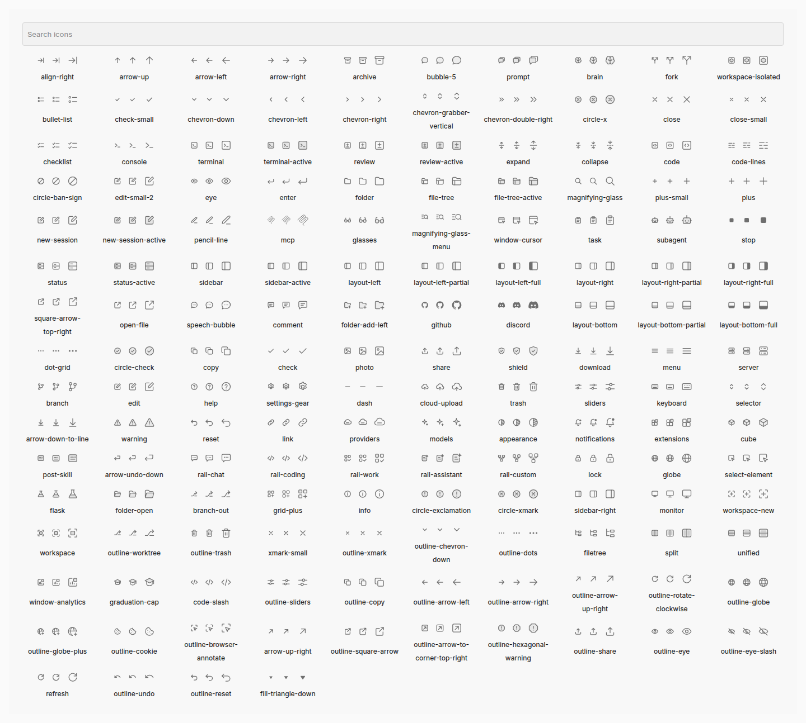
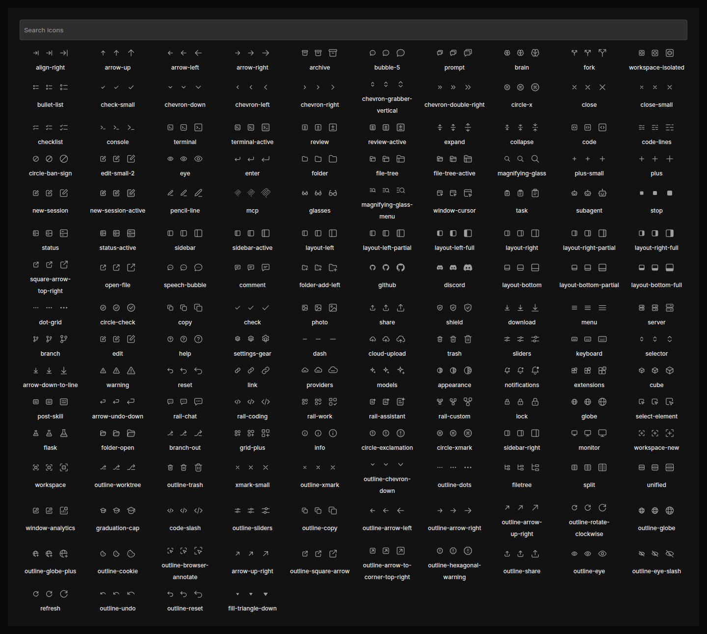
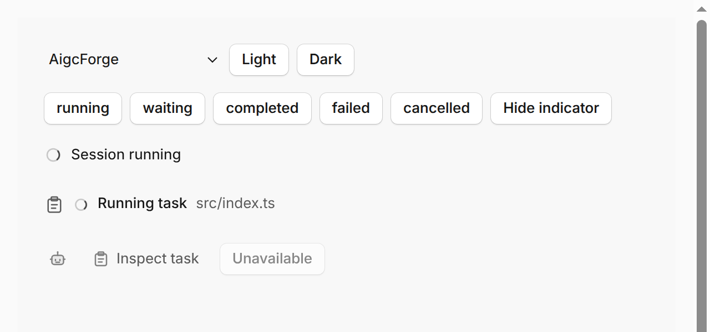
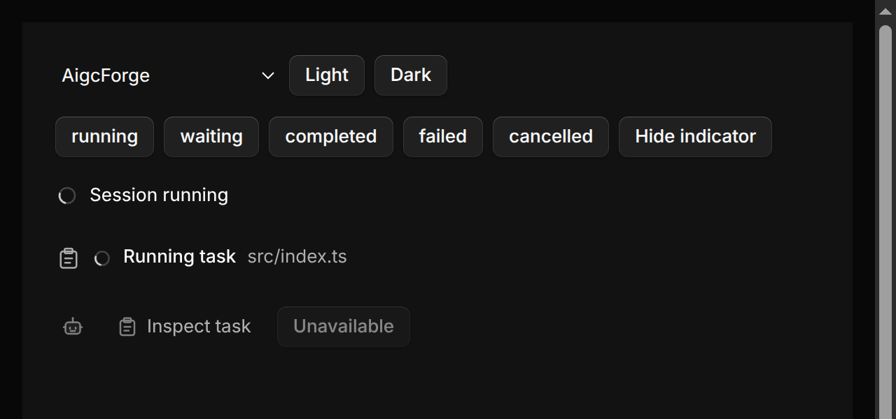
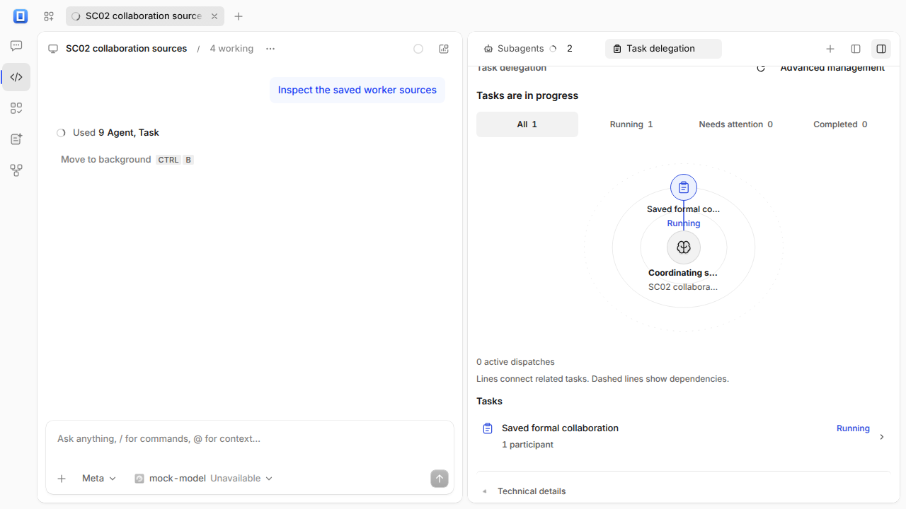

# Icon and execution feedback verification

The gallery renders all 154 production `Icon` keys at 14, 16, and 20 pixels. Task uses a clipboard/list identity; Custom uses composition blocks; Providers uses a service source. GitHub, Discord, and MCP retain their existing artwork and viewports.

The lifecycle capture renders the real `BasicTool`, `SessionProgressIndicatorV2`, `Button`, and `IconButton` through the existing ThemeProvider. One arc rotates during execution. Waiting, completed, failed, cancelled, hidden, and reduced-motion surfaces stop running feedback. A reserved marker slot keeps the tool title in place.

- Browser theme matrix: 36 built-in themes and one custom fallback, light/dark, 390/1000/1440 CSS pixels; 222 combinations checked.
- DPR 2 matrix: OC-2, Nord, and custom fallback in both schemes and the same three widths; 18 combinations checked.
- Native fixture renderer: Linux Electron 44.4.5 / Chromium 152.0.7977.130, DPR 2; light/dark, reduced motion, and completion checked. The captures below wait for fonts and finite transitions to finish.
- Icon geometry: 154 keys / 462 renders inside their declared viewports. A horizontal dash has zero geometric height and a visible stroke.
- Component regression: keyboard disclosure, singular execution feedback, stable title position, reduced motion, and custom-theme fallback are covered by the existing BasicTool keeper.
- Permission timeline regression: the real App provider and nested extension provider preserve the exact tool source; the tool shimmer and group indicator stop before approval and resume after it. The keeper fails on the original raw-running path.
- Background Subagent regression: a completed parent tool follows its child's permission/form waits and resumes. A parent question leaves the independent child running. The original child projection and parent wrapper gate each fail the corresponding production assertion.
- App regression: the existing saved Delegation keeper drives permission asked/replied through SSE and observes both the node and tab pause/resume. Restoring the old raw-status adapter makes this regression fail.
- Composer readiness: a held configuration response reproduced an editable draft with a hidden model control and an enabled Send button. Send and Enter now share the existing model-loading gate. Light/dark at 390/1440 pixels verify draft retention, no early session creation, and one prompt using the selected model after release. All 53 composer, queue, and mobile-focus regression scenarios passed against the production build with one worker and no retries; SC03 also checks the restored target model before sending its retained draft and attachment.
- Agent catalog readiness: the real LocalProvider reproduced a saved model being replaced by a default while its agent catalog was uninitialized. It now retains the saved model and includes source-aware Agent readiness in the Composer loading gate. Pending and empty catalogs, fixed Custom/Workflow roles, and ordinary locked children are covered by the existing selection integration suite: 74 passed; Composer unit tests: 83 passed.
- Mobile touch anchoring: delayed-image keepers establish that the earlier image row is entirely above the viewport after native momentum ends. Reading-position, detached-target, Home and scrollbar assertions stay strict. All 37 mobile scrolling scenarios passed against the production build with one worker and no retries.

## Production icon gallery

## Production components in Electron

These are cropped renderer captures of the lifecycle fixture controls and production components.

## Production App delegation

The production build shows the saved Task, live execution badge, and graph using the existing server fixture.

